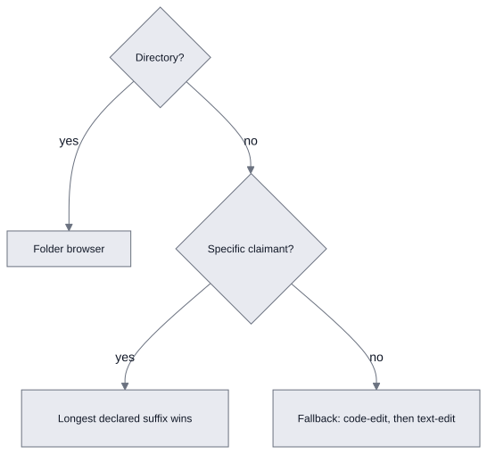
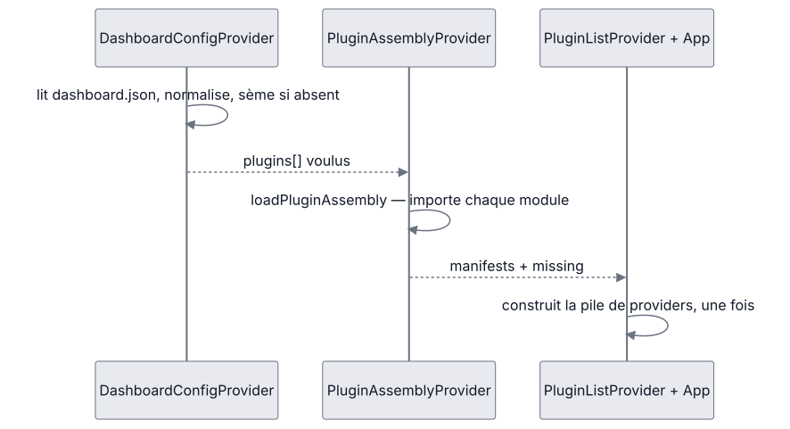

# Dashboard plugins — contrat, mécanismes et contraintes à l'exécution

Ce document dit ce qu'un plugin **est** et ce que Dashboard **en fait au runtime** :
le manifeste, la résolution du plugin qui ouvre un fichier, les registres dérivés,
le chargement, l'activation et la désactivation, et la relation avec les skills.
La sélection des plugins, leur build et leur livraison sont dans
[plugins-assembly.md](./plugins-assembly.md) ; les règles de placement et leurs
précédents dans [plugins-rules.md](./plugins-rules.md).
Écrire un plugin est le métier du skill `dashboard-plugin`
([`.agents/skills/dashboard-plugin/SKILL.md`](/.agents/skills/dashboard-plugin/SKILL.md)).

## Ce qu'est un plugin

Un plugin est **un module ES** dont `index.tsx` exporte un seul manifeste
`plugin: CmsPlugin`, plus **une ligne** dans
[`catalogue.json`](/exchange/dashboard/src/plugins/catalogue.json)
(`{ id, title, description }`). L'id est le nom du dossier sous `src/plugins/` et
le point d'entrée s'en déduit (`src/plugins/<id>/index.tsx`) — sans exception, ce
qui permet au build comme au chargeur de le trouver sans qu'on le leur dise.

Le manifeste est **toute** l'interface entre un plugin et le framework : cms-core
n'importe jamais un plugin, et un plugin n'en importe jamais un autre.

## Le manifeste, champ par champ

Le contrat est [`FileBasedPlugin.ts`](/exchange/dashboard/src/cms-core/core/FileBasedPlugin.ts).
Un seul champ est requis, `fileConfigFor` ; tout le reste est optionnel, et beaucoup
de plugins sont de purs visualiseurs sans rien d'autre.

| Champ | Ce qu'il apporte |
|---|---|
| `fileConfigFor(file)` | Revendique un fichier (`{ fileLabelCmp, mainView }`) ou le laisse passer (`null`). Requis. Un plugin qui ne revendique aucun type (`chat`, `tags`, `bookmarks`) retourne toujours `null`. |
| `fileExtensions` | Les suffixes revendiqués. Règlent les litiges entre prétendants (ci-dessous) et disent à l'UX générique (renommer, dupliquer) ce qu'un nom doit garder intact. À déclarer. |
| `fallback` | Seuls `code-edit` et `text-edit` : ne revendique que ce que personne d'autre n'a voulu. |
| `CreationProvider` | Une entrée « New \<type\> » dans le menu de création. |
| `toolBars` | Des onglets dans la barre haute ou l'une des colonnes (`ToolBarDeclaration` : `id`, `title`, `icon`, `render`, `defaultBar`, `flush`, plus son propre `isEnabled`). |
| `markdownRenderers` | Des rendus pour les liens `[[type:id\|title]]`, fusionnés à l'échelle de l'app. |
| `sideDocuments` | Des documents de ce type offerts *à côté* du document d'un autre plugin. |
| `capabilities` | Des fonctions offertes aux *autres* plugins, sous des noms appartenant au kit. |
| `appRoutes` | Des pages qui ne sont pas des documents du store (les boards), chacune revendiquant un préfixe d'URL. |
| `providers` | L'état qui doit survivre à la navigation entre documents — durée de vie de l'app, pas de la vue. |
| `withGlobalProvider` | Un wrapper par fichier, actif tant que le document de ce plugin est ouvert. |
| `isEnabled(config)` | Porte de la configuration runtime pour les contributions. Voir § [Les deux niveaux de gating](#les-deux-niveaux-de-gating) : elle ne couvre que les routes et les onglets. |

## Résolution — quel plugin ouvre un fichier

`fileConfigFor` dit *si* un plugin revendique un fichier ; ce que chacun a *déclaré*
dit quelle revendication gagne. L'ordre d'enregistrement ne règle rien.

<!-- kiao:diagram
```mermaid
flowchart TD
    D{Directory?} --&gt;|yes| B[Folder browser]
    D --&gt;|no| S{Specific claimant?}
    S --&gt;|yes| L1[Longest declared suffix wins]
    S --&gt;|no| F[Fallback: code-edit, then text-edit]
```
-->


1. **Un répertoire est parcouru, quel que soit son nom.** Le folder browser le
   revendique sur `isDirectory`, contre tout suffixe assorti au nom du dossier.
   Il est le plugin de cms-core lui-même — tout store est parcouru, quel que soit
   l'assemblage — importé dans [`App.tsx`](/exchange/dashboard/src/App.tsx) et placé
   en tête de liste, hors catalogue.
2. **Une revendication spécifique bat une revendication fallback.** `.mmap.json`
   contre le `.json` de `code-edit` — une différence de *nature*, qu'aucune
   comparaison de longueur ne trancherait.
3. **Entre revendications de même nature, le plus long suffixe déclaré gagne.**
   `.arch.md` contre `.md`, insensible à la casse (les visualiseurs revendiquent
   `.PNG` et `.JPG`).

Un plugin peut revendiquer un fichier pour lequel il ne déclare aucun suffixe ;
cette revendication ne porte simplement aucune longueur. C'est le
[`resolveFilePlugin`](/exchange/dashboard/src/cms-core/core/PluginList-ctx.ts) —
`fileConfigFor` dit *si*, lui dit *lequel*.

L'ordre de la liste n'est pourtant pas sans effet partout : il décide l'ordre dans
lequel les onglets de barre d'outils sont proposés, et tranche entre plusieurs
éditeurs d'une même capability (ci-dessous).

## Les registres dérivés — tout vient de la liste chargée

Résolution, commandes de création, onglets, pools — tout est dérivé de la liste
chargée, jamais d'une position ni d'un import. C'est ce qui permet à la liste
d'être assemblée au runtime. [`PluginList-ctx.ts`](/exchange/dashboard/src/cms-core/core/PluginList-ctx.ts)
en tient quatre :

| Registre | Dérivation | Note |
|---|---|---|
| `customLinkRenderers` | Fusion des `markdownRenderers` de chaque plugin | Écrasement muet en cas de collision : les clés doivent être globalement uniques, par convention. |
| `knownExtensions` | Toutes les `fileExtensions` déclarées, plus longues d'abord | Poolé plutôt que lu sur le plugin qui revendique le fichier : `.arch.md` vient d'`archdia-edit` et `.md` de `markdown-edit`, et un `.arch.md` doit garder tout son suffixe. |
| `sideDocuments` | Concaténation, dans l'ordre d'enregistrement | L'hôte accepte toutes les offres en deux lignes et n'en nomme aucune ; la paire voyage par chemin dérivé (`notes.md` → `notes.md.mmap.json`). |
| `capabilities` | **Tous** les éditeurs de chaque nom, dans l'ordre de l'assemblage | Un nom que personne n'a publié est absent plutôt que vide — c'est ainsi que le consommateur apprend à s'en passer. |

Le reste est composé dans `App.tsx` de la même façon : chaque `CreationProvider`
enregistre sa commande « New … » (le menu est ordonné par `order`, pas par
imbrication), chaque `providers` est monté dans la pile applicative dans l'ordre
de la liste, et les préfixes d'URL sont publiés par `AppRoutesFromPlugins`.

## Entre plugins — jamais d'import

L'ensemble des plugins est choisi par store : le module d'un plugin que
l'assemblage n'a pas chargé n'est pas là pour être importé. Une seule question
décide de la réponse : *l'autre plugin fonctionnerait-il encore sans le vôtre ?*

- **Oui — c'est du code partagé.** Il part dans le kit en `@cms-kit/<module>`,
  importé par les deux. Un module dont un second plugin a besoin cesse
  d'appartenir au premier.
- **Non — c'est une fonction.** Elle voyage en **capability** : publiée sous un
  nom dans le manifeste, demandée sous ce nom, absente quand personne ne l'a
  publiée. Le consommateur dégrade — pas de bouton Play sans `chat`, pas de
  couleurs sans `tags`.

Trois parties se partagent le morceau : cms-core poole les valeurs des manifestes
chargés et ignore le sens des noms ; le kit
([`@cms-kit/capabilities`](/exchange/dashboard/src/kit/capabilities/index.ts))
déclare chaque nom, son type, et ce que le consommateur fait sans lui ; les
plugins tiennent les deux bouts. Plusieurs éditeurs d'un nom sont tous gardés ;
ce que cela veut dire est par nom — le premier pour ce qui doit arriver une fois,
tous rassemblés pour ce qui est une liste par nature. Une capability peut être un
hook : le registre est fixe pour la vie de l'app, donc la fonction est le même
objet à chaque rendu.

Les noms d'aujourd'hui (`@cms-kit/capabilities` fait foi) :

| Nom | Publié par | Porte | Absent |
| --- | --- | --- | --- |
| `chat.show` | `chat` | `useShowChat()` — mettre une conversation à l'écran | la marque de chat n'est pas dessinée |
| `chat.options` | `chat` | `useChatOptions()` — les agents sur lesquels un flow node peut tourner | les selects n'offrent rien, aucune carte n'est jouable |
| `chat.run` | `chat` | `useChatRun()` — les runs en cours, `play`, `stop` | pas de Play, pas de bouton de chaîne |
| `tags.ui` | `tags` | `TagChips`, `TagPicker` | une carte ne porte pas de couleurs, pas de ligne de filtre |

Le board est aujourd'hui le seul consommateur — c'est pourquoi il y a quatre noms
ici et pas un framework : chacun était un import qui devait cesser d'en être un.

## Le démarrage — deux portes, puis la liste est fixe

Le démarrage est une séquence, tenue par trois providers dans
[`App.tsx`](/exchange/dashboard/src/App.tsx) (`WorkerClientProvider`,
`DashboardConfigProvider`, `PluginAssemblyProvider`), lue dans l'ordre où elle se
résout : la configuration dit quels plugins, l'assemblage les charge, et alors
seulement la pile de providers est construite à partir de la liste.

<!-- kiao:diagram
```mermaid
sequenceDiagram
    participant C as DashboardConfigProvider
    participant A as PluginAssemblyProvider
    participant P as PluginListProvider + App
    C->>C: lit dashboard.json, normalise, sème si absent
    C--&gt;>A: plugins[] voulus
    A->>A: loadPluginAssembly — importe chaque module
    A--&gt;>P: manifests + missing
    P->>P: construit la pile de providers, une fois
```
-->


**`DashboardConfigProvider`**
([`DashboardConfig-ctx.tsx`](/exchange/dashboard/src/cms-core/config/DashboardConfig-ctx.tsx))
lit le document de configuration `dashboard.json` (hors arbre de contenu, servi par
l'API des documents de configuration) et expose `{ chatEnabled, gitEnabled,
plugins }` :

- document présent → configuration normalisée ;
- document manquant (404) → semé avec les défauts (tous les plugins du build),
  puis défauts ;
- toute autre erreur (backend injoignable, JSON malformé) → défauts, porte
  ouverte plutôt que page blanche.

[`normalizeConfig`](/exchange/dashboard/src/cms-core/config/DashboardConfig-ctx.tsx)
lit `chatEnabled` sous ses anciens noms `agentEnabled` et `claudeCodeEnabled`
quand le store dit encore l'un d'eux, et applique `PLUGIN_RENAMES` aux ids
(`claude` → `chat`, `agent` → `chat`, `movie-view` → `movie-edit`,
`tasks-board` → `hybridflow-ui`) : un renommage dans
ce dépôt n'est pas une raison de perdre le choix enregistré d'un utilisateur.
Pas de liste du tout, c'est un store écrit avant que le choix n'existe : tout
charge. Une liste **vide** est un choix, et il est honoré.

**`PluginAssemblyProvider`**
([`PluginAssembly-ctx.tsx`](/exchange/dashboard/src/cms-core/core/assembly/PluginAssembly-ctx.tsx))
importe les plugins nommés, dans l'ordre nommé, avant le premier rendu
([`loadPluginAssembly`](/exchange/dashboard/src/cms-core/core/assembly/pluginAssembly.ts)) :
un nom que le build ne porte pas n'est pas une erreur — un store ouvert par un
assemblage plus petit — et un module qui refuse de charger est rapporté
(`console.error`) et sauté plutôt que d'emporter l'application : un store vaut
d'être ouvert avec neuf plugins sur dix. Les deux atterrissent dans `missing`,
que le panneau de configuration dessine.

**Le chargement bloque, une fois.** La liste des plugins n'est pas une valeur que
l'app relit ; c'est la forme de la pile de providers — commandes de création,
providers applicatifs, onglets y sont composés — donc l'app attend que chaque
plugin nommé soit là, et ne rebloque jamais : la liste est lue une fois, au
montage. **Dégrader, c'est la résolution et rien d'autre** : un fichier dont le
plugin n'est pas chargé tombe au prétendant suivant, sans chemin d'erreur parce
qu'il n'y a pas d'erreur.

## Activer et désactiver au runtime — écrire, puis recharger

L'interrupteur est le panneau de configuration, dont
[`usePlugins.ts`](/exchange/dashboard/src/cms-core/toolbox/usePlugins.ts) est la
moitié plugin :

- la bascule écrit la configuration (`saveConfigJson`) **dans l'ordre du
  catalogue**, pas dans celui des clics : la liste est relue comme l'ordre de
  chargement, qui ne doit pas dépendre du chemin par lequel on y est arrivé ;
- le panneau dit plainement que la page doit être rechargée — changer de quoi
  l'application est faite en rechargeant la page est la façon honnête de le
  faire (`dirty`, calculé contre la configuration du chargement) ;
- il nomme les plugins que le store demande et que ce build ne porte pas
  (`missing`).

La sauvegarde a un effet au-delà de cette page : worker lit `plugins` dans
le même document pour décider des skills du store, et les réinstalle sur-le-champ
(§ suivant). Éteindre un plugin retire donc son skill de `.agents/skills` et
`.claude/skills` avant même le retour du 204.

## Les deux niveaux de gating

Deux mécanismes portent le mot « activer », et ils ne couvrent pas la même chose :

1. **La liste `plugins`** décide ce qui est *importé*. Un plugin qui n'y est pas
   n'est pas chargé, son bundle n'est jamais récupéré, et ses fichiers tombent au
   prétendant suivant.
2. **`isEnabled(config)`** décide ce qui, d'un plugin *chargé*, *contribue*. Et
   elle ne couvre que deux contributions : les `appRoutes`
   (`AppRoutesFromPlugins`) et les `toolBars` (`PluginContributions`, elle-même
   affinée par le `isEnabled` de chaque onglet — l'onglet « Chain runs » du
   board s'éteint où le déploiement n'a pas de chat).

Tout le reste d'un plugin chargé reste en vie quand `isEnabled` répond non : la
résolution de fichiers, les commandes de création, les `providers` et les
`capabilities` ne sont pas filtrés. Concrètement, `chatEnabled: false` cache les
onglets Conversations et Usage mais laisse le socket du chat monté et ses
capabilities publiées — c'est pourquoi le consommateur combine les deux lectures
lui-même ([`useChatAvailable.ts`](/exchange/dashboard/src/plugins/hybridflow-ui/useChatAvailable.ts) :
`chatEnabled && useChatRunAvailable()`). Un board qui répondrait différemment
aux deux serait un board qui explique son propre packaging.

## La moitié skill

Chaque skill est la moitié agent d'un plugin Dashboard et le nomme
(`pluginOf` dans [`skills.go`](/reference/kiao-skills/skills.go)) — les skills de
formats pour DCMS, le skill `hybridflow` pour hybridflow. Un store reçoit
les skills que sa liste de plugins appelle — éteindre un plugin retire son skill
à la passe suivante, puisqu'un store qui ne peut pas ouvrir le format n'a aucun
usage d'une description lue au début de chaque tour. La correspondance vit dans
le paquet plutôt que dans les front matters parce qu'elle est le fait de la paire
plutôt que de l'une de ses moitiés, et parce que l'installeur doit la lire sans
lire ce que les CLIs lisent. Deux skills peuvent nommer un plugin (`graph` et
`strategy` sont toutes deux du graph editor) ; les tests du module refusent un
skill qui ne nomme aucun plugin, et un qui nomme un plugin que le catalogue a
abandonné.

Côté service, [`syncSkills`](/operation/worker/internal/hybridflow-runner/skills.go)
(Go, worker) installe le bundle compilé dans le binaire vers
`<store>/.agents/skills` (Codex, Muse) et `<store>/.claude/skills` (Claude —
constaté au strace, pas lu dans la documentation) :

- la liste lue est `plugins` du `dashboard.json` du store — la même que le panneau
  écrit — avec la même lecture fail-open que `normalizeConfig` : pas de document,
  pas de clé, illisible, et c'est tous les skills ; une liste vide est une
  réponse et c'est aucun ;
- la passe tourne **au démarrage et à la sauvegarde** du document
  (`OnDashboardConfigSaved`) : éteindre un plugin prend effet au tour suivant ;
- chaque skill installé porte un marqueur `.kiao-skill` à deux digests — la
  version du bundle dont il vient, et l'arbre tel qu'écrit — donc une édition
  sur place est restaurée (avec l'avertissement nommant la source), un répertoire
  sans marqueur est signalé et laissé seul, et un skill que le store ne doit plus
  avoir est élagué, qu'il vienne d'un plugin éteint ou d'un build qui l'a abandonné ;
- jamais fatal : un store dont les skills ne peuvent pas s'écrire coûte aux tours
  leurs instructions, pas au service son store.

## Contraintes à l'exécution, en bref

- La liste est lue une fois, avant le premier rendu ; changer l'assemblage,
  c'est recharger la page.
- Un plugin qui échoue est rapporté et sauté ; un fichier sans plugin tombe au
  prétendant suivant. Ni l'un ni l'autre n'est une erreur.
- La feuille de style d'un plugin est liée avant l'import de son module
  (`<id>/style.css`, idempotent) — un plugin sans CSS reçoit un fichier vide au
  build pour ne pas noyer la console de 404.
- Le registre des capabilities est fixe pour la vie de l'app : une capability
  peut être un hook, et en appeler une par éditeur dans une boucle est légal.
- `withGlobalProvider` enveloppe l'arbre tant que le fichier de ce plugin est
  ouvert — en se gardant contre un `currentFile` nul.
- Les `providers` survivent à la navigation parce que chaque vue principale
  apporte son propre `<LayoutContent>`, donc ses propres barres d'outils : tout
  ce qui vit dans une vue ou un panneau est démonté à la navigation vers un
  document d'un autre plugin.

## Sources

- Le contrat :
  [`FileBasedPlugin.ts`](/exchange/dashboard/src/cms-core/core/FileBasedPlugin.ts),
  [`PluginList-ctx.ts`](/exchange/dashboard/src/cms-core/core/PluginList-ctx.ts) (résolution),
  [`@cms-kit/capabilities`](/exchange/dashboard/src/kit/capabilities/index.ts)
- Le démarrage :
  [`App.tsx`](/exchange/dashboard/src/App.tsx),
  [`DashboardConfig-ctx.tsx`](/exchange/dashboard/src/cms-core/config/DashboardConfig-ctx.tsx),
  [`PluginAssembly-ctx.tsx`](/exchange/dashboard/src/cms-core/core/assembly/PluginAssembly-ctx.tsx),
  [`pluginAssembly.ts`](/exchange/dashboard/src/cms-core/core/assembly/pluginAssembly.ts),
  [`usePlugins.ts`](/exchange/dashboard/src/cms-core/toolbox/usePlugins.ts)
- La moitié skill : [`skills.go`](/reference/kiao-skills/skills.go),
  [`syncSkills`](/operation/worker/internal/hybridflow-runner/skills.go)
- Les décisions :
  [decision records](/docs/architecture/decisions/README.md) —
  2026-07-16 (manifeste), 2026-08-31 (assemblage)
