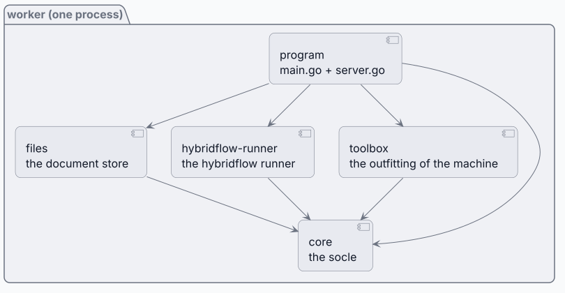
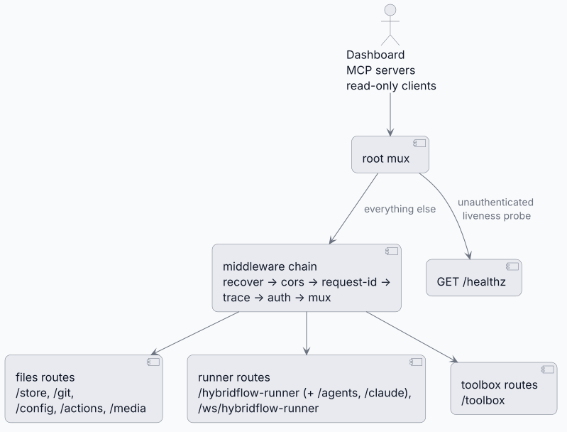
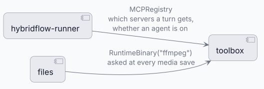
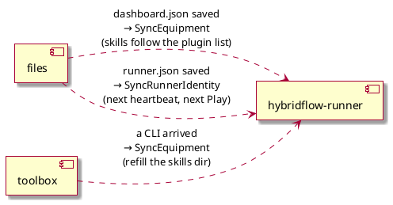
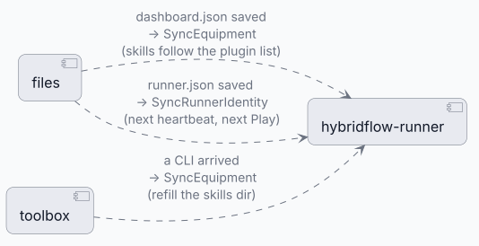
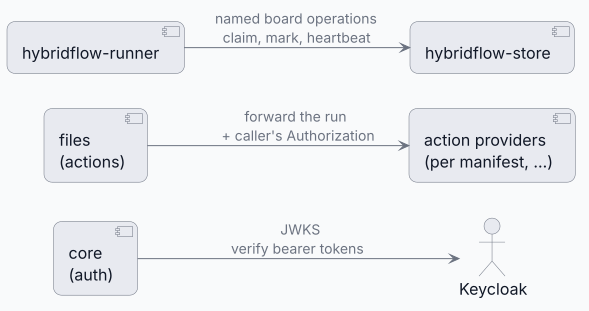
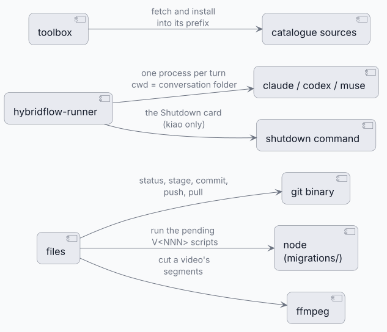
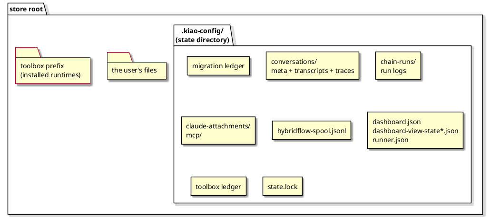
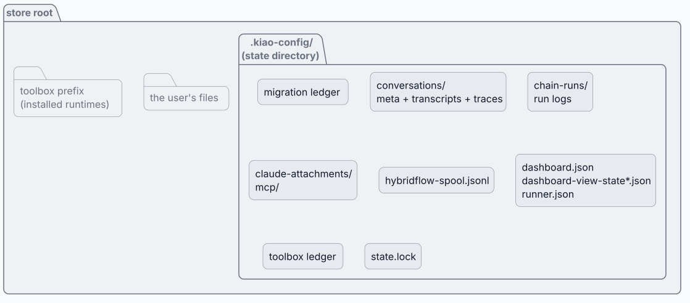

# worker — components

One process, one binary, four libraries and the program that wires them
(`operation/worker`). Each library depends on the socle (`core`) and never
on the others; only `main.go`/`server.go` know them all. What one library needs
from another arrives as a port — an interface or a callback the program fills in
at startup — so every edge between them is set in one file and visible there.

Two of the libraries are halves of functional features that cut across containers:
`files` is the backend half of **DCMS**, `hybridflow-runner` the engine of
**hybridflow**; `toolbox` and `core` serve both.

## 1. Static structure — who depends on whom

<!-- kiao:diagram
```plantuml
@startuml
skin rose

package "worker (one process)" {
  component "program\nmain.go + server.go" as Program
  component "files\nthe document store" as Files
  component "hybridflow-runner\nthe hybridflow runner" as Runner
  component "toolbox\nthe outfitting of the machine" as Toolbox
  component "core\nthe socle" as Core
}

Program --&gt; Files
Program --&gt; Runner
Program --&gt; Toolbox
Program --&gt; Core
Files --&gt; Core
Runner --&gt; Core
Toolbox --&gt; Core
@enduml
```
-->


No arrow runs between the three libraries. What one needs from another arrives as a
port the program fills in — for example `hybridflow-runner` holds an `MCPRegistry`
for the servers a turn gets, without importing a file of `toolbox`. The rule is
one-directional on purpose — a library that imported a sibling would make the
program's wiring order load-bearing and its tests heavier.
A port is not the same as the filesystem: both halves also read and write the
store and the state directory directly, through `core` path helpers and `os`,
without going through `files` at all (§3).

**core — the socle.** Store access (`Storage`: path resolution, the state
directory, the process lock), access control (the Keycloak authenticator, the
reader scope, turn tokens), configuration, the middleware chain, the error
taxonomy, structured logging, the MCP server types. Everything the other three
share, and nothing they do.

**files — the document store.** Browsing and changing the store, search and its
indexes, the link fixer, the migration runner, Git, config documents, file
actions, media cutting, staging, the import gate, dedup. The `.kiao-files`
declaration: what in the store is not content, and which passes stay out of it.

**hybridflow-runner — the hybridflow runner.** Conversations and their transcripts, the
hub that spawns turns on `claude`/`codex`/`muse`, permissions and questions, the
quota/options/sign-in surfaces, attachments, the bundled skills installed into
each store, the MCP bundle a turn is handed, and the runner that plays boards.

**toolbox — the outfitting of the machine.** The catalogue of what can be
installed (runtimes such as the agent CLIs and ffmpeg; MCP servers), the
ledger of what is, the install/uninstall jobs, the probe, the registration that
decides which MCP servers a turn gets. Also a build-time subcommand: `worker
toolbox preinstall` stages CLIs into an image without a running service.

**program — main.go + server.go.** Reads and validates the configuration, takes
the state lock, adopts legacy state, runs the migrations, starts the three
libraries in dependency order, fills every port, assembles the authenticator,
mounts the routes behind the middleware chain, and shuts it all down on signal.

## 2. The HTTP surface — who serves what

Each library states its own routes as data (`Routes()`); the program mounts
them all behind one middleware chain. Nothing is served that was not mounted.

<!-- kiao:diagram
```plantuml
@startuml
skin rose

actor "Dashboard\nMCP servers\nread-only clients" as Client
component "root mux" as Root
component "middleware chain\nrecover → cors → request-id →\ntrace → auth → mux" as Chain
component "files routes\n/store, /git,\n/config, /actions, /media" as F
component "runner routes\n/hybridflow-runner (+ /agents, /claude),\n/ws/hybridflow-runner" as A
component "toolbox routes\n/toolbox" as T
component "GET /healthz" as Health

Client --&gt; Root
Root --&gt; Chain : everything else
Chain --&gt; F
Chain --&gt; A
Chain --&gt; T
Root --&gt; Health : unauthenticated\nliveness probe

@enduml
```
-->


One route sits outside the chain: the liveness probe, which must stay cheap and
untraced. The auth step knows two credentials: a Keycloak JWT (`files_user`
reaches
everything; `files_reader` reaches five read routes under its roots) and, where
an MCP configuration exists, the turn tokens the turns this process spawned call
back in with.

## 3. Runtime reads — what each half asks of the others

Imports say what a library is built on; these edges say what it asks at
runtime. Every one is a port the program fills in `main.go`, and every lookup
is lazy — asked when needed, so installing something from the panel works on
the next click rather than at the next restart.

<!-- kiao:diagram
```plantuml
@startuml
skin rose
left to right direction

component "hybridflow-runner" as Runner
component "toolbox" as Toolbox
component "files" as Files

Runner --&gt; Toolbox : MCPRegistry\nwhich servers a turn gets,\nwhether an agent is on
Files --&gt; Toolbox : RuntimeBinary("ffmpeg")\nasked at every media save
@enduml
```
-->


No call runs from runner to files: the boards live in the hybridflow-store and are reached
over HTTP (§5), so the runner holds no port into the file store at all.

That was never the runner's whole contact with the disk, and the diagram
above is not where most of that contact is. The runner reads and writes the
store and the state directory directly — `core.ResolvePath` plus `os`, behind
`files`' back and by design:

- the skills installed into `<store>/.agents/skills` and `<store>/.claude/skills`,
  written with raw `os` calls and no index update;
- the card images `stat`ed under the store root to build a turn's prompt;
- the conversation working directory each spawned CLI runs in, with the whole
  store handed over as `--add-dir`;
- the state files it shares with `files`: `dashboard.json` (read for the plugin
  list) and `runner.json` (read for the runner identity) are read straight off
  disk, not through the endpoints that serve them.

The rule: `files` is the HTTP document API plus the search index plus link
repair — it is not the filesystem owner. `core` is the shared filesystem
vocabulary, and reaching the disk through it is not communicating with `files`.

## 4. Callbacks — what each half is told after the fact

Three edges run the other way, and all three exist for the same reason: a panel
save or a finished install changes something while the service is up, and the
half that owns it must run its pass again. One listener each, set by the
program; nil where nothing listens.

<!-- kiao:diagram

-->


Without these, switching a plugin off would leave its skill in the store until
a restart, and pressing "it's me" on the runners panel would change a file that
changes nothing. The fourth edge of this kind is not a callback but a
credential: `hybridflow-runner` hands its turn-token registry to the authenticator, so the
turns it spawns are the one callers besides Keycloak bearers the service
accepts.

## 5. The outside — network

What the service talks to over HTTP, and on whose behalf.

<!-- kiao:diagram
```plantuml
@startuml
skin rose
left to right direction

component "core\n(auth)" as Core
component "files\n(actions)" as Files
component "hybridflow-runner" as Runner
actor "Keycloak" as KC
component "action providers\n(per manifest, …)" as Prov
component "hybridflow-store" as HF

Core --&gt; KC : JWKS\nverify bearer tokens
Files --&gt; Prov : forward the run\n+ caller's Authorization
Runner --&gt; HF : named board operations\nclaim, mark, heartbeat
@enduml
```
-->


The action forward carries the caller's own token, so a provider reads and
writes the store as that user with no service account. The hybridflow link is
the narrow one: named operations on one card at a time, with a local spool
(`hybridflow-spool.jsonl`) queueing the marks while the link is down and
replaying them in order when it returns.

## 6. The outside — machine

What the service spawns and touches on its own host. Everything here is
optional at startup: a host with no agent CLI serves its store and reports an
agent tab with nothing to run.

<!-- kiao:diagram
```plantuml
@startuml
skin rose
left to right direction

component "files" as Files
component "hybridflow-runner" as Runner
component "toolbox" as Toolbox
component "git binary" as Git
component "node\n(migrations/)" as Node
component "ffmpeg" as FFmpeg
component "claude / codex / muse" as CLI
component "shutdown command" as Shut
component "catalogue sources" as Src

Files --&gt; Git : status, stage, commit,\npush, pull
Files --&gt; Node : run the pending\nV<NNN> scripts
Files --&gt; FFmpeg : cut a video's\nsegments
Runner --&gt; CLI : one process per turn\ncwd = conversation folder
Runner --&gt; Shut : the Shutdown card\n(kiao only)
Toolbox --&gt; Src : fetch and install\ninto its prefix
@enduml
```
-->


One rule holds across this view. **Nothing here is a sandbox**: a turn starts in its conversation folder
with the whole store handed over as `--add-dir`, and `Read`/`Bash` reach what
the service user can — containment is the permission mode and the human
answering it.

## 7. Where state lives

The store is the user's files; the service's own state sits beside them in the
state directory (`KIAO_WORKER_STATE_PATH`, default
`<root>/.kiao-config`), so a store that is moved takes its state with it and
two stores never share a ledger. The file API cannot address it: `Storage`
refuses every path landing in it, and a `.gitignore` of `*` keeps it out of
Source Control.

<!-- kiao:diagram

-->


`state.lock` is flocked for the process's lifetime: a second instance on the
same state directory is refused startup, because two writers would silently
discard each other's renames. The toolbox prefix is the one state that is not
about the store — what is installed on the machine — and the one file seeded
rather than owned is the `.gitignore`, written only when absent. The migration
ledger, the conversation registry and the config documents are all replaced by
temp-file + fsync + rename, so a reader sees one whole document or the other.
