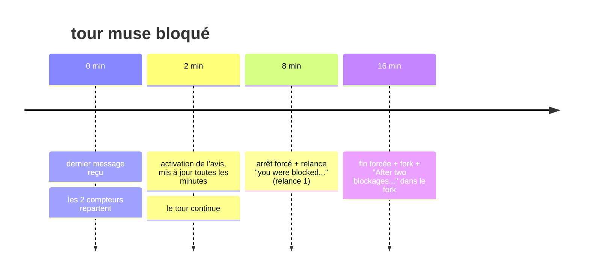
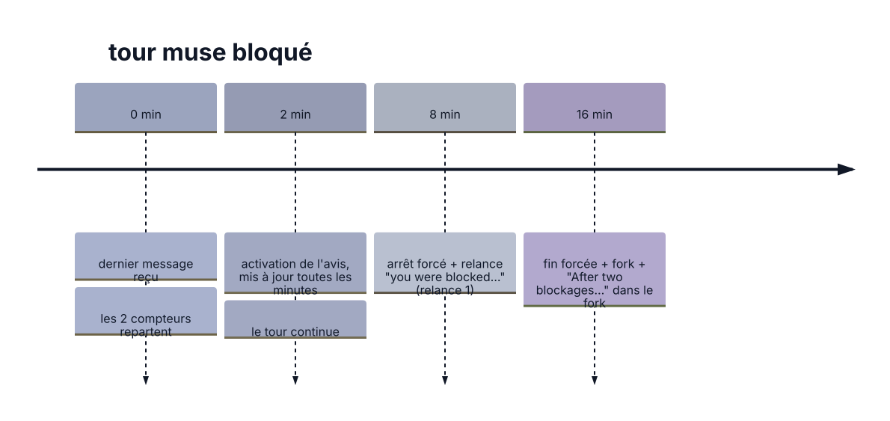

# Tour muse bloqué (hybridflow)

Bloqué = aucun message de `muse` : ni texte, ni outil, ni question, ni fin.

<!-- kiao:diagram

-->

* **2 min : activation de l'avis, mis à jour toutes les minutes.** Chaque avis dit depuis combien de temps le tour est silencieux (`quiet for 2m0s...`, `3m0s`...) et combien de relances il a déjà eues : rien entre parenthèses avant la relance, `(relance 1)` après.
* **Avant de conclure, le tour silencieux est repollé.** Le silence n'est pas toujours un blocage : quand la vue live est morte, le tour travaille sans que rien n'arrive. Le driver relit donc la session (`view/page` après le dernier curseur vu, rejoué dans le relais comme le direct ; `session/read` sans attacher ; croissance du journal de l'hôte) avant de conclure. Un tour qui a fini se termine proprement avec ce qui a été récupéré — pas de relance, pas de fork. Un tour qui vit attend une autre attente. Seul un tour ni mort ni vif est relancé, puis forké.
* **8 min sans rien : arrêt forcé + relance.** Le tour en cours est annulé et un nouveau tour démarre sur la même session avec `you were blocked and I had to stop you. Please resume.` Le compteur passe à 1, les deux attentes repartent, et ce que dit le tour relancé reste le tour en cours — le run ne voit pas le blocage.
* **8 min encore, après la relance : fin forcée + fork.** Le tour se termine en erreur `Muse was blocked twice without ending the turn.` Le run forke la conversation (qui porte le transcript tel qu'il était à la première relance, un tour bloqué étant silencieux) et y joue la carte avec `After two blockages, I forked this conversation. Please take it over and go through to the end of what was requested.`
* **Le run continue.** Si le tour relancé ou forké termine la tâche, la carte est marquée faite et la chaîne passe à la suivante. Un tour forké qui bloque deux fois à son tour n'est pas reforké : il est marqué en erreur et le play s'arrête.
* **Exception : attente d'une réponse de ta part.** Si le tour attend une approbation ou une réponse à une question, les deux compteurs sont en pause : pas d'avis, pas d'arrêt à 8 min. Le silence est ton délai de réflexion.

Deux autres délais, pour situer :

* Tour de compactage seul : 2 min, puis fin avec `compaction still running`, code 0.
* Lecture quota en fin de tour : bornée à 60 s, ne retient pas la fin.
