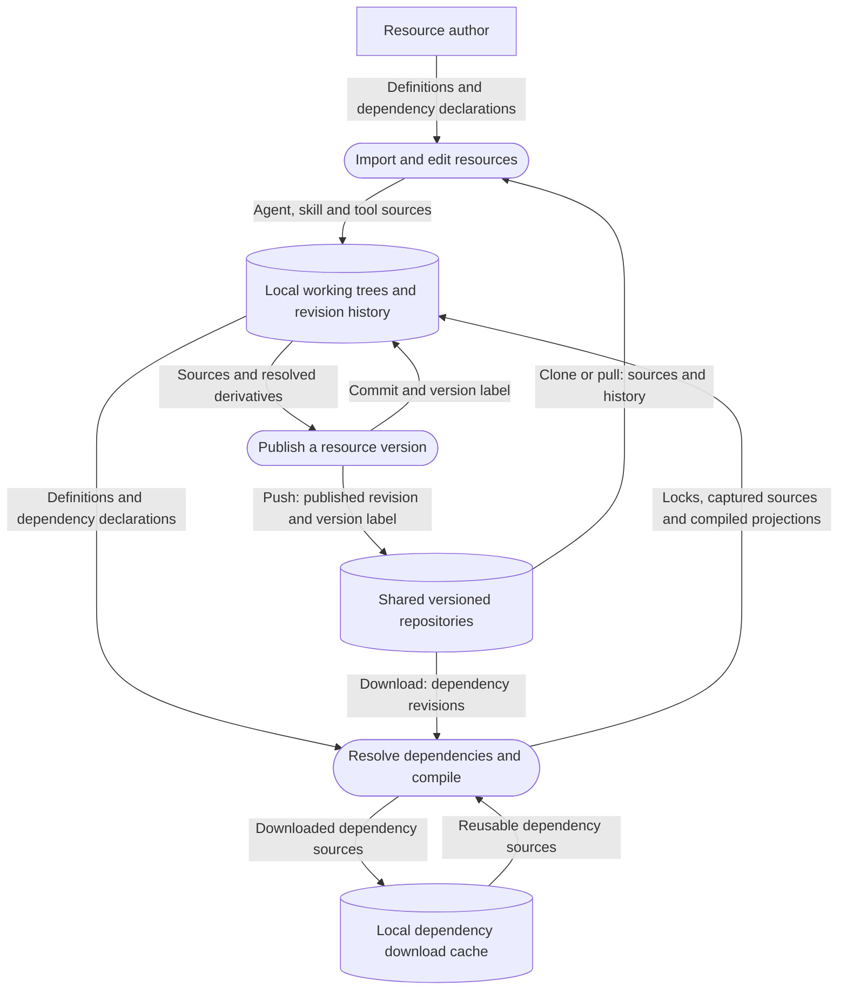
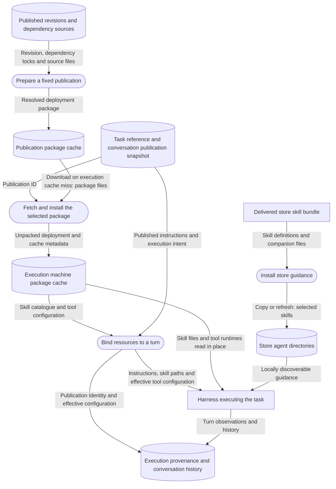

---
document:
  status: DRAFT
  role: PRIMARY_SOURCE
---

# Agent resource flows

This **conceptual data-flow model** follows agent resources from authoring to execution.
Processes are rounded, data stores cylindrical and external participants rectangular.
Arrows name data transfers.
The [solution design](../../solution-design/agentic-resources.md) maps these roles to Git, APM,
services and auditable paths.

## Sources and publications

An **agent definition** combines identity, standing instructions, model intent and dependency
declarations. **Skill definitions** contain guidance and companion files; **tool packages**
contain executable integrations and their configuration. Each resource has its own source history.
**Compiled instructions** and installed dependency projections are derived representations.

A publication fixes the **source revision** and **dependency state**. A later source edit
changes the draft. Existing execution context retains its selected snapshot. A resource can
be authored and published locally. A draft conversation captures the working definition and
its resolved dependencies.

## Delivery and execution

A **prepared deployment** contains the files needed to use a publication: locked dependencies,
skill projections, tool runtimes and tool configuration. The **publication cache** stores
transferable packages; the **execution cache** stores installed files on the task machine.
Neither cache owns the source definitions.

**Binding** to a **harness** supplies instructions and file references; it can also render temporary
configuration in the harness's format. The task workspace remains the working directory.
**Store guidance** is a separate delivery flow: selected skills are copied into the store's
agent directories for local discovery. Published agent dependencies remain in the execution cache.

**Execution provenance** identifies the publication, dependency revisions and effective runtime
configuration. Deleting a local source clone can make that publication unavailable for a new
installation; retained references and execution evidence still identify what was selected.
