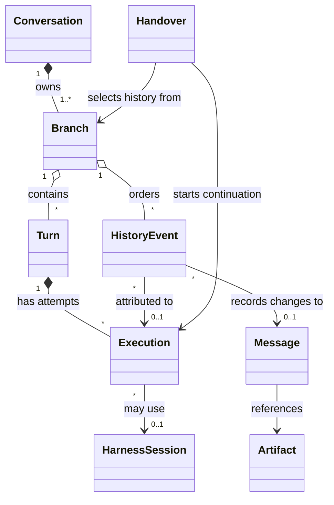

---
document:
  status: EXPERIMENTAL
  role: PRIMARY_SOURCE
---

# Conversation data architecture

[Architecture index](../README.md) · [Data view](../domain-views/Data.md)

**Status: target conceptual architecture.** Harness-independent conversations in the
hybridflow store support continuation across harnesses and machines, and live inspection
through asynchronous synchronization.

## Scope and authority

A **conversation** is durable exchange and work history, independent of sessions, models,
machines, boards or tasks, with any number of related work items. Harnesses provide
execution environments; agents define delegated behavior.

The store holds authoritative shared history;
[execution coordination](../domain-views/Data.md) owns its meaning and lifecycle. Execution
machines retain unsynchronized evidence and remain authoritative about whether their
processes have stopped. Store observations can lag execution.

Externally started conversations retain source identity and capture coverage: complete,
partial observation or missing content. Observation requires no authority over launch or
execution.
Referenced definitions, publications, profiles, usage and artifacts keep their authorities
and lifetimes; evidence identifies versions used. Synchronization does not reproduce
workspaces or external effects.

## Conceptual information model

Stable concept identities are independent of titles, locations and native identifiers.
**Relationships describe information, not storage structures.**

| Concept | Required information |
| --- | --- |
| Conversation | Identity, purpose, title, creation provenance, lifecycle, related work; survives tasks and native sessions. |
| Branch | History line, parent, exact fork point and accepted position; every conversation starts with one. |
| Turn | Requested work: initial and additional inputs, instructions, outcome and end reason; may span messages and tools. |
| Execution | Turn attempt: participant, harness and version, machine or runner, model, effective configuration, publication and profile revisions, start/end observations, outcome. Retries and harness changes create new executions. |
| Message | Authored contribution: participant, role, instruction authority, turn and reply relationships and ordered, progressively captured content with revisions and completeness. |
| History event | Content or execution fact with subject, origin, causal position and observation times. |
| Harness session | Native identity qualified by harness and source installation and bound to executions; optional native continuation data. Session identity alone supplies no portable context. |
| Handover | Transfer from an exact branch position to a destination execution, recording context, responsibility, outstanding work, compatibility and result. |
| Synchronization position | Per-source produced, durably received and incorporated progress, gaps and latest observation. |

Participants distinguish humans, agents, tools and coordinators. Delegation records its
parent execution and any separate conversation. Origin-qualified identifiers make imports
and retransmissions idempotent; similar titles or text do not establish identity. Vocabulary
and source mappings have identifiable versions.

## Portable conversation content

| Information | Required meaning |
| --- | --- |
| Inputs and instructions | Requests, steering, effective instructions and authority, published agent context and supplied context; submitted, delivered and consumed inputs distinguished where reported. |
| Replies and content parts | Ordered text, structured values, code, media or file references, authorship and relationships; partial, final, interrupted, omitted and redacted states. |
| Tool operations | Stable call identity, caller, meaning, structured input, output or reference, progress, outcome, error and timing. Results identify calls; unknown outcomes stay unknown. |
| Human interactions | Questions, choices, answers, approvals, decisions and withdrawals linked to operations; decision-maker and scope. Past permission grants no new authorization. |
| Execution evidence | Transitions, terminal outcome and reason, configuration, usage origin and diagnostics; absent usage or cost means unknown. |
| Working context | Objective, decisions, constraints, unfinished work and artifact revisions; summaries identify covered history. |
| Native extensions | Source evidence without common representation; retain harness, format, presence, interpretability and explicit omissions from destination context. |

Preserve interleaving and unanswered questions. Artifacts identify content and revision, media
type and availability; continuation needs durable, destination-accessible content. Local
paths bind artifact or workspace identities; source-only paths are insufficient. Missing, changed or expired content affects readiness.

Private state and undisclosed reasoning are unnecessary. Record capture limits without
inventing messages, ordering, success or reasoning; native interpretation must not gate
common-history inspection.

## Continuation across harnesses

Continuation supplies history and context to a new execution in the same lineage, without
implying identical behavior or restored process state. Native import is optional.

A handover must identify:

- Conversation, branch, exact accepted position and coverage.
- Objective, effective instructions, decisions, open questions, unfinished work and original contributions.
- Selected history, summaries, artifact revisions and omissions.
- Workspace state, tools, capabilities, destination bindings and incompatibilities;
  workspace readiness differs from synchronization.
- Source state, pending or unresolved operations and continuation responsibility.
- Destination harness and configuration, supplied context, translations, substitutions and loss.

Derived context preserves provenance, authorship and authority, including quoted tools or artifacts.
Reusing history must not invent user messages, rerun tools or duplicate usage.

Each branch has one active continuation authority. Transfer requires a known source boundary
and confirmation the previous execution cannot advance it. Pending questions and operations
must be completed, cancelled or explicitly retained as unresolved. Handover states: prepared,
blocked, accepted, completed, failed.

Disconnection does not prove stoppage. Without exclusivity, continue on a separate branch
from a known point; reconcile external effects before repeating work. Branching does not
isolate shared-workspace effects.

## Asynchronous synchronization and live inspection

Retain evidence independently of viewers; progressively synchronize partial output, tool
progress, questions and state changes while execution continues.

Events carry stable event and source identities, source order and causal references.
Distinguish occurrence, local observation and receipt times where available. Clock differences
and network arrival order cannot reorder history; do not invent a total order.

- **Durable progress.** Retain unacknowledged evidence across interruptions; acknowledge
  durable store receipt. Source stream identity and generation prevent position reuse.
- **Idempotent receipt.** Retransmission duplicates nothing; incompatible same-identity
  payloads are conflicts.
- **Visible gaps.** Distinguish received evidence from contiguous, causally complete history.
- **Explicit revisions.** Identify partial updates, finalization, corrections and replacements;
  late updates cannot silently overwrite newer revisions.
- **Recoverable observation.** Snapshots name covered positions; reconnecting readers recover
  subsequent changes without affecting execution or retention.
- **Separate completion and delivery.** Terminal records name final evidence boundaries;
  missing preceding content or artifacts remain coverage gaps.
- **Preserved authority.** Late evidence retains source attribution without reclaiming a
  transferred branch or replacing destination state; preserve divergence for reconciliation.

Live views:

| Dimension | Reader information |
| --- | --- |
| Execution | Queued, running, waiting for input or operations, completed, failed, cancelled, interrupted or unknown, with supporting observation and reason. |
| Synchronization | Latest contact; produced, received and complete positions; pending evidence and gaps. |
| Content | Partial and final messages and operations; artifact availability. |
| Continuation | Active harness and machine, branch and execution, latest handover and obstacles. |

Expose uncertainty: stale “running” observations do not establish current activity; lost
contact does not establish failure; terminal records do not establish complete synchronization.
Required latency and tolerated offline duration remain unspecified. Synchronizing calls and
decisions never requests or authorizes their execution elsewhere.

## Lifecycle and information policy

Configuration and publication snapshots preserve meaning after sessions, runners, tasks, agents
or machines disappear. Credentials and connection secrets are excluded from portable context.

Owner policies govern retention, redaction and deletion. Context compaction does not delete
history; lost evidence changes coverage and readiness. Propagate disposal within scope so stale
sources cannot restore content. Queues and synchronization acknowledgments do not define retention.

[Data policies](../domain-views/Data.md) apply: classification (DP1), readers and external
destinations (DP2), retention and deletion (DP3), credentials (DP4). Cross-harness context transfer
is external disclosure under DP2. Reader restrictions cover history and artifacts.

## Required scenarios

| Scenario | Required result |
| --- | --- |
| External conversation | Common identity, source bindings, declared coverage; readable without native session. |
| Muse continues Codex work | Selected context arrives; lineage and harness provenance survive. |
| Remote execution continues | Partial replies, progress, pending interactions and freshness visible. |
| Connectivity returns | Catch up without duplicates; expose remaining gaps. |
| Reordered events/clocks | Preserve causal/source order and finalized content. |
| Source disappears mid-operation | Qualify state; retain unknown outcome; avoid blind repetition. |
| Incomplete handover | Identify missing context or workspace content and readiness impact. |

Harness mappings declare satisfied requirements and limitations without weakening common meaning.
