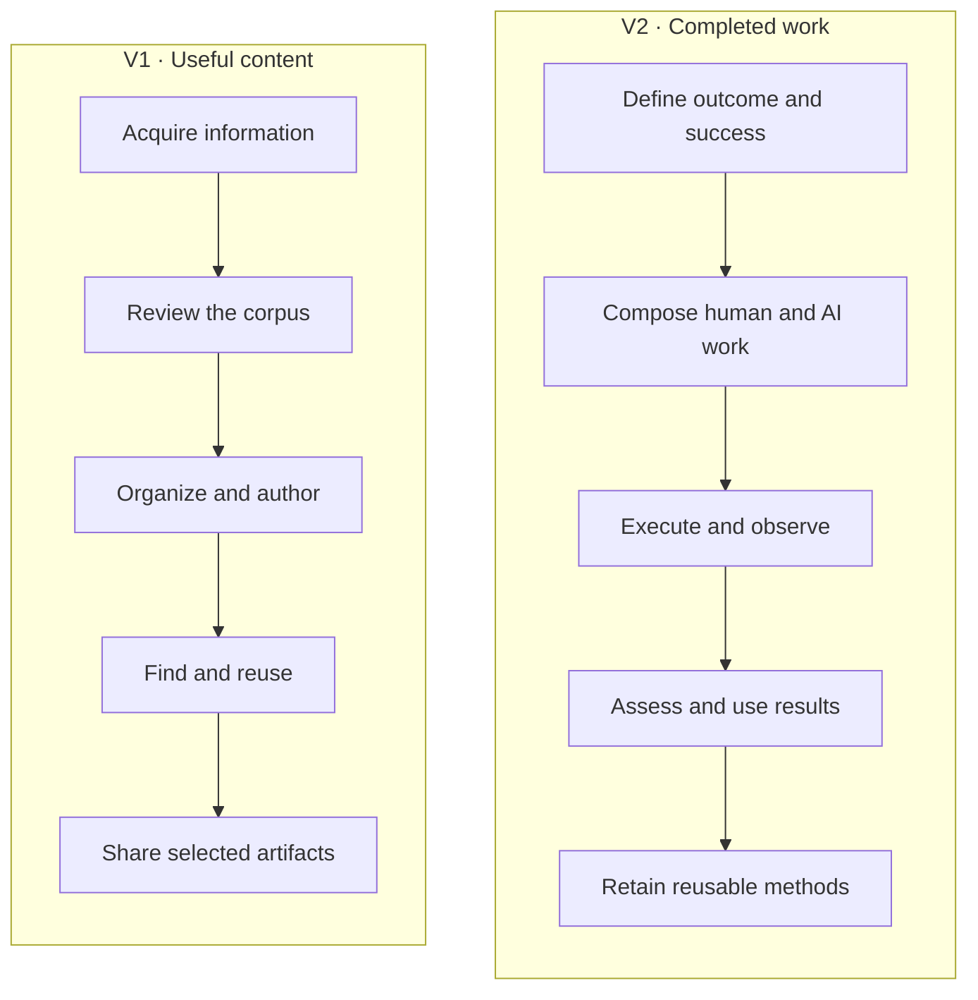

# Business architecture

[Architecture index](../README.md) · [Data](./Data.md) ·
[Information Systems](./Information%20Systems.md) · [Technology](./Technology.md)

## Purpose and scope

Support an individual's knowledge and content work: turn information and intentions
into useful artifacts and completed work, with human and AI contributions, while
retaining control of the workspace. The scope is the base distribution's generic
capabilities and extension boundaries. Training, software development and other
specialized activities are uses of these capabilities.

The desired outcomes are control and portability of information; efficient content
production and retrieval; effective delegation; reusable methods; understandable
execution history; low operating effort; and controlled expenditure. Their ranking
and success measures remain **unspecified**.

## Capability catalog

A capability describes an ability of the business independently of the people,
applications or technologies used to provide it.

| ID | Capability | Business result |
| --- | --- | --- |
| B1 | Content acquisition and curation | External material is collected, reviewed and selected for the knowledge base. |
| B2 | Content creation and maintenance | Documents, media, models and code become useful, maintainable artifacts with navigable relationships and revision history. |
| B3 | Knowledge retrieval and reuse | The owner can find, consult and reuse material, answer questions from the base and share selected artifacts with readers. |
| B4 | Hybrid work design | An intended outcome becomes a plan of human tasks, AI tasks and coordination steps, with success criteria. |
| B5 | Work execution and assessment | Work is performed, observed, interrupted or continued, and its results can be assessed. |
| B6 | Method reuse | Work patterns and agent definitions can be prepared, published and reused with identifiable versions. |
| B7 | Workspace governance and operation | The owner controls configuration, equipment, access, information handling and operating resources. |

## Roles and participation matrix

One person may be the owner, author/curator, workflow designer, human performer and
operator. A restricted reader is a separate beneficiary of selected content. An AI
agent performs delegated work under the owner's authority.

**D** = decides and remains accountable; **P** = performs; **R** = receives or reads;
**P\*** = performs when delegated and equipped; **—** = no primary participation.
This is a business responsibility matrix; access rights follow separate controls.

| Role | B1 | B2 | B3 | B4 | B5 | B6 | B7 |
| --- | --- | --- | --- | --- | --- | --- | --- |
| Owner | D | D | D | D | D | D | D |
| Author / curator | P | P | P | — | P | — | — |
| Workflow designer | — | — | — | P | — | P | — |
| Human task performer | — | — | — | — | P | — | — |
| Operator | — | — | — | — | — | — | P |
| Restricted reader | — | — | R | — | — | — | — |
| Delegated AI agent | P* | P* | P* | P* | P* | P* | P* |

## Value streams

These streams describe how value is obtained. Their stages can be repeated or
combined; human review and agent assistance can occur at several stages.

| Representative journey | Value delivered | Main capabilities |
| --- | --- | --- |
| Collect internet material → verify the corpus → generate training material → use it. | Useful learning content grounded in selected source material. | B1, B2, B3, B5 |
| Supply meeting minutes → propose a workflow to update the base → check the workflow → run it and perform its human tasks → ask questions of the updated base. | A maintained knowledge base reflecting decisions and subsequent work. | B1–B5 |
| Define a new software feature → plan and delegate implementation → perform human tasks and assess the result → reuse the resulting code and knowledge. | A completed development change and retained working knowledge. | B2, B4, B5, B6 |

These owner-provided journeys illustrate business use. They do not imply a dedicated
training product, meeting-management system or software delivery pipeline.

## Business rules and decision rights

- The owner controls their files, work and machine. Several agents or runners can
  participate in that person's activity concurrently.
- A task is work for a human or an AI agent. Coordination and display elements can
  support the plan without being tasks. Human work is performed by the person.
- Execution completion records an operational outcome. It does not certify the
  quality of the artifact or the owner's acceptance. A designer can include human
  assessment in the workflow; there is no universal business approval gate.
- Permission modes govern tool execution. Questions require the person's answer.
  The policies for disclosing information or acting on external systems remain
  explicit open items in [Data](./Data.md).
- A restricted reader receives only authorized content access. Owning the system
  does not confer ownership of external services or resources it can reach.

The owner decides business intent, information policy and operating expectations.
Maintainers keep these views synchronized with accepted changes, following the
[shared principles](../principles.md) and [architecture ownership rules](../README.md).

## Evidence and realization

The mission and journeys incorporate the owner's discovery answers. The
[user manual](/docs/user-manual/README.md) and
[product description](/docs/promo/README.md) support the capability synthesis.
[Information Systems](./Information%20Systems.md) maps B1–B7 to logical services;
the [solution designs](../../solution-design/README.md) describe their implementation.
