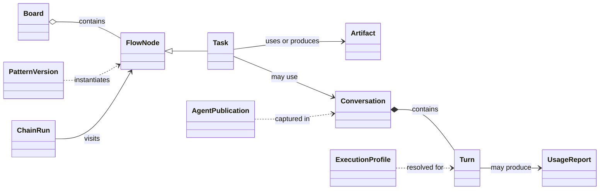

# Data architecture

[Architecture index](../README.md) · [Business](./Business.md) ·
[Information Systems](./Information%20Systems.md) · [Technology](./Technology.md)

## Scope and information catalog

This conceptual view identifies information, authority and lifecycle independently
of storage products or physical schemas. The installation owner is the business
steward; the logical services below hold responsibility for each information set.

| ID | Information set | Meaning |
| --- | --- | --- |
| D1 | Authored artifacts | Documents, media, models, code and their authored relationships or supporting metadata. |
| D2 | Derived representations | Managed indexes, conversions and generated renditions of artifacts, with provenance distinguishing them from authored material. |
| D3 | Work definitions | Boards, flow nodes, human/AI tasks, success criteria, chains, workflow groups and current work status. |
| D4 | Reusable work patterns | Node classes, their versions and workflow classes from which concrete work is instantiated. |
| D5 | Managed agent definitions | Editable agent configurations and immutable publications defining delegated behavior. |
| D6 | Execution profiles | Local runtime and provider configuration, model choices, resource selection and credential references. |
| D7 | Credentials | Private provider secrets, service credentials and temporary delegated credentials, with distinct issuers and lifetimes. |
| D8 | Execution evidence | Conversations, turns, chain-run history, decisions, configuration snapshots and diagnostic traces. |
| D9 | Usage reports | Reported resource consumption attributed to work; an absent cost means unknown. |
| D10 | Workspace reference knowledge | Content templates, format guidance, tags, bookmarks, themes and import-review rules. |
| D11 | Execution environment records | Runner identities and availability, installed equipment, selected capabilities and installation records. |
| D12 | Presentation state | Navigation, layout and display preferences, distinct from content and work meaning. |

## Conceptual relationships

This selected UML view shows domain relationships. It does not prescribe physical
tables, foreign keys or a separate store for every class.

A flow node represents a task, coordination behavior or display information. A
workflow groups nodes; a chain run is an execution. A conversation may also exist
independently of a task. References connect these domains without making their
lifetimes identical.

## Service-to-data responsibility matrix

Service identifiers are defined in [Information Systems](./Information%20Systems.md).
**O** = authoritative domain responsibility; **P** = produces information submitted
to that authority; **R** = consumes information; **—** = no primary relationship.
Authority describes meaning and lifecycle, rather than exclusive physical access.

| Information | A1 Interaction | A2 Content | A3 Work | A4 Execution | A6 Definitions | A7 Environment |
| --- | --- | --- | --- | --- | --- | --- |
| D1 Artifacts | — | O | — | P/R | — | — |
| D2 Derived representations | — | O | — | R | — | — |
| D3 Work definitions | — | — | O | P/R | — | — |
| D4 Reusable patterns | — | — | R | — | O | — |
| D5 Agent definitions | — | — | R | R | O | — |
| D6 Execution profiles | — | — | — | R | — | O |
| D7 Credentials | — | — | — | P | — | O |
| D8 Execution evidence | — | — | R | O | — | — |
| D9 Usage reports | — | — | O | P | — | — |
| D10 Reference knowledge | — | P/R | — | R | O | — |
| D11 Environment records | — | — | — | P/R | — | O |
| D12 Presentation state | O | — | — | — | — | — |

A1 and the integration service A5 mediate access to domain services. A4 issues
temporary turn credentials; A7 administers local credential configuration, while
external providers retain authority over the credentials they issue. File access
can carry several information sets: a reference document's format meaning belongs
to A6 even when A2 stores it. Authorized tools can also modify artifacts directly;
domain operations provide associated index and link maintenance.

## Integrity and provenance

- Give work, agents, conversations and executions stable identities. Content
  references use the workspace's link conventions; relocating a document and
  changing the work's identity are different operations.
- Separate mutable definitions from published versions. Instances record their
  source version; detachment or source deletion can clear that reference without
  replacing the task's content. A task conversation captures an agent publication;
  subsequent edits do not silently change that conversation.
- An execution profile remains a separate local authority. Turns retain effective
  execution configuration and, for profile-based execution, the profile revision;
  publication of an agent does not freeze all environment configuration.
- Preserve prompt intent separately from results. Use provenance to distinguish
  generated representations, copied context and authored originals.
- Usage reports are appended and replayed idempotently. Reporting corrections add
  records; totals are derived. Reported cost and measured consumption do not imply
  a complete financial ledger.

## Lifecycle and policy placeholders

| Information class | Baseline lifecycle |
| --- | --- |
| Artifacts and reference knowledge | Authored material is maintained by the owner; safely identified derived representations may be regenerated. |
| Work definitions and reusable versions | Drafting, publication, instantiation, archiving and deletion are separate operations. Archiving a flow node retains a hidden record. Published agent history is retained and immutable. |
| Execution evidence | Retained by the execution authority, with bounded transcripts and temporary mechanisms; history is not a guaranteed complete audit. |
| Synchronization and transient state | Change feeds, queues and caches support delivery or reconciliation; their lifetime does not define business retention. |
| Credentials and presentation state | Have private or presentation-specific lifecycles; neither belongs implicitly in shared artifact exports. |

The following policies are **unspecified**, as confirmed by the owner. Existing
mechanisms do not supply these business decisions.

| Open item | Definition to supply | Decision owner |
| --- | --- | --- |
| DP1 — Classification | Sensitivity categories and the treatment required by each. | Installation owner |
| DP2 — Disclosure | Permitted readers and external destinations, including model providers, tools and remotes; any review conditions. | Installation owner |
| DP3 — Retention and deletion | Preservation periods, disposal rules and exceptions for artifacts, definitions, versions, execution evidence and usage. | Installation owner |
| DP4 — Credential lifecycle | Required rotation, revocation and recovery rules for private credentials. | Installation owner |

Restricted-reader access remains a real boundary. Import scanning assists human
review through heuristics; it does not guarantee classification or prevent every
disclosure. Whole-workspace backup and recovery requirements are owned by
[Technology](./Technology.md), including the separate information sets above.

## Evidence and realization

See the [work information design](/operation/hybridflow-store/docs/solution-design/schema.md)
and [current domain entities](/operation/hybridflow-store/core/entities),
[state ownership](/operation/worker/docs/solution-design/request-handling.md),
[agent publications](../../solution-design/decisions/00075-agent-publications.md),
[execution profiles](/operation/worker/PROTOCOL/pi.md),
[conversation records](/operation/worker/internal/hybridflow-runner/conversations/conversations.go)
and [import review](/exchange/dashboard/docs/solution-design/import-gate.md).
