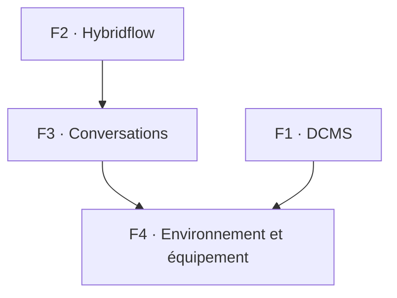

# Fonctionnalités

Cette vue décrit ce que kiao fait, au niveau conceptuel.

## Zones fonctionnelles

| ID | Zone | Ce qu'elle fournit |
| --- | --- | --- |
| F1 | DCMS (gestion de documents et de contenus) | Gestion d'une base de documents, de code source ou de connaissances. |
| F2 | Hybridflow (workflows hybride) | Conception et exécution de workflows composés de tâches humaines et de tâches d'agent. |
| F3 | Conversations avec les agents | Dialogue avec un agent, libre ou rattaché à une tâche. |
| F4 | Environnement et équipement | Gestion de l'environnement d'exécution, des outils et des profils d'exécution dont le travail a besoin. |

## F1 · DCMS — gestion de documents et de contenus

Le [document](../data/dcms-concept-catalog.md) est le concept central de DCMS : il englobe
les artefacts informationnels persistés que le système gère, quelle que soit leur destination.
Un contenu est destiné à être publié ou diffusé.

- Parcourir, créer, modifier, déplacer, renommer et supprimer des fichiers dans un dossier choisi.
  Les documents sont conservés dans ces fichiers ; pas de base documentaire distincte.
- Modifier chaque format avec son propre éditeur et le rendre sur place : markdown,
  code et texte brut, schémas, cartes mentales, graphes, diagrammes d'architecture,
  matrices de fonctionnalités, modèles, images et SVG, PDF et ePub, audio,
  vidéo et modèles 3D.
- Retrouver un document : recherche en plein texte, navigation par liens et par
  passage, signets et étiquettes.
- Conserver l'historique : versionnage, différences et synchronisation du
  dossier.
- Faire entrer un document sous contrôle : examen des téléversements et recherche de secrets
  avant import.

## F2 · Hybridflow — travail hybride

- Concevoir un travail comme un graphe BPMN de nœuds : tâches d'agent, tâches humaines,
  nœuds de coordination et d'affichage, enchaînés dans l'ordre.
- Énoncer le résultat visé et ses critères de réussite sur le travail.
- Réutiliser des conceptions : classes de nœuds et classes de workflows instanciées en
  éléments concrets ; définitions d'agent publiées comme versions immuables.
- Exécuter un workflow : prendre un travail, l'exécuter, attendre, répondre aux questions, interrompre
  et reprendre, sans qu'une interface ouverte soit la vie de l'exécution.
- Suivre un travail en cours d'exécution : état du tableau en direct, historique des exécutions de chaînes et consommation
  attribuée au travail. L'achèvement enregistre un résultat ; il ne
  certifie pas la qualité — l'évaluation est elle-même un travail que le concepteur peut ajouter.

## F3 · Conversations avec les agents

- Converser avec un moteur d'agent dans une conversation libre, et poursuivre,
  bifurquer ou compacter cette conversation.
- Déléguer un tour : lui donner un dossier de travail, des documents ou passages sélectionnés et des
  pièces jointes ; le piloter pendant son exécution ; l'arrêter.
- Répondre à ses questions et contrôler ses outils par les modes d'autorisation.
- Conserver les preuves : transcription, tours et traces, séparés de
  l'état du travail qu'ils ont servi.
- Les conversations sont aussi la manière dont une tâche d'agent hybridflow s'exécute. Hybridflow
  détient la définition du travail et son état ; les conversations détiennent le
  dialogue et ses traces.

## F4 · Environnement et équipement

- Équiper la machine : installer, retirer et vérifier les environnements d'exécution et les moteurs
  d'agent, et savoir si chacun répond, pas seulement s'il est
  présent.
- Équiper un tour : sélectionner les serveurs MCP et les outils qui lui sont remis.
- Configurer l'exécution : profils d'exécution nommant le fournisseur, les modèles et les
  références d'identifiants, conservés localement chez l'exécutant. Les instructions d'agent
  restent chez l'agent ; les identifiants restent hors des tableaux et des transcriptions.
