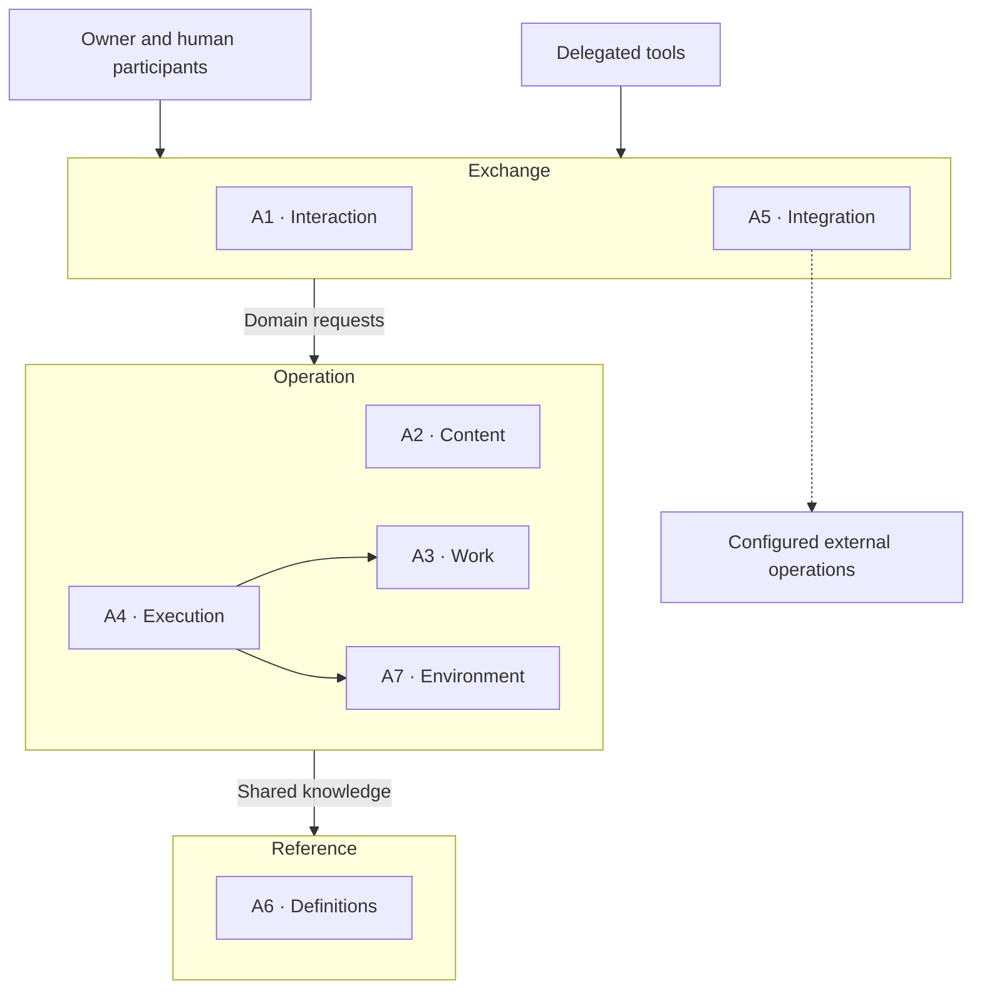

# Information systems architecture

[Architecture index](../README.md) · [Business](./Business.md) ·
[Data](./Data.md) · [Technology](./Technology.md)

## Scope and decomposition

This is the logical application view supporting the business capabilities. Data
architecture is defined separately in [Data](./Data.md). Services below classify
responsibilities; several can share an application or runtime, and one service can
span several runnable components.

The [responsibility zones](../principles.md) organize this view: **Exchange** owns
interaction with people and external systems, **Operation** owns business operations
and work coordination, and **Reference** owns shared definitions and reusable
knowledge.

## Application-service catalog

| ID | Logical service | Zone | Responsibility |
| --- | --- | --- | --- |
| A1 | Workspace interaction | Exchange | Present artifacts, work and conversations; collect commands, human answers and decisions; maintain presentation preferences. |
| A2 | Content management | Operation | Maintain the content tree, authored relationships, import review, derived representations, retrieval and revision operations. |
| A3 | Work management | Operation | Maintain boards, tasks, coordination and display nodes, workflow groups, work status, conditional claims and attributed usage. |
| A4 | Execution coordination | Operation | Run conversations and chains, dispatch agent turns, handle waits and interruptions, collect answers and retain execution evidence. |
| A5 | Integration mediation | Exchange | Adapt tool and extension requests to domain contracts, route configured external operations and carry the caller's delegated authority. |
| A6 | Shared definitions | Reference | Maintain and supply reusable work patterns, published agent definitions, content templates, format guidance and workspace reference rules. |
| A7 | Environment administration | Operation | Manage execution locations, equipment, tool availability, execution profiles and private credential configuration. |

DCMS combines content interaction, management and related shared services.
Hybridflow combines work design, shared work and agent definitions, execution,
conversation interaction and reporting. Both functional sets use integration and
environment services.

## Capability-to-service matrix

Capabilities B1–B7 are owned by [Business](./Business.md).
**P** = primary realization; **S** = supporting contribution; **—** = no primary
mapping. Environment administration supports the workspace as a whole; its direct
business capability is B7.

| Capability | A1 | A2 | A3 | A4 | A5 | A6 | A7 |
| --- | --- | --- | --- | --- | --- | --- | --- |
| B1 Acquisition and curation | S | P | — | S | S | S | — |
| B2 Creation and maintenance | S | P | — | S | S | S | — |
| B3 Retrieval and reuse | S | P | — | S | S | S | — |
| B4 Hybrid work design | S | S | P | S | S | S | — |
| B5 Execution and assessment | S | S | S | P | S | S | — |
| B6 Method reuse | S | S | S | — | S | P | — |
| B7 Governance and operation | S | S | S | S | S | S | P |

## Logical collaboration

Arrows indicate requests or use of a responsibility, rather than a particular
protocol. Arrows between zones summarize collaboration; internal arrows select
key dependencies. Evidence returns through interaction and integration paths.

## Contracts and behavioral boundaries

- Business rules use explicit domain contracts. Interaction and integration
  adapters translate requests without taking ownership of those rules. Shared
  contracts have one authoritative definition.
- Editing a board and executing its work are separate operations. Execution owns
  the play loop and continues independently of an open user interface. It asks
  work management for claims and state transitions.
- Current work state belongs to work management; conversation and run history
  belong to execution coordination. The domains exchange references, outcomes and
  usage reports. The [data matrix](./Data.md) defines their authorities.
- Independent work items can change concurrently. Conditional updates expose
  conflicts, and synchronization preserves unsaved user edits where supported.
  Deferred updates require ordered, idempotent reconciliation.
- Published definitions supply stable task context. Agent instructions and model
  intent are separate from local runtime and credential configuration. Missing or
  unavailable references must remain understandable when work cannot start.
- An optional capability has an explicit absence behavior. Local content work
  remains useful without agent execution or work management. Optional extensions
  and network services participate only when configured and available.

## External service boundaries

| Boundary | Information or behavior exchanged | Dependency |
| --- | --- | --- |
| Agent engines and model providers | Prompts, instructions, selected content, tool activity, replies and reported consumption. | Required for the selected agent execution; provider capabilities differ. |
| Identity provider | Authentication evidence and verification material. | Conditional on the secured operating arrangement. |
| Version-control remote | Selected revision history and synchronization operations. | Optional for local content work. |
| Specialized operation provider | A declared operation on content and its outcome. | Optional extension; the provider owns its business operation. |
| Shared work authority | Work definitions, claims, transitions and usage across execution locations. | May be colocated or reached remotely; one configured authority governs a given set of work. |
| Equipment distribution source | Runtime and tool packages plus verification information. | Needed for acquisition or update; already installed functions have their own dependencies. |

Disclosure policy is the open item DP2 in [Data](./Data.md). Infrastructure
dependencies and operating expectations are defined in [Technology](./Technology.md).

## Evidence and realization

The logical grouping is synthesized from the
[shared principles](../principles.md), [interaction design](../../solution-design/interactions.md),
[content interaction design](/exchange/dashboard/docs/solution-design/README.md),
[worker responsibilities](/operation/worker/docs/solution-design/components.md),
[work information design](/operation/hybridflow-store/docs/solution-design/README.md),
[tool contracts](/reference/kiao-mcp/README.md) and
[extension contracts](../../solution-design/file-actions.md).
The [container catalog](../../solution-design/containers.md) and
[solution design index](../../solution-design/README.md) own concrete system boundaries.
