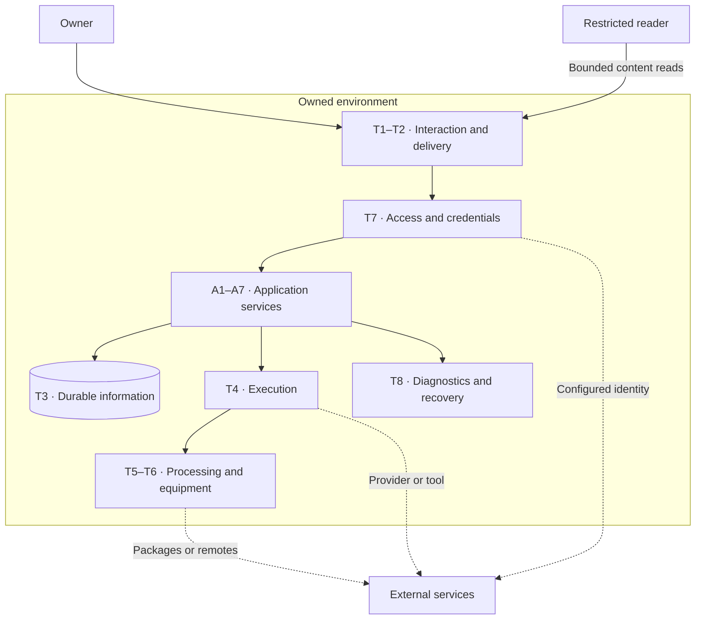

# Technology architecture

[Architecture index](../README.md) · [Business](./Business.md) ·
[Data](./Data.md) · [Information Systems](./Information%20Systems.md)

## Scope and technology-service catalog

This logical view describes the software and infrastructure services required by
the application architecture. Product choices, versions, packaging and physical
deployment topology belong to [solution designs](../../solution-design/README.md).

| ID | Technology service | Required capability |
| --- | --- | --- |
| T1 | Client interaction and rendering | Interactive authoring, navigation, document rendering and presentation of live work. |
| T2 | Request delivery and communication | Request routing, service communication, long-lived observations and reconnect behavior. |
| T3 | Durable information persistence | Store ordinary artifacts, structured work and private operational state with appropriate concurrency and atomicity. |
| T4 | Supervised execution | Start and stop agent/tool processes, bound concurrency, handle cancellation and settle interrupted work. |
| T5 | Content processing and versioning | Conversion, indexing, diagram rendering, media processing and revision operations. |
| T6 | Equipment and software distribution | Assemble, install, verify and select supported runtime and tool resources; retain installation provenance. |
| T7 | Identity, access and credentials | Support trusted local operation or authenticated access, enforce restricted-reader boundaries and manage delegated credentials. |
| T8 | Operational evidence and recovery support | Correlate diagnostics, record outcomes, reconcile deferred updates and support controlled state transitions after interruption or upgrade. |

## Application-to-technology dependency matrix

Logical application services A1–A7 are defined in
[Information Systems](./Information%20Systems.md).
**R** = required support for that active service; **C** = conditional on a selected
feature or operating arrangement; **—** = no direct relationship at this level.
These are logical dependencies, not a deployment or network-access specification.

| Application service | T1 | T2 | T3 | T4 | T5 | T6 | T7 | T8 |
| --- | --- | --- | --- | --- | --- | --- | --- | --- |
| A1 Workspace interaction | R | R | R | — | C | — | R | C |
| A2 Content management | C | R | R | C | R | C | R | R |
| A3 Work management | — | R | R | — | — | — | R | R |
| A4 Execution coordination | — | R | R | R | C | C | R | R |
| A5 Integration mediation | — | R | — | C | — | C | R | R |
| A6 Shared definitions | — | C | R | — | C | C | R | C |
| A7 Environment administration | — | R | R | R | — | R | R | R |

## Logical infrastructure and trust

The enclosing boundary denotes owner-operated resources. Persistence covers content,
work and private operational state with different authorities and lifecycles; it
does not prescribe physical storage installations. The restricted reader reaches
content through access controls. External services retain their own trust boundaries.

## Technical constraints and quality attributes

| Concern | Baseline constraint or behavior |
| --- | --- |
| Portability | Content remains accessible as ordinary files. Installed local content functions remain useful without agent execution or a boards service; remote and authenticated arrangements can introduce network dependencies. |
| Concurrency and integrity | Independent work can progress concurrently. Conditional claims and revisions protect authoritative work state; durable writes avoid exposing partial state. Deferred delivery requires idempotent reconciliation. |
| Execution continuity | An open interface is not the lifetime of a run. Process interruption is recorded and settled; restart does not imply that every operation resumes automatically. |
| State separation | Artifacts, work definitions, execution evidence, credentials, presentation preferences and equipment have explicit authorities and lifetimes, as cataloged in [Data](./Data.md). |
| Trust | The owner operates the installation under their machine privileges. A task's working folder scopes context; it is not a security sandbox. Restricted-reader access remains bounded. External access follows configured credentials and the owner's information policy. |
| Extensibility | Runtime and provider capabilities are discovered or declared explicitly. An unavailable optional function has a defined absence behavior; it does not invalidate unrelated content work. |
| Observability | Correlate requests and executions, expose interruptions and preserve configuration provenance where supported. Missing usage or cost information remains unknown. |
| Controlled evolution | State transformations have explicit scope, version history and repeatable failure behavior. Applied transformation history is immutable outside a coordinated, checked retirement. |

Durable writes, revision history and deferred-delivery mechanisms provide specific
forms of resilience. They do not establish a complete workspace backup or a tested
disaster-recovery guarantee.

## Operating requirement placeholders

The following requirements are **unspecified**, as confirmed by the owner.
Implementation limits and default timeouts are not substitutes for business targets.

| Open item | Definition to supply | Decision owner |
| --- | --- | --- |
| TP1 — Availability | Expected service hours and tolerable interruption for content and execution services. | Installation owner |
| TP2 — Performance | Acceptable response and completion times for browsing, search, editing and execution observation. | Installation owner |
| TP3 — Capacity | Workspace size, work volume, concurrent owner-side activities, runners and agent turns. | Installation owner |
| TP4 — Recovery objectives | Maximum acceptable data loss and recovery time for each information class. | Installation owner |
| TP5 — Backup and recovery practice | Backup scope, frequency, destinations, protection of private state and credentials, and restoration verification. | Installation owner |

A complete recovery scope must account for content, work state, private execution
state and necessary environment configuration. Version control of artifacts alone
does not cover all these authorities. Information-handling and retention policies
remain the open items in [Data](./Data.md).

## Evidence and realization

See [deployment arrangements](../../solution-design/views/Deployment.md),
[state handling](/operation/worker/docs/solution-design/request-handling.md),
[execution and process lifecycle](/operation/worker/docs/solution-design/conversations.md),
[deferred work updates](../../solution-design/interactions.md),
[equipment management](/operation/worker/docs/solution-design/actions-toolbox.md),
[migration governance](/migrations/README.md) and
[build and distribution tooling](/bin/README.md).
The [executable](/docs/user-manual/deep-dive/kiao-executable.md) and
[image](/docs/user-manual/deep-dive/kiao-docker.md) manuals own their operating procedures.
