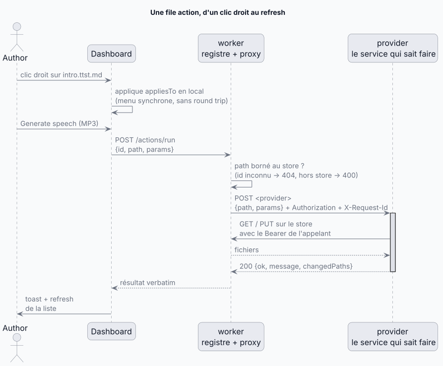

# Les file actions — le point d'extension « opérer sur un fichier »

Une file action est une opération sur un fichier du store, proposée dans le menu
contextuel du navigateur, exécutée par un autre service que worker. Ajouter une action,
c'est une entrée JSON dans un manifeste plus un endpoint sur le service qui la fait :
ni Go, ni code Dashboard. Ce document dit comment le système tient ensemble, pour
décider ; la procédure est dans le skill
[file-actions](/.agents/skills/file-actions/SKILL.md), le contrat normatif dans
[PROTOCOL.md](/operation/worker/PROTOCOL.md).

## Le tour d'une action

<!-- kiao:diagram
```plantuml
@startuml
title Une file action, d'un clic droit au refresh
actor Author
participant Dashboard
participant "worker\nregistre + proxy" as FS
participant "provider\nle service qui sait faire" as PUB

Author -> Dashboard : clic droit sur intro.ttst.md
Dashboard -> Dashboard : applique appliesTo en local\n(menu synchrone, sans round trip)
Author -> Dashboard : Generate speech (MP3)
Dashboard -> FS : POST /actions/run\n{id, path, params}
FS -> FS : path borné au store ?\n(id inconnu → 404, hors store → 400)
FS -> PUB : POST <provider>\n{path, params} + Authorization + X-Request-Id
activate PUB
PUB -> FS : GET / PUT sur le store\navec le Bearer de l'appelant
FS --&gt; PUB : fichiers
PUB --&gt; FS : 200 {ok, message, changedPaths}
deactivate PUB
FS --&gt; Dashboard : résultat verbatim
Dashboard -> Author : toast + refresh\nde la liste
@enduml
```
-->


Trois rôles, trois contrats :

| Rôle | Sait | Ignore |
| --- | --- | --- |
| Dashboard | la liste des actions, la règle d'applicabilité, les paramètres à demander | quel service exécute quoi (l'URL provider ne traverse jamais le wire) |
| worker | le manifeste, la règle, où router | ce que fait chaque action (`actions.go` ne nomme ni TTS ni units) |
| provider | son métier, le store via worker | le menu, la règle, les autres actions |

## Les trois contrats

**1. Le manifeste appartient au déploiement.** Le fichier nommé par
`KIAO_WORKER_ACTIONS_PATH` déclare chaque action : `id`, `label`, `group`/`order`
(tri du menu), `appliesTo`, `params`, `provider` (URL absolue). Vide ou absent :
la fonctionnalité est absente, pas cassée — le menu est ce qu'il était, chaque run
est une action inconnue. Malformé : le démarrage refuse (fail fast), jamais une
entrée de menu silencieusement manquante. Chargé une fois au démarrage : modifier le
manifeste demande un restart.

**2. L'applicabilité est un vocabulaire volontairement pauvre.** Deux clés, ET-logique,
toutes deux optionnelles : `extensions` (suffixe du *nom* de fichier, insensible à la
casse — `.ttst.md`, `.mlunit.json`) et `directory` (l'entrée doit ou non être un
dossier). Règle vide = tout. La pauvreté est le prix du menu synchrone : tout est
décidable depuis `{ path, isDirectory }`, que le client tient déjà, donc le menu se
construit sans round trip. Revers : la règle est implémentée deux fois, en Go et en
TypeScript, avec la même table de tests — et c'est PROTOCOL.md qui fait foi, pas l'une
des deux implémentations.

**3. Le provider reçoit un appel ordinaire et rend un verdict ordinaire.**
`POST {path, params}` (params `{}` si aucun — jamais `null`) → `200 {ok, message,
changedPaths}`. Le `Bearer` de l'appelant voyage avec la requête : le provider lit et
écrit le store au nom de l'utilisateur, sans compte de service, les deux services
exigeant le même rôle realm. `X-Request-Id` voyage aussi : une action = une paire de
traces corrélées. Échecs en deux espèces : opération refusée = `200 {ok: false,
message}` lisible par l'utilisateur (même choix que `/git/*`) ; provider injoignable
ou au-delà du budget de 10 minutes = `502`. Le path est borné au store *avant* tout
envoi : forwarder un chemin non vérifié ferait de worker un confused deputy.

`changedPaths` dit ce que l'action a écrit pour que le client refresh juste ça. Le
client actuel s'en sert en booléen (non vide = refresh de la liste) ; le contrat
permet mieux, personne ne l'a encore demandé.

## Pourquoi cette forme

- **Pas de registre Go in-process** : il aurait fallu réimplémenter la synthèse
  Google/Azure dans un service dont le métier est les fichiers, et chaque action
  aurait été un déploiement de worker. ([00006](/docs/architecture/decisions/00006-file-actions-declared.md))
- **La règle évaluée des deux côtés** : un round trip par clic droit aurait rendu le
  menu asynchrone pour la première fois. La duplication bornée par un vocabulaire
  pauvre coûte moins cher. ([00007](/docs/architecture/decisions/00007-applicability-rule-both-sides.md))
- **L'URL provider jamais divulguée** : le routage est de la topologie de déploiement,
  le client nomme une action par id. Même marché que le catalogue toolbox :
  le déploiement déclare, le client pointe.
- **Des paramètres pauvres** (`string`, `boolean`, `enum`) : un seul formulaire
  générique les rend tous — ajouter une action paramétrée ne demande toujours aucun
  code Dashboard. Ce qu'une action n'exprime pas avec ça appartient au provider, pas
  à un langage de formulaire plus riche.
- **Publier depuis le seul path** : une action n'est joignable que d'un menu, où il n'y
  a qu'un path — une action de publication a donc exigé que la résolution de la chaîne quitte
  le navigateur pour le serveur. ([00008](/docs/architecture/decisions/00008-publish-resolved-server-side.md))

## Ce qui existe

Ce que le manifeste du déploiement déclare — sans manifeste, aucune action. Le manifeste
est le fichier JSON nommé par `KIAO_WORKER_ACTIONS_PATH`, fourni par le déploiement.

## Quand ce n'est PAS une action

- **Ça a besoin de ce qui est chargé dans l'onglet.** Générer la version statique
  d'un `.src.md` ressemble à une action, mais le provider aurait dû dessiner quatre
  moteurs de diagrammes en headless derrière un shim approximant la métrique de texte,
  alors que le navigateur les a déjà chargés avec un vrai moteur de layout. C'est une
  entrée de menu du plugin, qui fait le travail dans l'onglet.
  ([00014](/docs/architecture/decisions/00014-static-version-in-browser.md))
- **Ça doit exister sans manifeste.** Aucun build de base n'en câble — ni l'image,
  ni l'exécutable installé, ni `local-start-kiao.sh`, ni e2e — donc partout là il n'y a
  aucune action, par absence de manifeste. C'est aussi ce qui a tranché la version
  statique : une action aurait été absente partout où l'on écrit.
- **Le provider n'a pas d'endpoint action.** Un provider peut s'intégrer directement
  côté client en attendant son endpoint : provisoirement normal, pas un modèle.

Règle de placement (checklist) : [plugins-rules](/docs/architecture/containers/dashboard/plugins-rules.md).

## Coûts et limites, pour décider

- **Ajouter** = un endpoint provider + une entrée de manifeste + câbler le manifeste
  là où l'action doit exister. Ni worker ni Dashboard ne changent, ne rebuildent, ne
  redéploient.
- **Un fichier à la fois** : le menu n'offre une action que sur une sélection unique ;
  pas de batch, pas de multi-sélection.
- **Appel synchrone, pas de progression** : le client attend (toast « … »), budget
  10 minutes côté worker. Une action longue ne rend compte qu'à la fin.
- **Applicabilité et paramètres non extensibles sans toucher les deux côtés** :
  enrichir le vocabulaire, c'est changer worker *et* Dashboard *et* PROTOCOL.md —
  c'est fait pour décourager.
- **Silence hors prod** : sans manifeste, pas d'erreur et pas d'entrée — à savoir
  avant de promettre une action dans un environnement qui n'en déclare aucune.

## Pointer plutôt que dupliquer

La description normative du wire reste [PROTOCOL.md](/operation/worker/PROTOCOL.md)
§ File actions ; le côté Dashboard reste
[server-actions.md](/docs/architecture/containers/dashboard/server-actions.md) ; le
côté provider suit le contrat décrit plus haut, une route par id d'action.
Ce document est la vue d'ensemble qui les relie.
