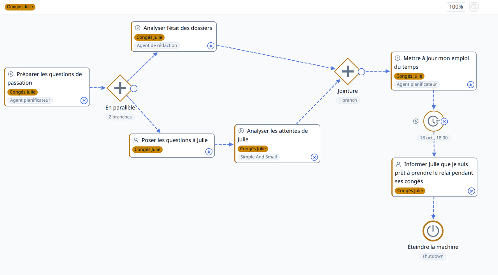
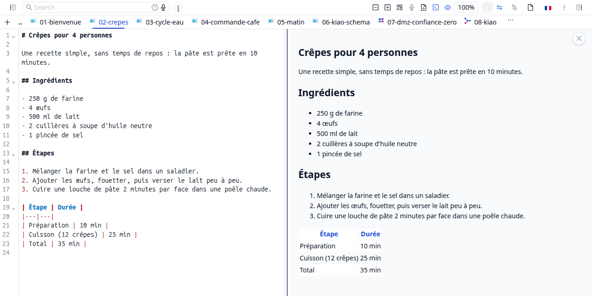
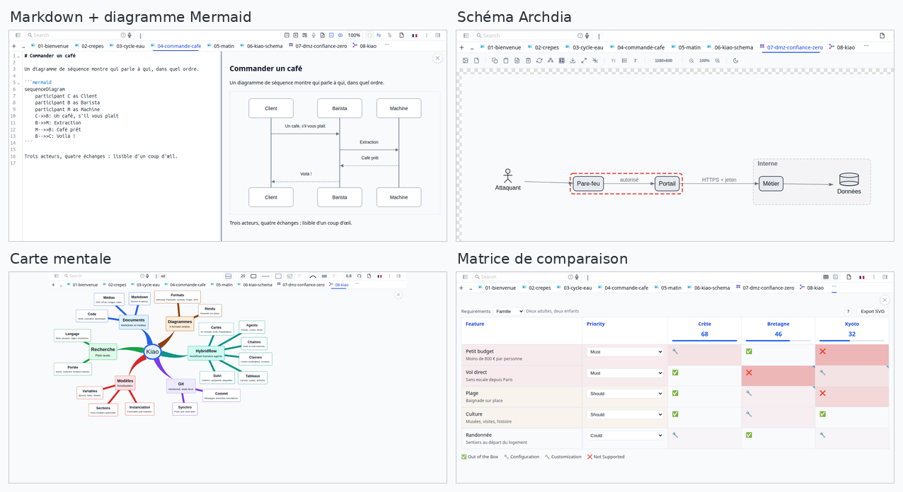

# Kiao — documents, workflows agentiques, et contenus

Kiao contient un **système de gestion de documents et de contenus** (DCMS) et un **moteur de workflow humain/IA**. Vous pouvez demander à l'IA de concevoir des workflows pour résoudre des tâches complexes, les inspecter, puis les exécuter.

Cet environnement se prête aussi très bien au développement logiciel : code, design et architecture. Kiao est d'ailleurs développé avec Kiao.

## Les agents travaillent avec vous

Du simple chat à la conception de workflows complexes, l'IA construit, propose, inspire, et vous conseille.



*La board Passation avant congés : les agents préparent et analysent en
parallèle, l'humain répond et valide, une attente planifiée ferme la
journée. Capture de l'application.*

## Vos fichiers restent vos fichiers

Pas de base opaque, pas d'export pour récupérer ce qui est à vous : kiao
édite un dossier tel quel, le versionne en git et le cherche en plein texte.
Ce que vous voyez dans le CMS est ce qui est sur le disque.



*L'éditeur markdown — source et rendu côte à côte, navigation par onglets.
Ici une recette : texte, liste et tableau. Capture de l'application.*

## Un éditeur par format

Chaque type de fichier s'ouvre avec l'éditeur qui lui convient : markdown,
cartes mentales, graphes, diagrammes (PlantUML, archdia), PDF, ebooks,
images, vidéo, code… Le classeur ne change pas, seul l'établi s'adapte.



*Un éditeur par format, quatre exemples : Markdown + Mermaid (diagramme de
séquence), Archdia (périmètre de confiance), carte mentale, matrice de
comparaison. Captures de l'application.*

## Ça s'installe en une commande

```bash
kiao ~/mes/documents
```

Une commande, et le dossier s'ouvre dans le navigateur — sans Docker, sans
compte, sans configuration. L'image Docker existe pour les déploiements
serveur. Dans les deux cas, diagrammes et recherche fonctionnent en local.

---

*kiao — la distribution publique : gestion documentaire (DCMS) et workflows
humain-agent (hybridflow).*
