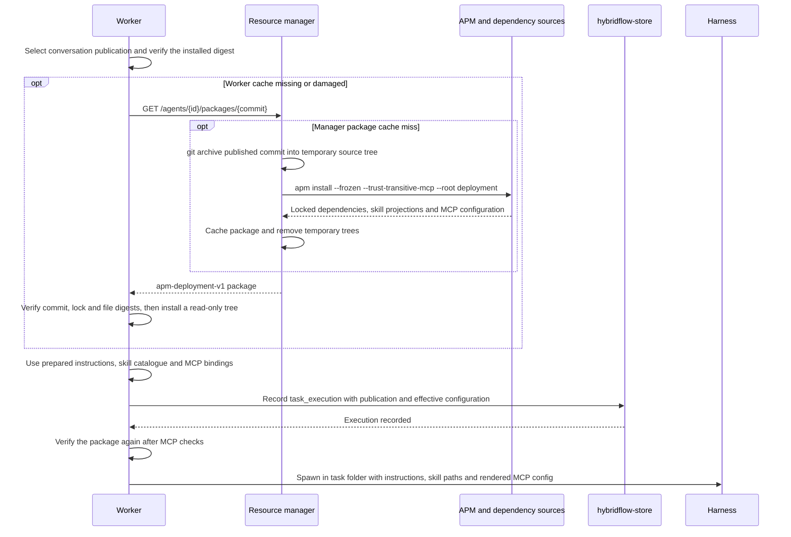

---
document:
  status: DRAFT
  role: PRIMARY_SOURCE
---

# Agentic resources

Read for **Git/APM publication**, **runtime delivery** and **storage audits**.
[Hybridflow concept catalog](../architecture/data/hybridflow-concept-catalog.md) ·
[Conceptual data flows](../architecture/data/agentic-resources.md) ·
[Runtime ownership (ADR 00070)](decisions/00070-runtime-agent-resource-manager.md)

The manager's [service contract](../../operation/agentic-resource-manager/README.md) lists its API
and non-storage configuration.

## Runtime responsibilities

**Source ownership** belongs to agentic-resource-manager: agent Git working trees, editable skill/MCP
repositories, APM resolution, releases and prepared package cache. It discovers repositories on
catalogue reads, so manual clones and edits appear without registration. Dashboard's
`hybridflow/agentic-resources/` module edits these server-side working trees. On the instance
that hosts the manager, the DCMS file browser opens the same files under
`/agentic-resource-management/`. The two services access the directory through their configured
paths.

Workers own **installed execution packages** and harness launch. hybridflow-store owns **task
references** and **execution provenance** in PostgreSQL; it resolves agent identities through the
manager. Workers and hybridflow-store select the manager with
`KIAO_AGENTIC_RESOURCE_MANAGER_URL` and `KIAO_AGENTIC_RESOURCE_MANAGER_SERVICE_TOKEN`.
Dashboard uses same-origin `/api/agentic`; the worker offers an authenticated proxy at
`/agentic-resources-api/`, and hybridflow-store retains forwarding agent routes.

## Import and publication

1. **Import or create.** Supply a Git URL or a path accessible to the resource manager. It clones
   an existing agent with its identity and releases, installs dependencies and compiles it.
   In a repository without APM sources, it commits and pushes the new draft on the repository's
   branch, preserving existing files and history. An empty repository field creates a local
   Git/APM project.
2. **Edit the draft.** `agent.json` holds identity and a default harness. The optional
   `harnesses` list enables a shared definition on several harnesses. The matrix shows the
   replacement for agent IDs listed in a publication’s `supersedes`. Existing references
   can still resolve the original agents.
   `.apm/agents/*.agent.md` holds the description, standing instructions and agent defaults.
   `apm.yml` declares Git dependencies for resources with a remote and relative paths for local
   resources. Enabling **Local** uses the working tree of a Git dependency in draft conversations
   and blocks publication. The choice lives in the agent clone’s Git metadata.
3. **Resolve and compile.** Publication snapshots the current draft in a temporary Git worktree
   with its own index. It converts older captures to Git references when their source
   clones have remotes. It captures local dependencies from clean configured
   repositories into `.apm/resources/`, records their commits in `kiao.lock.json`, runs
   `apm install --trust-transitive-mcp`, then compiles the agent with APM. A shared
   definition compiles for Codex and Claude Code.
   A successful compilation applies the versioned changes to the draft. A preparation failure
   leaves its files and index intact. `apm.lock.yaml` fixes APM's resolution and `.gitignore`
   records the generated skill paths. A clean Git checkout installs them with
   `apm install --frozen --trust-transitive-mcp`.
4. **Publish a major, minor or patch release.** The bump starts from the greater of the
   `apm.yml` version and the latest local release tag. New agent manifests start at `0.0.0`.
   Publishing resets the components below the selected one, writes the version to `apm.yml`
   and tags the commit with `vMAJOR.MINOR.PATCH`. Agent releases push the commit and tag
   atomically when a remote exists. Dashboard asks for confirmation before a push with local
   resource dependencies. A failed push leaves the release local for an explicit push.
   Skill and MCP releases commit and tag locally. The Git push action sends them to the remote.
5. **Pull remote commits.** The editor reads the remote on open and while it stays open, so
   **Pull** is enabled only while the branch holds commits the working tree lacks. The pull
   fetches the branch with its release tags and fast-forwards the draft. A working tree with
   local changes refuses the merge; the editor reports the Git reason. The
   [manager contract](../../operation/agentic-resource-manager/README.md) names both endpoints.

**Task references survive clone deletion** (`settings.agent`). Confirmation covers missing or
unreachable remotes, local changes and unpushed refs, and expires when repository state changes.
Reimporting the repository restores its stable agent identity. Agent selection belongs to task
definition.

## Package delivery and harness binding

**Publication snapshots** carry the APM version, instructions from the native definition,
the commit, lock digest and captured local dependency commits. A conversation retains its
selected publication. Historical snapshots with a Git tag recover their APM version from that tag.
The worker binds the publication to the selected harness and Pi profile. Codex, Claude Code,
Muse and Pi receive the same instructions, skills and MCP bindings from the shared publication.
Each driver supplies them in the format its harness consumes. The selected model or Pi profile
and the resolved effort are captured with the conversation. The worker supplies the harness
default when the selection and agent publication leave the model unset.

**Use local draft** in **New conversation** captures the agent definition and installs its current
APM dependencies in a staging directory. The manager resolves local links against the resource
working trees. The worker verifies and saves the prepared package before creating the conversation.
Each turn uses that saved package. Start another draft conversation to try subsequent edits.

For a **task turn**, package delivery precedes provenance recording and harness launch:

The worker builds the skill catalogue from the Codex and Claude projections in the deployment
cache. Each name appears once, with its description and absolute `SKILL.md` path in the turn
instructions. The worker reads `.mcp.json`, resolves packaged `kiao-mcp-*` commands to
`apm_modules/**/runtime/server.mjs` and supplies per-turn callback credentials. The task machine
provides Node and its harness CLI. Native adapters render the instructions and MCP configuration;
they do not move the agent repository into a harness home. Task execution records are available at
`/boards/{handle}/flow-nodes/{id}/executions`.

### Installed package immutability

**An installed package is read-only.** The worker writes the files in a staging directory,
checks them against the source digest, then installs the tree with read-only files and directories.
SHA-256 covers the relative path and bytes of every file in the tree, including hidden files and
files named like logs. The worker rejects symlinks and special files. It keeps the expected digest
in a sibling manifest and rebuilds runtime bindings from the verified files.

| Write path | Destination and protection |
| --- | --- |
| Git checkout, APM install and compile, dependency download and package export | The manager writes in editable source repositories, isolated preparation directories and its own caches. The worker installs the returned file map. |
| Worker install, draft snapshots and cache metadata | The worker stages a complete package beside the installed tree. The manifest and the saved draft source sit beside the installed tree. |
| MCP diagnostics, stdio relay and tool calls | Probes and subprocesses start in the store or task folder. The worker sets `KIAO_MCP_LOG_DIR` for every stdio binding from a package, including commands wrapping another MCP process. This overrides the KIAO MCP module's installation-relative log default. Draft diagnostics use a disposable directory with separate package and log paths. |
| Harnesses, skills and subprocesses | The harness works in the selected store folder. The runner refuses working directories into the cache, including symlink aliases. Harness configuration, session files, traces and generated files belong in the harness state, work folder or a temporary directory. This includes caches that scripts might otherwise create beside imports and assets. |
| DCMS and its MCP file tools | The configured state directory is protected from saves, uploads, extraction, copies, media output, subsidiary and index operations, renames and deletions. The check follows existing symlink prefixes and protects ancestors from recursive deletion or moves. Link repair and other store walks skip state. |
| Startup migrations and legacy skill retirement | The migration helper excludes the configured state and its physical location even with an empty `.kiao-files`. Legacy skill retirement inspects its named workspace and harness directories. Published skills are read through their installed paths. |
| Source Control and host maintenance | Git ignores cache files by default and the worker rejects direct Git operations on state paths. Shell commands, forced Git changes, backups and sync tools running with the owner's access can change a live cache. The worker checks the full digest before reuse and again before spawning the harness. |

When the digest differs, the worker fetches the exact publication from the resource manager or
loads the saved draft source. It verifies the selected commit or draft ID and APM lock digest. It
compares the source file digest with the recorded digest when available, validates the staged and
installed trees, and then allows launch. The displaced tree stays in a sibling quarantine directory,
which also preserves any installation-relative logs from older workers.

A healthy legacy draft supplies its own recovery source once its full digest and lock have been
verified. An already damaged legacy draft with no verified snapshot requires a new draft
conversation. An unavailable or inconsistent recovery source prevents launch.

### MCP diagnostics

**Edit agent** checks the selected draft or publication on the Dashboard's worker. Before a turn,
the executing worker checks the conversation's package again. It resolves the commands and checks
`initialize` and `tools/list` over stdio or streamable HTTP. The checks run in parallel with a
12-second deadline. The runner delivers the available servers and adds the failure reasons to the
agent's instructions.

The worker sets `KIAO_MCP_DIAGNOSTIC=1` for stdio checks. Each KIAO MCP entry point supplies its own
read-only dependency checks and reports failures on stderr. The worker includes the relevant stderr
in the diagnostic and revokes the check's callback token when it finishes. During a turn, a stdio
server exit returns an MCP tool error for each outstanding call. The relay keeps the connection open
so the harness can continue the turn.

## Storage inventory

**Storage is per host**: manager paths are on the manager machine, worker paths on
each execution machine. `<agent-repo>` is a repository under an agent root; `<state>` is
`KIAO_WORKER_STATE_PATH`, default `<dcms-root>/.kiao-config`; `<dcms-root>` is `KIAO_WORKER_DCMS_ROOT`
(standalone worker default `/tmp`). Relative manager paths resolve against its working directory.

| Data and owner | Physical location | Path selection and audit evidence |
| --- | --- | --- |
| **Shared sources and releases** — Git remote | Repository URL in each clone's `.git/config` | Git remote configuration; optional, no KIAO storage variable. Inspect remote refs as well as local tags. |
| **Agent working trees and history** — manager | `<agent-root>/<repository>/`, including `.git/`, `agent.json`, `.apm/agents/*.agent.md`, `apm.yml` | `KIAO_AGENTIC_RESOURCES_PATH` selects the directory for discovery and new clones, default `agentic-resources` under the manager's working directory. |
| **Skill and MCP source repositories** — manager | `<dependency-root>/skill-*/SKILL.md` and companion files; `<dependency-root>/mcp-*/apm.yml`, typically `runtime/server.mjs` | `KIAO_AGENTIC_DEPENDENCIES_PATH` selects one directory. Resource discovery also scans the agent directory. |
| **Captured local dependency sources** — manager | `<agent-repo>/.apm/resources/<name>/`, `<agent-repo>/kiao.lock.json` | Fixed below the agent repository; lock records source commits. These copies are committed with the agent. |
| **Temporary local dependency choices** — manager | `kiao-local-dependencies.json` in the agent clone’s Git metadata | Use `git rev-parse --git-path kiao-local-dependencies.json` in the agent checkout. |
| **Native agent projections** — manager | `<agent-repo>/.claude/agents/*.md`, `.codex/agents/*.toml`; `AGENTS.md` when context compilation emits it | Generated by APM install/compile for the declared targets; the worker uses the native source snapshot for agent instructions and model/effort. |
| **Resolved dependencies and projections** — manager | `<agent-repo>/apm_modules/`, `apm.lock.yaml`, `.agents/skills/`, `.claude/skills/`, `.mcp.json` | Manifest/targets select projections; lock lists deployed files. `apm_modules/` is ignored in newly created repositories. |
| **APM download cache** — APM process | Linux: `${XDG_CACHE_HOME:-$HOME/.cache}/apm/`, including `git/db_v1/`, `git/checkouts_v1/`, `http_v1/` | APM 0.35.1: `APM_CACHE_DIR` overrides the root and `APM_NO_CACHE=1` uses an invocation-local temporary cache. Uses the manager process environment. |
| **Prepared publication packages** — manager | `<cache>/<sha256>.json`, containing the deployment's base64 file map | `KIAO_AGENTIC_RESOURCE_MANAGER_CACHE`, default `<agent-root>/.cache`. Filename hashes `apm-deployment-v1:<agent-id>:<commit>`. |
| **Package preparation trees** — manager | `<temp>/kiao-agent-deployment-*/source/` and `deployment/` | OS temporary directory (`TMPDIR` on Unix); removed after preparation. The source comes from the published commit, independently of draft edits. |
| **Installed deployment and reuse metadata** — worker | `<state>/agentic-packages/<commit-or-draft-id>-<key>/deployment/` and sibling JSON | `KIAO_WORKER_STATE_PATH`. The key derives from the state path, agent ID, commit or draft ID, lock digest, Node setting and worker URL. Metadata records the file-tree digest. |
| **Publication skills and tool files** — worker | Within that `deployment/`: `.agents/skills/`, `.claude/skills/`, `.mcp.json`, `apm_modules/`, `apm.lock.yaml` | Package file map and original committed lock. Reuse verifies the file-tree digest. |
| **Draft recovery source** — worker | `<state>/agentic-packages/<draft-id>.draft.json` | The original file map and its digest, saved before the conversation starts. |
| **Displaced deployment** — worker | `<state>/agentic-packages/.quarantine-<cache-name>-*/` | The tree replaced during repair. The worker logs the path and verified digest. |
| **Packaged MCP tool-call logs** — worker | `<state>/logs/kiao-mcp/<commit-or-draft-id>-<key>/YYYY-MM-DD.jsonl` | The worker sets `KIAO_MCP_LOG_DIR` for stdio servers from the package. |
| **Conversation agent snapshot** — worker | `<state>/conversations/<id>/meta.json` (`agentVersion`), with effective instructions in `transcript.jsonl` | `KIAO_WORKER_STATE_PATH` retains the selected agent configuration independently of the current catalogue. |
| **Harness model preferences** — worker | `<dcms-root>/.kiao-config/harness-models/<harness>.json` | [Catalogue and defaults](../../operation/worker/PROTOCOL/harnesses.md#model-preferences) |
| **Task selection and execution provenance** — hybridflow-store | PostgreSQL `task` holds agent, harness, model and Pi profile. Immutable `task_execution` holds agent repository/commit and effective execution settings. | `KIAO_HYBRIDFLOW_STORE_DATABASE_URL` |

**Harness input files** are adapter-specific derivatives; their roots follow `<state>` or the OS
temporary directory (`TMPDIR` on Unix):

| Harness | Instructions and MCP binding | Files written for execution |
| --- | --- | --- |
| Claude | `--append-system-prompt` and `--mcp-config` | `<state>/mcp/<digest>.json`; reused by content and swept at startup. |
| Codex | `-c developer_instructions=…` and MCP `-c` options | No agent installation file; configuration travels in process arguments. |
| Muse | Instructions prepended to input. Staged `XDG_CONFIG_HOME` when MCP is supplied. | `<temp>/muse-turn-*/config/muse/settings.json` and links to the user's Muse skills. Removed after the turn. |
| Pi | `--append-system-prompt` and staged `PI_CODING_AGENT_DIR` | `<state>/pi-runs/turn-*/instructions.md`, `mcp.json` and bridge/configuration files; removed after the turn. |

## Dependency repository delivery

The independent skill and MCP repositories in `agentic-resources/` are sources the manager
can use to prepare an agent package. `agentic-resources.json` pins their assembly commits.
After committing a source change, update its pin with `bin/refresh-agentic-catalogue.py`.

The published source checkout includes the catalogue commit of `mcp-kiao` for the shared build.
Builds stage the full dependency catalogue at the pinned commits. A checkout supplies Git
objects if available. Otherwise staging fetches the declared remote, or reads
`agentic-bundles/<name>.bundle` for an entry without a remote. Use
`bin/stage-agentic-repositories.py stage --fresh <destination> .` to verify that these sources
supply the complete catalogue. Use `restore .` to populate editable source checkouts.

VPS installation and Docker startup seed missing repositories and fast-forward clean managed
checkouts on `main`. Before a fast-forward, or when a draft must stay in place, the seeder
archives untracked skill projections whose bytes match an older committed lock under
`.git/kiao-old-apm-*/`. Use `seed --dry-run` to inventory the commit, pending action and
retained differences for each repository. The agent publication fixes the skills its turns receive.
Docker's manager uses the delivered Git repositories for a frozen install when they hold the
exact commits in the publication lock. Other locked commits are fetched from their declared
remotes. The Git transport for publishing releases uses the source repository's remote.
[Skill delivery decision](decisions/00071-agent-packages-deliver-skills.md)

The **launch mode** determines source placement; explicit path variables override these defaults:

| Launch mode | Agent sources | Dependency sources |
| --- | --- | --- |
| `bin/local-start-kiao.sh` with no manager URL | `<dcms-root>/agentic-resource-management/agents/` | `<dcms-root>/agentic-resource-management/dependencies/` |
| kiao image with no manager URL | `<dcms-root>/agentic-resource-management/agents/` | `<dcms-root>/agentic-resource-management/dependencies/` is initialized from the image's seed. `KIAO_AGENTIC_RESOURCES_ROOT` overrides the common root. |
| Installed `kiao` executable, or a configured external manager | Repositories on the server selected by `KIAO_AGENTIC_RESOURCE_MANAGER_URL` | Repositories on the same server |

The management folder's `.gitignore` excludes its contents from the enclosing store repository.
Each resource keeps its own Git repository. The folder's `.kiao-files` excludes those working
trees from automatic DCMS migrations and link rewrites. Upgrades copy working trees and Git
metadata from older locations outside the store, then move grouped dependency repositories
directly under `dependencies/`. Local paths in APM drafts follow the moves. A name collision
halts consolidation before repositories move. The local and Docker launchers keep the manager's
prepared-package cache in their state and development volumes, respectively.

At startup the worker retires legacy copies from `.agent/skills`, `.agents/skills` and `.claude/skills`
at the DCMS root and in the worker's home. It also checks the Codex and Muse skill directories
and the configuration paths from `CLAUDE_CONFIG_DIR`, `CODEX_HOME` and `XDG_CONFIG_HOME`. The
image includes the shell home on the development volume.

The worker identifies copies by their KIAO installation marker or by an exact content match with
a former Git-tracked skill. The latter check requires a single regular `SKILL.md` and accepts
either Git checkout line ending.

For a **source-to-execution audit**:

1. **Identify the publication** in the conversation snapshot and `task_execution`.
2. **Compare source revisions**: Git commit/tag, `apm.lock.yaml` digest and `kiao.lock.json`.
3. **Inspect installed files** under the deployment root recorded in worker cache metadata.

For path/key calculations, read manager
[package assembly](../../operation/agentic-resource-manager/adapters/filesystem/package.go),
[cache storage](../../operation/agentic-resource-manager/adapters/cache/cache.go) and worker
[package installation](../../operation/worker/internal/hybridflow-runner/boards/agent_package_cache.go).
