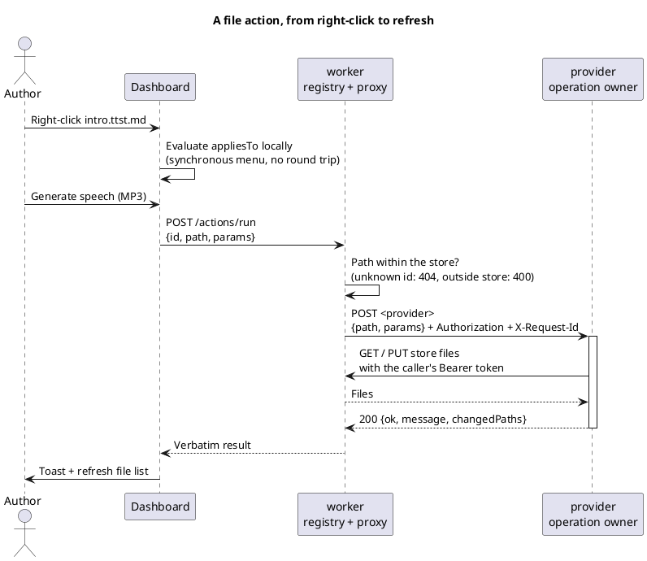
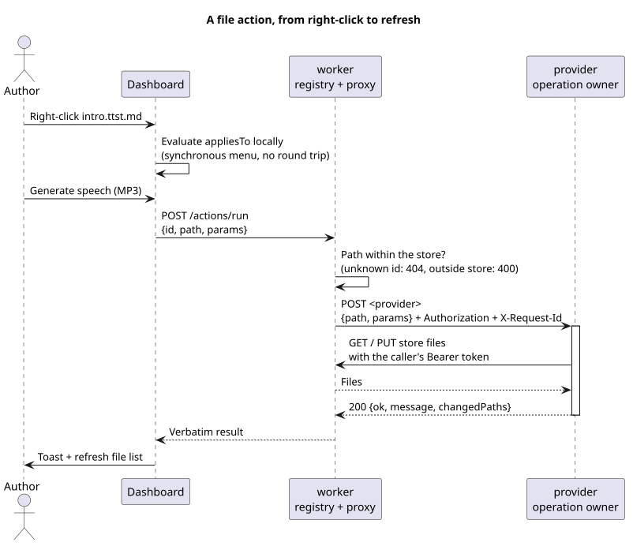

# File actions — the server extension point for file operations

A file action is an operation on a store file, offered in the browser's context menu and executed
by a provider service. Adding one requires a JSON manifest entry and a provider endpoint, with
no worker or Dashboard implementation change. This page explains the design for implementation
reviews; the [file-actions skill](/.agents/skills/file-actions/SKILL.md) provides the procedure,
and the [wire protocol](/operation/worker/PROTOCOL/actions-media-toolbox.md#file-actions) is normative.

## From right-click to refresh

<!-- kiao:diagram

-->

Three roles divide the responsibilities:

| Role | Knows | Does not know |
| --- | --- | --- |
| Dashboard | Action descriptors, applicability and requested parameters. | Provider routing; the provider URL never crosses the client wire. |
| worker | The manifest, applicability rule and provider destination. | The operation's business logic; `actions.go` names neither TTS nor units. |
| Provider | Its operation and store access through worker. | The menu, applicability rule and other actions. |

## The three contracts

**The deployment owns the manifest.** `KIAO_WORKER_ACTIONS_PATH` names a file declaring `id`,
`label`, `group`/`order`, `appliesTo`, `params` and an absolute `provider` URL for each action.
An unset or blank setting disables the feature: no new menu items, and every run has an unknown
ID. A malformed manifest aborts startup rather than silently omitting a menu entry. The catalogue
loads once at startup, so changing it requires a restart.

**Applicability has a deliberately small vocabulary.** `extensions` and `directory` are optional
and combined with AND. Extensions match the file **name**, case-insensitively, including compound
suffixes such as `.ttst.md` and `.mlunit.json`. `directory` requires or excludes a directory.
An empty rule matches everything. These checks need only `{ path, isDirectory }`, already held
by the client, so the menu stays synchronous. Go and TypeScript implement the same rule with
matching test tables; the wire protocol is authoritative.

**The provider receives a normal request and returns an operation result.**
`POST {path, params}` uses `{}` for absent parameters, never `null`, and returns
`200 {ok, message, changedPaths}`. worker forwards the caller's `Authorization` and
`X-Request-Id`. The provider reads and writes through worker on the caller's token, with no
service account; both services require the same realm role. The request ID correlates their traces.

An operation refusal returns `200 {ok: false, message}`, with a message the user can act on,
as `/git/*` does. An unreachable provider or a call exceeding the 10-minute budget returns `502`.
A provider's non-2xx response becomes an operation result containing its message and HTTP status.
worker bounds the path to the store **before** forwarding, preventing an unchecked path from
turning it into a confused deputy.

`changedPaths` names files or folders the action wrote. It permits targeted refreshes; the current
client uses only whether the list is nonempty to decide to refresh the file list. Include writes
left behind by a refused operation too.

## Why this shape

- **Providers own business logic.** An in-process Go registry would require worker to implement
  speech synthesis and redeploy for every new action. See [00006](./decisions/00006-file-actions-declared.md).
- **Both sides evaluate a bounded rule.** A round trip on every right-click would make the menu
  asynchronous. The small duplicated vocabulary costs less; see
  [00007](./decisions/00007-applicability-rule-both-sides.md).
- **Provider URLs stay server-side.** Routing is deployment topology. Clients name declared IDs,
  as they do for the toolbox catalogue.
- **Parameters stay simple:** `string`, `boolean` and `enum` fit one generic form. More complex
  interaction belongs to the provider rather than an expanded form language.
- **A path is enough to invoke an action.** Publication therefore resolves the content chain
  server-side instead of relying on browser state; see
  [00008](./decisions/00008-publish-resolved-server-side.md).

## Availability

Only actions declared in the deployment-supplied manifest exist. Base builds do not wire a
manifest by default: the image, installed executable, local startup and e2e environments therefore
have no file actions unless their assembly supplies one.

## When to use another extension point

- **The operation needs the current tab's state.** Generating a `.src.md` static version uses
  diagram renderers and real browser layout already loaded in the tab. Implementing four
  headless renderers behind approximate text metrics would duplicate that work. Use a plugin
  context-menu entry; see
  [00014](/exchange/dashboard/docs/solution-design/decisions/00014-static-version-in-browser.md).
- **The feature must exist without a manifest.** A file action would disappear in every assembly
  that supplies none; static-version generation also depended on this availability requirement.
- **The provider has no action endpoint yet.** A temporary direct client integration can bridge
  that gap, but is not the extension model to copy.

See the [Dashboard placement checklist](/exchange/dashboard/docs/solution-design/plugins-rules.md).

## Costs and limits

- **Adding an action:** implement a provider endpoint, add its manifest entry and wire that
  manifest into the intended assembly. worker and Dashboard need no rebuild or redeployment;
  restart worker to load the changed manifest.
- **One selection at a time.** The menu requires a single selected, pointed entry; no batch or
  multi-selection invocation.
- **Synchronous call without progress.** The client displays a loading toast and waits for the
  result, within worker's 10-minute provider budget.
- **Changing applicability or parameter types affects both sides.** Update worker, Dashboard
  and the normative protocol together.
- **An absent manifest is quiet.** There is no error and no action menu entry; check assembly
  configuration before promising the feature in an environment.

## Authoritative references

The [file action wire contract](/operation/worker/PROTOCOL/actions-media-toolbox.md#file-actions)
defines the API. [Server actions](/exchange/dashboard/docs/solution-design/server-actions.md)
describes Dashboard's integration. A provider implements one endpoint per action ID following
that contract; the [skill](/.agents/skills/file-actions/SKILL.md) gives the implementation procedure.
