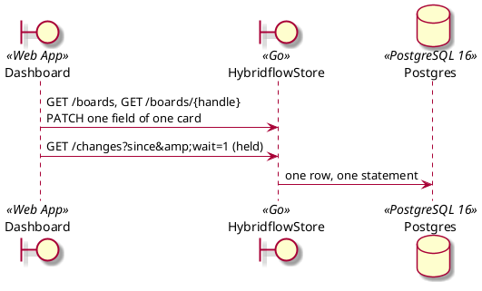
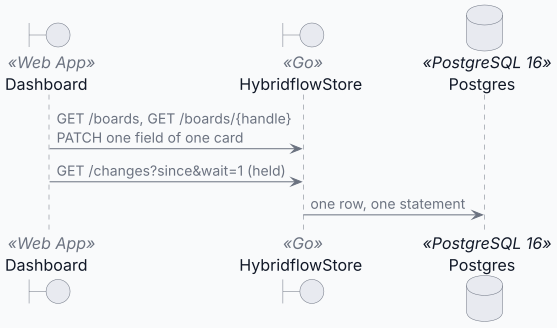
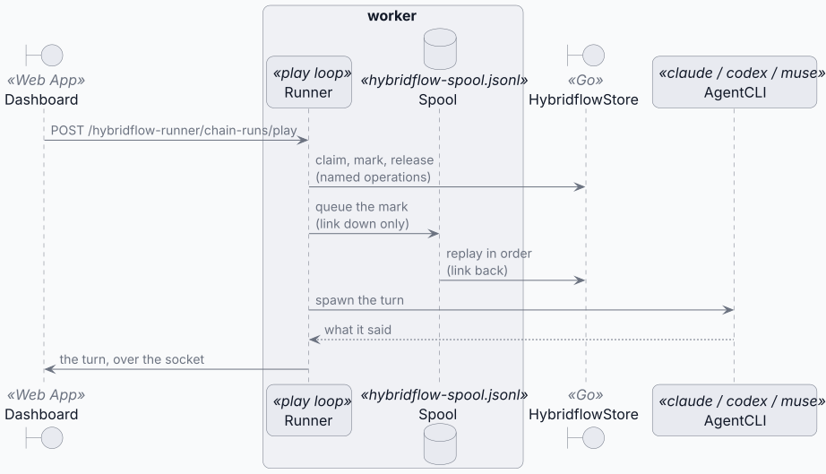

# Hybridflow — board and task interactions

This design spans [Dashboard](/exchange/dashboard/docs/solution-design/README.md),
[worker](/operation/worker/docs/solution-design/README.md) and
[hybridflow-store](/operation/hybridflow-store/docs/solution-design/README.md).

## The board on screen

Dashboard talks to the store directly. No worker in this path.

<!-- kiao:diagram

-->


**Writes are one card, one field.** Two runs marking two cards are two statements
that do not overlap, and a person renaming a third card while they do it is a write
neither of them can lose.

**Reads are told, not polled.** `GET /changes?wait=1` is held open until something
on the board changes, so a card a run just marked redraws in the time a notification
takes. A re-read is a **three-way merge**, not a replacement: the mark must arrive
without taking the keystrokes of whoever is typing in another card.

## A card being played

The play loop stays in the hybridflow-runner inside worker: it needs the process that spawns
the CLI and owns the turn socket, and that process cannot move. What it needs from the boards is
one narrow seam — a port of **named operations** (`internal/hybridflow-runner/boards/boards.go`):
claim, reopen, hold, finish, chat, drop, answered over HTTP by the hybridflow store.
One line of configuration names it: `KIAO_WORKER_HYBRIDFLOW_URL`.

<!-- kiao:diagram
```plantuml
@startuml
skin rose

boundary Dashboard <<Web App>>
box "worker"
participant Runner <<play loop>>
database Spool <<hybridflow-spool.jsonl>>
end box
boundary HybridflowStore <<Go>>
participant AgentCLI <<claude / codex / muse>>

Dashboard -> Runner : POST /hybridflow-runner/chain-runs/play
Runner -> HybridflowStore : claim, mark, release\n(named operations)
Runner -> Spool : queue the mark\n(link down only)
Spool -> HybridflowStore : replay in order\n(link back)
Runner -> AgentCLI : spawn the turn
AgentCLI --&gt; Runner : what it said
Runner -> Dashboard : the turn, over the socket
@enduml
```
-->


**A run's credential.** A run lasts hours; the token of the person who clicked Play
lasts minutes. So the runner presents a **service token** the deployment configures
on both sides — the same shape as the credentials it already issues to its own turns —
and names the run's owner in `X-Kiao-Actor`. The service records that as the actor, so
a card a run moved still says whose run it was. A caller bearing a JWT may not use the
header: it is who its token says it is, and the right to speak for somebody is the
service token's alone. The variables on both sides are listed in
[the configuration table](/operation/hybridflow-store/docs/solution-design/deployment.md).

### When the link is down: the spool

**The queue lives in the runner**, not in the store: a JSONL file,
`hybridflow-spool.jsonl`, under the worker state directory, mirrored in memory
with a cache of the last board seen (`internal/hybridflow-runner/boards/boards_spool.go`).

**Live first, queue second.** Every mark is tried against the store as usual, so a
claim refused (409) or a card gone (404) still reaches the runner at once. Only a mark
the store cannot be asked about — link down, timeout, 5xx — is appended to the spool,
answered **optimistically** from the cached board, and replayed **in order** by a
background sender once the link is back. Reads fall back to that same cache, so a chain
walks on across the outage; what a run cannot do blind is **start** a board it never
read, which would be inventing the card. A refusal at replay time (409, 404, 400) drops
the record — no retry can fix it — and a crash between queueing and sending replays it
after the restart, which is safe because every operation is idempotent at the store.

**Usage reports queue first.** A turn's bill changes no card, so there is no refusal the
run must hear before its next turn: the runner files it on the spool and moves on, and
the sender the filing wakes posts it at once — realtime, without the play loop ever
touching the network for it.

**Why a spool file and not a broker.** One consumer, a few marks per card, and the
claim must be answered live *before* the turn starts — always queueing would run turns
on cards another run holds. A broker would add a deployment, ordering and exactly-once
semantics for a problem a crash-safe append file solves in one place, beside the runner
that is its only writer and only reader.
