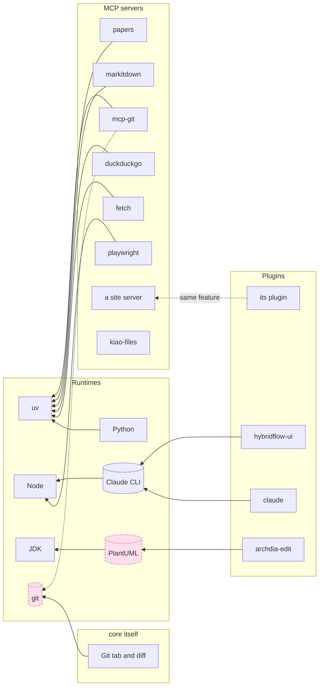

---
document:
  status: DRAFT
  role: PRIMARY_SOURCE
---

# What a kiao build delivers — proposed solution design for one catalogue

A kiao build assembles Dashboard plugins, MCP servers and runtimes. This proposal covers their
catalogue and dependencies. [Agent package delivery](../../agentic-resources.md)

## 1. What each kind is today

| | Declared in | Carried by | Switched off | Dependencies | Health |
|---|---|---|---|---|---|
| **Plugin** (17 shipped, plus dropped-in ones) | `src/plugins/catalogue.json`, one line; a dropped-in one by its `package.json` in its own project directory | compiled into the SPA; `VITE_PLUGIN_PATHS` decides which dropped-in ones | per **store** (`dashboard.json`), needs a reload | — | — |
| **MCP server** (10) | `internal/toolbox/catalog/pub.json`, `kind: mcp` (+ deployment-staged `*.json` beside it) | `pub.json` embedded, the rest staged per deployment; installed on demand through five channels | per **machine** (the toolbox ledger's `enabled`) | `requires` → runtimes, `requiresEnv` → tokens | handshake probe: tools, bytes, error |
| **Runtime** (6) | `internal/toolbox/catalog/pub.json`, `kind: runtime` | installed on demand: `uv-bootstrap`, `node-tarball`, `temurin`, `uv-python`, `system`, `claude-release`, `codex-release` | install / uninstall only | `requires` (python → uv) | version probe |

## 2. Three things that are wrong

### 2.1 The dependency graph stops at the MCP corner

`requires` exists in exactly one file and points in exactly one direction: from an MCP server to a
runtime. Three real dependencies of the *other* kinds live outside that closure, and each is
provisioned by hand, differently, in every build:

**PlantUML** is needed by `archdia-edit` and by every markdown render that carries a diagram
fence. It arrives four ways — a `plantuml/plantuml-server:jetty` container in a server deployment, a server
inside the `kiao` image behind nginx, and a pinned, SHA-256-verified jar fetched by
`bin/install-kiao-executable.sh` into `dist/cache/plantuml` with its own `--skip-plantuml` and
`--plantuml-jar` flags. The fourth way is *not at all*: neither `bin/local-start-kiao.sh` nor the
e2e stack sets `VITE_PLANTUML_SERVER_URL`, so on a developer's own machine a diagram renders as
nothing and no part of the system says why.

**git** is what `internal/files/git/git.go` shells out to, and the Git tool bar tab and the
side-by-side diff are built on it. It has nowhere at all to be declared, because it is not a
plugin's dependency but *core's own*: the Git tab is one of the two tabs core contributes
itself (`App.tsx`), present in every assembly, switchable off nowhere. Worse: `git` in the
catalogue is the *MCP server* `mcp-server-git`, so the one row wearing that name is the one thing
that is not the dependency — switching it off implies "no git", which is false, and switching it
on does nothing for the tab.

**The harness CLIs** are needed by Hybridflow to run agent turns.

**This part is done.** `claude-cli`, `codex-cli` and `muse-cli` are catalogue runtimes on three
channels of their own, `claude-release`, `codex-release` and `muse-release`, which do for a release
binary what `temurin` does for a JDK: resolve the current version, read the publisher's checksum,
verify, unpack. The build script holds a list of ids — `--preinstall
claude-cli,codex-cli,muse-cli` — and `worker toolbox preinstall` does the fetching, into a
prefix the image copies whole. `--skip-claude`, `--claude-version`, the `dist/cache/claude`
directory and the sixty lines that used them are gone, and the Codex and Muse twins they would have
spawned were never written.

So the catalogue that already knows how to fetch a checksummed Temurin JDK still does not know that
a jar it could fetch by the same means is fetched instead by a block of bash with its own pin, its
own digest, its own cache directory and its own skip flag — `bin/install-kiao-executable.sh`, for
PlantUML. That is the same shape, one node further along, and the mechanism it needs now exists.

### 2.2 Nothing can say why a resource does not work

The toolbox ledger already keeps the fact that matters, and keeps it for MCP servers alone: not
*is it installed* — a package manager reporting success proves files were written, not that
anything runs — but *did it answer*. A plugin switched on with its dependency missing is drawn
exactly like one that works. Harness availability also depends on the CLI being reachable.

### 2.3 Assembly selection

Plugin projects are selected when the Dashboard bundle is built. A site-specific MCP server
follows the same assembly selection when the corresponding package is staged.

**Since this was written**, the pair ships aligned — but by a split, not by an `audience` field.
The site-specific server moved to its own package, built self-contained and overlaid into the
bundle's `dist/` only by the deployments that carry its plugin; the base bundle stages its own
servers and names the overlaid one only where it was overlaid. See step 3 below.

**And the catalogue half followed.** The toolbox no longer reads one embedded document: it merges
`pub.json` with every `*.json` the deployment staged beside it, and the site-specific components
moved to such a file, which only those assemblies stage. The shared panel lists no such row;
the site's lists them.

## 3. The target: one manifest and one graph

Promote the toolbox catalogue from *what the MCP panel installs* to **the manifest of everything a
build delivers**. The entry shape is the one already there — `id`, `kind`, `title`, `role`,
`requires`, and a `recipes` map keyed by platform — with three changes:

- Add `plugin` entries with the `assembly` recipe channel.
- Allow dependencies across kinds. `archdia-edit` requires PlantUML, which requires a JDK.
  The Git tab depends on Git. A `core` entry can declare resources shared by all assemblies.
- **`audience: "everyone" | "owner"`** replaces the directory-scan-plus-which-script-calls-it
  rule, for the assembly's resources.

The dashed nodes are the ones that do not exist in any catalogue. `cli` was the third and is now
two rows — `claude-cli` and `codex-cli` — so the edges into it are edges the system can draw;
`git` and `plantuml` are still edges nothing can. `mcp-git` is the renamed MCP
entry: its `id` is prefixed so that `git` can name the binary, while `server: "git"` — what the
CLI sees — stays untouched.

### What falls out of it

1. **Two bash fetches become two recipes.** The PlantUML jar and the Claude CLI binary are
   checksummed downloads of a pinned version, which is precisely what the `temurin` and
   `node-tarball` channels are. `install-kiao-executable.sh` and `build-kiao-image.sh` stop
   holding a pin, a digest, a cache path and a skip flag each, and hold instead a list of ids to
   preinstall. `--skip-plantuml` and `--skip-claude` become the same gesture: leave it off the
   list.
2. **The panel gains a reason, not just a fourth section.** The closure already computed to turn
   *install fetch* into *install uv and fetch, is that alright?* is the same closure that answers
   "archdia-edit is on, but PlantUML is not reachable". The ledger's third fact generalises from the MCP handshake to a probe per kind — a
   binary on PATH answering `--version`, an HTTP endpoint answering a render.
3. **A site-specific server stops being everybody's.** One `audience` field, read by every build site, settles
   what three mechanisms currently disagree about. **Done, without the field:** the server moved
   to its own package and is overlaid into the staged bundle by the site's own deploys; the base bundle
   and the shared image no longer carry it, and the seed default no longer names it. The toolbox
   catalogue keeps its row, which reads unavailable without the overlay.
4. **No build site holds a list.** A script deriving the dropped-in projects from the directory
   already exists because the list was written by hand once and every build site added afterwards
   was born without it — the server deploy and the installed executable each shipped an assembly
   missing the dropped-in projects, and their files simply opened as code. That fix is right and
   it should cover the assembly's resources.

### Where the manifest lives, and why it has to move

Vite reads the plugin catalogue at bundle build time. The toolbox uses its catalogue to install
runtimes and MCP servers on demand.

So the file moves to a neutral module — `reference/kiao-catalog/catalog.json` — with **one source
and three readers**: `//go:embed` into the worker exactly as today, `jq` from the build
scripts, and a Vite plugin at bundle time. This is a move rather than an invention: plugins
already work this way. `src/plugins/catalogue.json` is *already* a build input read by both the
build and the loader; it simply has a file of its own.

The toolbox ledger records ownership of installed components. The store configuration selects
Dashboard plugins from the bundle.

## 4. Migration, in the order that pays

| Step | Change | Risk | What it buys immediately |
|---|---|---|---|
| 1 | Rename `git` → `mcp-git`; add `git`, `plantuml`, `claude-cli` as runtimes with a **detect-only** recipe (present on PATH / reachable, never installed) | none — additive | three honest rows; the panel can finally answer "why is my diagram blank" |
| 1a | **Done.** `claude-cli` and `codex-cli` are runtimes — with real recipes rather than detect-only, because step 4 came with them | none — additive | two honest rows, and the panel can install either CLI |
| 2 | Add `plugin` entries to the manifest and the cross-kind `requires` edges. Files stay where they are; `src/plugins/catalogue.json` becomes a generated view | low | the graph above becomes real; unmet dependencies become reportable |
| 3 | Move the manifest to `reference/kiao-catalog/`; Vite and the build scripts read it. `dashboard-plugin-projects.sh` becomes a filter on `audience` | medium — touches four build sites | one list; a new build site cannot be born incomplete |
| 4 | Fold the PlantUML jar and Claude CLI fetches into checksummed recipes | medium | ~150 lines of bash and two ad-hoc caches deleted |
| 4a | **Done, for the CLIs.** `claude-release` and `codex-release` channels; `bin/build-kiao-image.sh` holds `--preinstall claude-cli[,codex-cli]` and calls `worker toolbox preinstall`. PlantUML is untouched | low, as it turned out — the prefix is the cache and the image copies it whole | ~60 lines of bash, one ad-hoc cache and two flags deleted; the second CLI cost a word rather than a block |
| 5 | Probe per kind; the panel shows the unmet-dependency reason on every row | low | a health report for each resource |

**Done, for one row of step 1.** `graphviz` is a catalogue runtime on a `detect` channel: the panel
reports whether `dot` is on the machine and names the system's own install command when it is not,
and never installs anything. It is the row that answers "why is my diagram blank". The `plantuml`
jar as a recipe, and the `git` rename, are still to come.

Steps 1 and 2 are additive and reversible and can be taken in any order against any other work.
Step 3 is the one that touches the build scripts and is the point of no return. Steps 4 and 5 are
what make the first three worth having, and neither is urgent.

What taking 1a and 4a first actually showed: **step 3 was not the prerequisite it looks like.** The
build script reads the manifest through `worker toolbox preinstall` rather than through `jq`,
so the one source stayed embedded in the Go binary and the build site still holds no pin. Moving the
file to `reference/kiao-catalog/` remains the right step for the *plugins*, which Vite has to read
at bundle time and a subcommand cannot serve — but nothing about a runtime or an MCP server needs
it. Step 3 is one reader's problem, not three.

## 5. What this does not solve

**A harness CLI installed by the panel is not on the harness half's PATH — except in the image.** The
two halves reach a binary by different routes: the toolbox looks in its prefix first and PATH after,
while the hybridflow-runner half spawns a bare `claude` or `codex` and lets the process PATH resolve it. In the
image those agree, because the prefix's `bin` is on `PATH` in the Dockerfile; on a machine whose
prefix is `~/.local/share/kiao/toolbox` they do not, so a CLI installed from the panel is a row
that reads `installed` and a harness tab that still has nothing to spawn. The fix is the one step 5
is already about — a lookup the hybridflow-runner half asks the toolbox rather than PATH — and it is
deliberately not a PATH the service rewrites for itself at startup, which would change what every
tool a turn runs resolves to.

**Resolved for the native shapes, the image's way rather than step 5's.** The launcher hands its
worker child a PATH with the prefix's `bin` ahead of it (`pathWithToolbox`,
`bin/kiao-launcher/service.go`), and `bin/local-start-kiao.sh` exports the same — which is what the
Dockerfile does one level down, now done by whatever starts the service rather than only by the
image. The service still does not rewrite its own PATH: it is given one, by the half that knows
where the panel was pointed, which is the same half that sets `KIAO_WORKER_TOOLBOX_PATH` two
lines above. **The consequence the paragraph above names is accepted, not avoided:** a runtime the
panel installed now shadows the machine's own for every tool a turn runs under `kiao`, exactly
as it has always done in the image. Step 5's lookup remains the finer answer — it would offer the
harness without touching what a turn resolves — and is still worth doing; this is what makes a harness
installed from the panel work on a laptop today. A server unit is not covered: it has no `PATH=` line
and its systemd default does not even carry `~/.local/bin`, so a harness installed from the panel
there still needs one written into `kiao-worker.service`.

**Since this was written**, the image is the runtime that depends on it: it now ships *no* harness CLI
and expects both to be installed from the panel, which works there and only there. Three things came
with that. Whether a harness is offered is read per request rather than fixed at startup — the
deployment's veto, the CLI on PATH, and the row's switch — so an install shows up on the next page
load. The row's `registered` field gained a second meaning, *offered in the harness tab*, which is the
control for a CLI the panel did not install and therefore cannot remove. Audience is binary here (`everyone` / `owner`) because that is the only distinction the builds
actually make today. If a third party ever gets a build, it becomes a set rather than a flag, and
the manifest is the right place for that to happen — but declaring it now would be inventing a
requirement.

The manifest describes availability, dependencies and health. Vite assembles plugins and toolbox
recipes install components.
