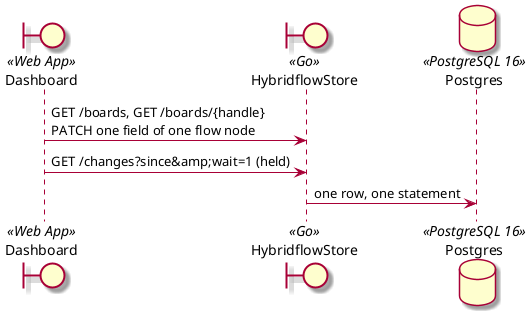
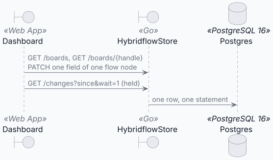
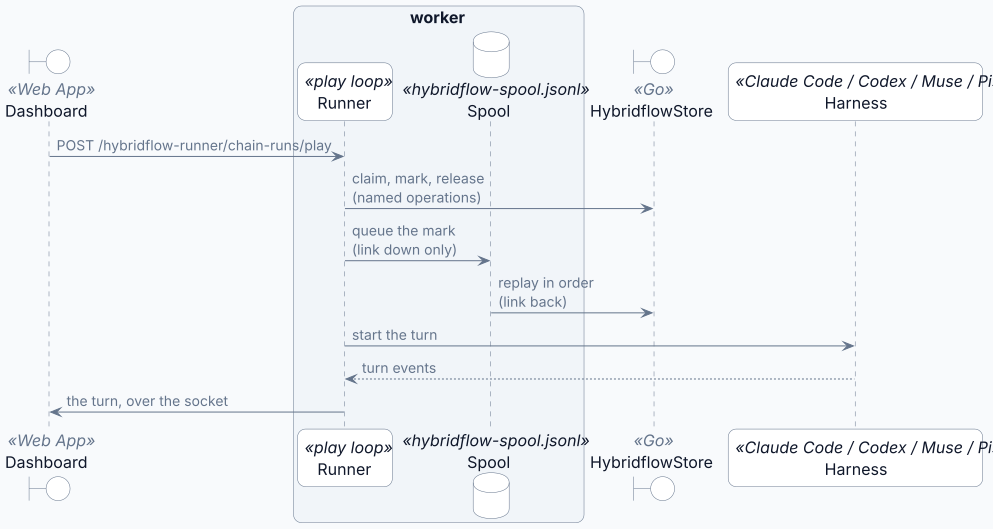

---
document:
  status: DRAFT
  role: PRIMARY_SOURCE
---

# Hybridflow — board and flow node interactions

This design spans [Dashboard](/exchange/dashboard/docs/solution-design/README.md),
[worker](/operation/worker/docs/solution-design/README.md) and
[hybridflow-store](/operation/hybridflow-store/docs/solution-design/README.md).

## The board on screen

Dashboard talks to the store directly. No worker in this path.

<!-- kiao:diagram

-->


**A patch names a flow node and the fields to change.** Runs updating different nodes can
proceed independently while a person edits the board.

`GET /changes?wait=1` stays open until the board changes. Dashboard rereads and performs a
**three-way merge** so the updated status appears on the card while local edits survive.

## A flow node being played

The play loop stays in the hybridflow-runner inside worker, which launches the harness and
owns the turn socket. What the play loop needs from the boards is
one narrow seam — a port of **named operations** (`internal/hybridflow-runner/boards/boards.go`):
claim, reopen, hold, finish, chat, drop, answered over HTTP by the hybridflow store.
One line of configuration names it: `KIAO_WORKER_HYBRIDFLOW_URL`.

<!-- kiao:diagram
```plantuml
@startuml
skin rose

boundary Dashboard <<Web App>>
box "worker"
participant Runner <<play loop>>
database Spool <<hybridflow-spool.jsonl>>
end box
boundary HybridflowStore <<Go>>
participant Harness <<Claude Code / Codex / Muse / Pi>>

Dashboard -> Runner : POST /hybridflow-runner/chain-runs/play
Runner -> HybridflowStore : claim, mark, release\n(named operations)
Runner -> Spool : queue the mark\n(link down only)
Spool -> HybridflowStore : replay in order\n(link back)
Runner -> Harness : start the turn
Harness --&gt; Runner : turn events
Runner -> Dashboard : the turn, over the socket
@enduml
```
-->


**A run's credential.** A run lasts hours; the token of the person who clicked Play
lasts minutes. So the runner presents a **service token** the deployment configures
on both sides — the same shape as the credentials it already issues to its own turns —
and names the run's owner in `X-Kiao-Actor`. The service attributes flow node changes to
that owner. A caller bearing a JWT may not use the
header: it is who its token says it is, and the right to speak for somebody is the
service token's alone. The variables on both sides are listed in
[the configuration table](/operation/hybridflow-store/docs/solution-design/deployment.md).

### When the link is down: the spool

**The queue lives in the runner**, not in the store: a JSONL file,
`hybridflow-spool.jsonl`, under the worker state directory, mirrored in memory
with a cache of the last board seen (`internal/hybridflow-runner/boards/boards_spool.go`).

**Live first, queue second.** Every mark is tried against the store as usual, so a
claim refused (409) or a flow node gone (404) still reaches the runner at once. Only a mark
the store cannot be asked about — link down, timeout, 5xx — is appended to the spool,
answered **optimistically** from the cached board, and replayed **in order** by a
background sender once the link is back. Reads fall back to that same cache, so a chain
walks on across the outage; what a run cannot do blind is **start** a board it never
read, which would be inventing the flow node.

**A disk-backed enqueue succeeds only after persistence.** The candidate queue is written
to a sibling temporary file, synced, closed and atomically renamed over the spool. Directory
creation, temporary-file creation, encoding, writing, syncing, closing and rename errors
reach the calling operation (`ReportUsage`, `SettleRun` or a flow node mark). On failure the
previous file, in-memory queue and optimistic board cache are retained; the new record is
not sent, and the caller can retry. A process without a configured spool path has only
an in-memory queue and no restart guarantee.

The sender removes a delivered record, or a terminal refusal (409, 404, 400), only after
persisting the reduced queue. If that save fails, it logs the error, retains the head and
stops the pass. A subsequent pass or process restart replays the retained records in order.
A crash during transmission has the same outcome. Delivery is at least once: usage reports
keep their persisted report id, so the store's idempotent insertion counts each report once.
An absent report id is generated before enqueueing. Cached optimistic marks remain visible
while earlier marks are acknowledged and later marks for that board remain queued.

**Usage reports queue first.** A turn's bill changes no flow node, so there is no refusal the
run must hear before its next turn: the runner persists it on the spool, then wakes the
sender to post it without a network call on the play loop. Turn settlement logs a filing
error if the spool cannot be saved; it does not claim that the bill was queued.

**Why a spool file and not a broker.** One consumer, a few marks per flow node, and the
claim must be answered live *before* the turn starts — always queueing would run turns
on flow nodes another run holds. A broker would add a deployment, ordering and exactly-once
semantics for a problem a crash-safe append file solves in one place, beside the runner
that is its only writer and only reader.
