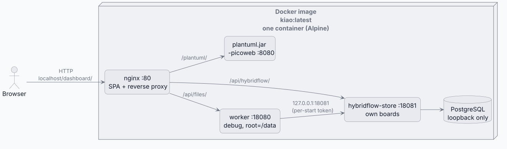
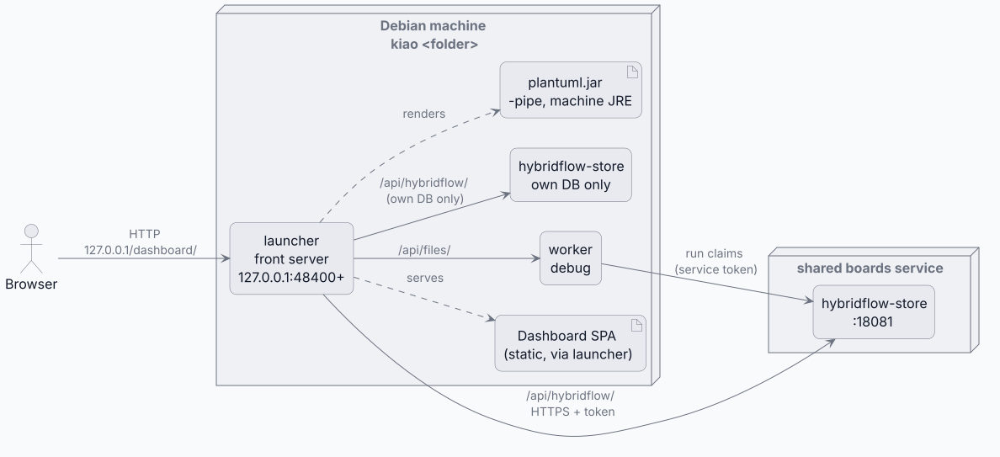

# Deployment solution design

Answers the question: which deployment target hosts which process, and how?

kiao — DCMS (the file/content feature of Dashboard + the files service in worker) and
hybridflow (the workflow/agent UI + the hybridflow-runner in worker + the store) in one
deliverable — ships to **two targets**, both built from the shared
stage in [`bin/build-all.sh`](/bin/build-all.sh) ([`bin/README.md`](/bin/README.md)): the image
and the executable. Each end script rebuilds the Dashboard bundle itself — its
`VITE_*` values are baked in at build time and differ per target. One diagram per
target below.

### Image

<!-- kiao:diagram
```plantuml
@startuml
skinparam componentStyle rectangle
skinparam defaultTextAlignment center
left to right direction

actor "Browser" as Browser

node "Docker image\nkiao:latest\none container (Alpine)" as Image {
  component "nginx :80\nSPA + reverse proxy" as Nginx
  component "worker :18080\ndebug, root=/data" as Files
  component "hybridflow-store :18081\nown boards" as Hybridflow
  database "PostgreSQL\nloopback only" as DB
  component "plantuml.jar\n-picoweb :8080" as Plant
}

Browser --&gt; Nginx : HTTP\nlocalhost/dashboard/
Nginx --&gt; Files : /api/files/
Nginx --&gt; Hybridflow : /api/hybridflow/
Nginx --&gt; Plant : /plantuml/
Hybridflow --&gt; DB
Files --&gt; Hybridflow : 127.0.0.1:18081\n(per-start token)
@enduml
```
-->


One Alpine container ([`Dockerfile`](/bin/docker/kiao-image/Dockerfile),
[`docker-entrypoint.sh`](/bin/docker/kiao-image/docker-entrypoint.sh),
[`kiao.conf.template`](/bin/docker/kiao-image/kiao.conf.template)): nginx on `:80` serving the
SPA and proxying the same `/api/*` and `/plantuml/` routes, the two Go binaries, an embedded
PostgreSQL on loopback with no password, and `plantuml.jar` on a trimmed runtime in `-picoweb`
mode. Auth is `debug` throughout. Its boards are its own: the entrypoint refuses
`KIAO_WORKER_HYBRIDFLOW_URL` (it would split one board across two services) and mints the
service token per start. `KIAO_HYBRIDFLOW_STORE_DATABASE_URL` may point its own service at
another PostgreSQL instead. See [kiao-docker.md](/docs/user-manual/deep-dive/kiao-docker.md).

### Executable

<!-- kiao:diagram
```plantuml
@startuml
skinparam componentStyle rectangle
skinparam defaultTextAlignment center
left to right direction

actor "Browser" as Browser

node "Debian machine\nkiao <folder>" as Machine {
  component "launcher\nfront server\n127.0.0.1:48400+" as Launcher
  artifact "Dashboard SPA\n(static, via launcher)" as SPA
  component "worker\ndebug" as Files
  component "hybridflow-store\nown DB only" as Hybridflow
  artifact "plantuml.jar\n-pipe, machine JRE" as Plant
}

node "shared boards service" as Boards {
  component "hybridflow-store\n:18081" as RemoteBoards
}

Browser --&gt; Launcher : HTTP\n127.0.0.1/dashboard/
Launcher --&gt; Files : /api/files/
Launcher --&gt; Hybridflow : /api/hybridflow/\n(own DB only)
Launcher --&gt; RemoteBoards : /api/hybridflow/\nHTTPS + token
Files --&gt; RemoteBoards : run claims\n(service token)
Launcher ..> SPA : serves
Launcher ..> Plant : renders
@enduml
```
-->


`kiao <folder>` ([`bin/install-kiao-executable.sh`](/bin/install-kiao-executable.sh), parts
under `~/.local/share/kiao`): the Go launcher is the front server — what nginx is in the
image ([`web.go`](/bin/kiao-launcher/web.go)) — on the next free ports from 48400, loopback-bound,
one instance per folder. The SPA is built with `VITE_NO_SECURITY` and no service worker; the
service runs in `debug` auth mode. Boards are a shared service's over HTTPS when configured (the
launcher adds the service token and `X-Kiao-Actor`, which never reach the browser); with
`KIAO_HYBRIDFLOW_STORE_DATABASE_URL` it starts a hybridflow-store of its own instead, and
setting both is refused. Diagrams render locally through the shipped `plantuml.jar` in `-pipe`
mode — no third port. See [kiao-executable.md](/docs/user-manual/deep-dive/kiao-executable.md).
