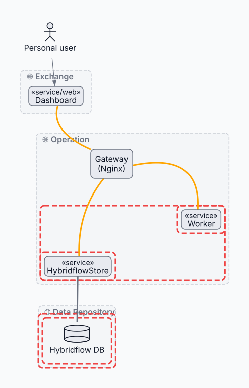

# Container flows

<!-- kiao:diagram
````archdia
---
type: PLANTUML
---
```plantuml
@startuml
skinparam componentStyle rectangle
skinparam defaultTextAlignment center
left to right direction

actor "Personal user" as PersonalUser

package "🌐 Operation" {
    node "Gateway\n(Nginx)" as GW

    rectangle "HybridflowStore" <<service>> as MSHybridflowStore
    rectangle Worker <<service>>
}

package "🌐 Exchange" {

    component "Dashboard" <<service/web>> as Dashboard

    Dashboard -[thickness=3,#orange]- GW
}

PersonalUser --&gt; Dashboard

package "🌐 Data Repository" {

    database "Hybridflow DB"

    MSHybridflowStore -[thickness=3]- "Hybridflow DB"
}

GW -[thickness=3,#orange]- MSHybridflowStore
GW -[thickness=3,#orange]- Worker
@enduml

@startuml
package "Operation Services" <<trust>> {
    rectangle "HybridflowStore" <<service>> as MSHybridflowStore
    rectangle Worker <<service>>
}

package "File Storage" <<trust>> {
    rectangle Worker <<service>>
}

package "HybridflowStore Area" <<trust>> {
    rectangle "HybridflowStore" <<service>> as MSHybridflowStore
}

package "DB Area" <<trust>> {
  package "Unit Data" <<trust>> {
      database "Hybridflow DB"
  }
}
@enduml
```
===
---
type: LAYOUT
---
```json
{
  "size": {
    "width": 516,
    "height": 770
  },
  "positions": {
    "PersonalUser": {
      "x": 40,
      "y": 40
    },
    "GW": {
      "x": 180,
      "y": 296
    },
    "MSHybridflowStore": {
      "x": 88,
      "y": 509
    },
    "Worker": {
      "x": 360,
      "y": 416
    },
    "Dashboard": {
      "x": 57,
      "y": 171
    },
    "Hybridflow DB": {
      "x": 92,
      "y": 639
    }
  },
  "bends": {
    "Dashboard->GW": [
      -39,
      4
    ],
    "GW->Worker": [
      48,
      -47
    ],
    "GW->MSHybridflowStore": [
      -19,
      -6
    ]
  }
}
```
````
-->

