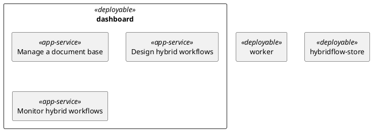
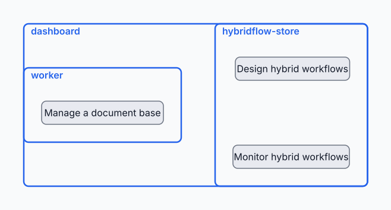
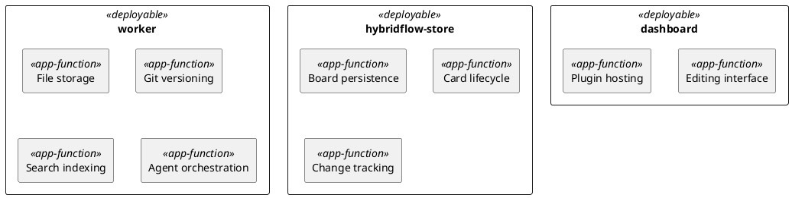
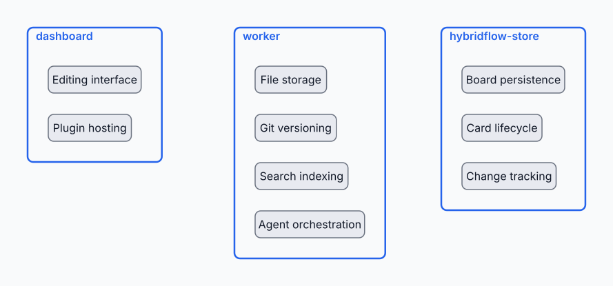

# Services and functions

<!--
  GENERATION RULES

  Template: title, two questions, one sentence per heading, two diagrams. Add no visible prose.
  English throughout. Altitude: a global view, not a catalogue — merge, drop the anecdotal, four
  items per container at most, and name things so a reader who has not read the code understands.

  A SERVICE is what a user gets, end to end: business reality, not applicative, named with a verb.
  A container that is a means and not an end of its own renders none.

  A FUNCTION is what a container does inside itself, named with a noun phrase.

  The containers are those of docs/solution-design/containers.md.
-->

This document answers two questions:

1. Which container provides which (external) service?
2. Which container performs which (internal) function?

## 1. Container services

Which container provides which service? This diagram shows the external services the system
renders, within its deployable units (C4 containers).

<!--
  Some services no single container can render. Such a service is declared inside each container
  that takes part in it — the same alias twice is one box with two parents, and the perimeters
  cross over it. That crossing is the point of this diagram: it says the two units cannot be
  separated without losing the service.

  Layout is placed by hand, never left to ELK, and only leaves carry a position: a box is computed
  from its children, so it is as wide as its widest leaf and no container ever gets an entry.
  Worker crosses the dashboard's left edge; hybridflow-store holds the right side over its full
  height, both its leaves being the dashboard's own extremes. After any move, check that no box
  closes over a leaf that is not its own and that boxes sharing no leaf do not overlap.
-->

<!-- kiao:diagram
````archdia
---
id: services
type: PLANTUML
name: Services
---

===
---
type: LAYOUT
---
```json
{
  "size": {
    "width": 678,
    "height": 340
  },
  "positions": {
    "DesignWorkflows": {
      "x": 396,
      "y": 96
    },
    "MonitorWorkflows": {
      "x": 392,
      "y": 244
    },
    "ManageDocuments": {
      "x": 70,
      "y": 170
    }
  }
}
```
````
-->


## 2. Container functions

Which container performs which function? This diagram shows the internal functions of the system,
within its deployable units (C4 containers).

<!--
  What belongs here: what the container does for itself. A function is not a service seen closer —
  the same container appears in both diagrams saying different things.

  Same discipline as diagram 1, with <<app-function>> leaves and nothing shared, so the boxes
  stand apart: three columns at x = 40, 340, 640, leaves at column + 30, 70 below one another
  and 56 below their box top. Aliases are the label in PascalCase, unique per diagram — the two
  diagrams are separate archdia blocks and share nothing.
-->

<!-- kiao:diagram
````archdia
---
id: functions
type: PLANTUML
name: Functions
---

===
---
type: LAYOUT
---
```json
{
  "size": { "width": 920, "height": 400 },
  "positions": {
    "EditingInterface": { "x": 70, "y": 96 },
    "PluginHosting": { "x": 70, "y": 166 },
    "FileStorage": { "x": 370, "y": 96 },
    "GitVersioning": { "x": 370, "y": 166 },
    "SearchIndexing": { "x": 370, "y": 236 },
    "AgentOrchestration": { "x": 370, "y": 306 },
    "BoardPersistence": { "x": 670, "y": 96 },
    "CardLifecycle": { "x": 670, "y": 166 },
    "ChangeTracking": { "x": 670, "y": 236 }
  }
}
```
````
-->

