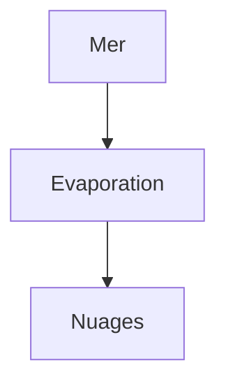
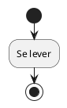
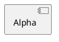

# Centered diagrams

A narrow mermaid diagram:



A narrow plantuml diagram:



A narrow graph diagram:

```graph
{
  "size": { "width": 300, "height": 200 },
  "nodes": [
    { "id": "alpha", "title": "Alpha", "x": 40, "y": 60 },
    { "id": "beta", "title": "Beta", "x": 180, "y": 120 }
  ],
  "edges": [ { "from": "alpha", "to": "beta" } ]
}
```

A narrow svg diagram:

```svg
<svg xmlns="http://www.w3.org/2000/svg" width="120" height="80"><rect width="120" height="80" fill="#4a90d9"/></svg>
```

A narrow archdia diagram:

````archdia
---
type: PLANTUML
---

===
---
type: LAYOUT
---
```json
{
  "size": { "width": 300, "height": 200 },
  "positions": {
    "Alpha": { "x": 40, "y": 40 }
  }
}
```
````

A prose paragraph after the diagrams.
