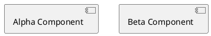
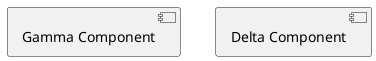

# Diagram in markdown

A prose paragraph before the diagram.

````archdia
---
type: PLANTUML
---

===
---
type: LAYOUT
---
```json
{
  "size": {
    "width": 640,
    "height": 480
  },
  "positions": {
    "Alpha Component": {
      "x": 40,
      "y": 40
    },
    "Beta Component": {
      "x": 300,
      "y": 40
    }
  }
}
```
````

A prose paragraph between the diagrams.

````archdia
---
type: PLANTUML
---

===
---
type: LAYOUT
---
```json
{
  "size": {
    "width": 640,
    "height": 480
  },
  "positions": {
    "Gamma Component": {
      "x": 40,
      "y": 40
    },
    "Delta Component": {
      "x": 300,
      "y": 40
    }
  }
}
```
````

A prose paragraph after the diagram.
