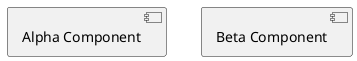

# Preview zoom probe line=1

A prose paragraph before the diagram. line=3

````archdia
---
type: PLANTUML
---

===
---
type: LAYOUT
---
```json
{
  "size": {
    "width": 640,
    "height": 480
  },
  "positions": {
    "Alpha Component": {
      "x": 40,
      "y": 40
    },
    "Beta Component": {
      "x": 300,
      "y": 40
    }
  }
}
```
````

A prose paragraph after the diagram. line=39

## Section 1 line=41

Paragraph text for section 1 line=43

More prose in section 1 to give the block some height line=45

## Section 2 line=47

Paragraph text for section 2 line=49

More prose in section 2 to give the block some height line=51

## Section 3 line=53

Paragraph text for section 3 line=55

More prose in section 3 to give the block some height line=57

## Section 4 line=59

Paragraph text for section 4 line=61

More prose in section 4 to give the block some height line=63

## Section 5 line=65

Paragraph text for section 5 line=67

More prose in section 5 to give the block some height line=69

## Section 6 line=71

Paragraph text for section 6 line=73

More prose in section 6 to give the block some height line=75

## Section 7 line=77

Paragraph text for section 7 line=79

More prose in section 7 to give the block some height line=81

## Section 8 line=83

Paragraph text for section 8 line=85

More prose in section 8 to give the block some height line=87

## Section 9 line=89

Paragraph text for section 9 line=91

More prose in section 9 to give the block some height line=93

## Section 10 line=95

Paragraph text for section 10 line=97

More prose in section 10 to give the block some height line=99

## Section 11 line=101

Paragraph text for section 11 line=103

More prose in section 11 to give the block some height line=105

## Section 12 line=107

Paragraph text for section 12 line=109

More prose in section 12 to give the block some height line=111

## Section 13 line=113

Paragraph text for section 13 line=115

More prose in section 13 to give the block some height line=117

## Section 14 line=119

Paragraph text for section 14 line=121

More prose in section 14 to give the block some height line=123

## Section 15 line=125

Paragraph text for section 15 line=127

More prose in section 15 to give the block some height line=129

## Section 16 line=131

Paragraph text for section 16 line=133

More prose in section 16 to give the block some height line=135

## Section 17 line=137

Paragraph text for section 17 line=139

More prose in section 17 to give the block some height line=141

## Section 18 line=143

Paragraph text for section 18 line=145

More prose in section 18 to give the block some height line=147

## Section 19 line=149

Paragraph text for section 19 line=151

More prose in section 19 to give the block some height line=153

## Section 20 line=155

Paragraph text for section 20 line=157

More prose in section 20 to give the block some height line=159

## Section 21 line=161

Paragraph text for section 21 line=163

More prose in section 21 to give the block some height line=165

## Section 22 line=167

Paragraph text for section 22 line=169

More prose in section 22 to give the block some height line=171

## Section 23 line=173

Paragraph text for section 23 line=175

More prose in section 23 to give the block some height line=177

## Section 24 line=179

Paragraph text for section 24 line=181

More prose in section 24 to give the block some height line=183

## Section 25 line=185

Paragraph text for section 25 line=187

More prose in section 25 to give the block some height line=189

## Section 26 line=191

Paragraph text for section 26 line=193

More prose in section 26 to give the block some height line=195

## Section 27 line=197

Paragraph text for section 27 line=199

More prose in section 27 to give the block some height line=201

## Section 28 line=203

Paragraph text for section 28 line=205

More prose in section 28 to give the block some height line=207

## Section 29 line=209

Paragraph text for section 29 line=211

More prose in section 29 to give the block some height line=213

## Section 30 line=215

Paragraph text for section 30 line=217

More prose in section 30 to give the block some height line=219

