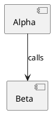

===
---
type: LAYOUT
---
```json
{
  "size": {
    "width": 800,
    "height": 400
  },
  "positions": {
    "A": {
      "x": 100,
      "y": 160
    },
    "B": {
      "x": 500,
      "y": 160
    }
  }
}
```
