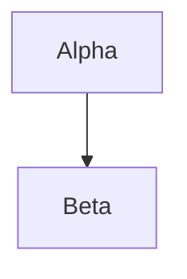
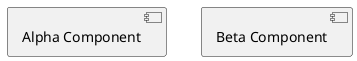
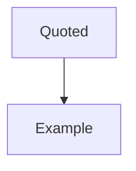

# Static version

A prose paragraph before the diagrams.



A prose paragraph between the diagrams.

`````archdia
---
type: PLANTUML
---

===
---
type: LAYOUT
---
```json
{
  "size": { "width": 640, "height": 480 },
  "positions": {
    "Alpha Component": { "x": 40, "y": 40 },
    "Beta Component": { "x": 300, "y": 40 }
  }
}
```
`````

```graph
{
  "size": { "width": 400, "height": 300 },
  "nodes": [
    { "id": "alpha", "title": "Alpha", "values": { "cost": 10, "computedBenefit": 40 }, "x": 40, "y": 60 },
    { "id": "beta", "title": "Beta", "values": { "cost": 20, "computedBenefit": 55 }, "x": 220, "y": 140 }
  ],
  "edges": [ { "from": "alpha", "to": "beta" } ]
}
```

```svg
<svg xmlns="http://www.w3.org/2000/svg" width="60" height="40"><rect width="60" height="40" fill="#4a90d9"/></svg>
```

Source code is not a diagram and stays readable as source:

```ts
const answer = 42;
```

And a diagram shown as an example stays an example:

````markdown

````

A prose paragraph after the diagrams.
