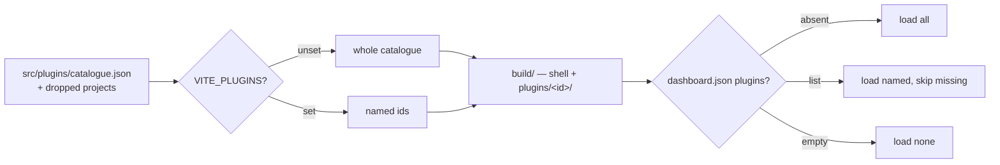
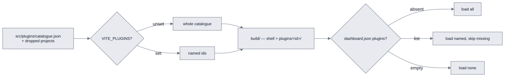

# Dashboard plugins — selection, build and delivery

This page explains how the plugin set is selected, compiled and delivered: the catalogue, shared
surface, plugin and shell builds, build checks, development server and external projects. Runtime
behavior is in [plugins-runtime.md](./plugins-runtime.md); placement rules and their precedents
are in [plugins-rules.md](./plugins-rules.md).

## Build model

Each plugin is compiled separately into an independently deliverable artifact, then loaded
dynamically according to configuration.

- **One build per plugin, plus one for the shell.** A plugin produces
  `build/plugins/<id>/index.js` and `style.css`. The shell publishes shared modules such as React,
  antd, `@cms-core` and kit modules through an import map. A plugin bundles its own code and
  dependencies only it needs.
- **Selection happens twice, outside source code.** `VITE_PLUGINS` chooses what the build ships;
  each store's `dashboard.json` chooses what it loads. Omitted plugins are neither shipped nor
  downloaded; unavailable store selections are reported and skipped.
- **Build checks cover the assembled artifacts.** Development-server tests do not exercise the
  import map or plugin bundles. The build checks imports, the single stylesheet, asset URLs and
  installability.

## Build selection and store selection

<!-- kiao:diagram

-->


**Delivery** is fixed by `VITE_PLUGINS`; unset means the whole catalogue. `build/` contains the
shell (`index.html` with its import map, `assets/`, `runtime/`) and one `plugins/<id>/` directory
per selected plugin.

**Loading** belongs to the store's `.kiao-config/dashboard.json`. A store may request plugins
absent from a smaller build; the configuration panel reports them. No list means load all;
an explicitly empty list means load none.

## Catalogue and external projects

[catalogue.json](/exchange/dashboard/src/plugins/catalogue.json) supplies each plugin's ID, title
and configuration-panel description. The ID is the folder name, and the entry point is always
`src/plugins/<id>/index.tsx`. Catalogue order does not determine file-resolution specificity.

[readCatalogue](/exchange/dashboard/vite-plugins/assembly-shared.mjs) adds projects named by
`VITE_PLUGIN_PATHS`. Each directory has `index.tsx` and a `package.json` declaring
`kiaoPlugin: { id, title, description }`. Duplicate IDs are errors. The merged catalogue uses the
same build, store configuration and panel rows for both kinds. `VITE_PLUGINS` filters the merged
set; an unknown ID fails through `assembledPlugins`.

## Shared surface

**A plugin must use the shell's React instance.** Another copy would break hooks, lose the antd
theme and escape the router. The shell publishes
[SHARED_MODULES](/exchange/dashboard/vite-plugins/assembly-shared.mjs) at stable URLs under its
base path, listed in an `index.html` `<script type="importmap">`. Plugin builds mark the same
names external. The browser resolves a bare `react` import to the shell's copy.

The shared surface contains:

- **Modules requiring shared identity:** React and its JSX runtime, antd, routing, OIDC context,
  pointing helpers, the files client whose errors use `instanceof`, CodeMirror facets and language
  registries, and mermaid's global configuration and diagram registry. Sharing also avoids a
  second large mermaid download.
- **Modules the shell already carries and plugins also use:** for example
  `@codemirror/language-data`, imported by both the kit and a plugin.
- **The framework and kit facades:** `@cms-core` and the explicitly declared `@cms-kit/<module>`
  entry points. Bundling a second copy would create independent application state.

Other dependencies stay inside the importing plugin: pdfjs with `pdf-view`, three.js with
`three-d-model-view`. An assembly without those plugins downloads neither dependency.

**Published modules cannot be tree-shaken across that interface.** The import map must answer
every exported name. A candidate costs its full size in the shell. `@ant-design/icons` stays out:
roughly 900 KB shared would replace only a few KB bundled into each plugin, and duplicate icon
components do not require shared identity.

## Plugin build

[pluginBuildConfig](/exchange/dashboard/vite-plugins/pluginBuild.mjs) emits
`build/plugins/<id>/index.js` and `style.css`. Shared specifiers survive as bare imports resolved
by the shell's import map.

- **`base` is `<base>plugins/<id>/`.** Assets live below the plugin directory. Using only the
  app base would request a SPA route, receive `index.html` with status 200 and silently render
  an image as alternative text. [checkAssetUrls](#build-order-and-checks) enforces this.
- **`cssCodeSplit: false`** ensures one stylesheet, because the loader links only
  `<id>/style.css`. `alwaysAStylesheet` emits an empty file when needed, in `order: 'post'`
  after real CSS. Running it earlier would rename real CSS to `style2.css`, which nobody loads.
- **`preserveEntrySignatures: 'strict'`** preserves the `plugin` export; otherwise Rollup may
  treat the entry as an application and remove its exports.
- **`contractOnly`** rejects shell files bundled into a plugin. A `src/` file outside
  `src/plugins/` creates another instance of its state, including React contexts with no
  matching provider. This broke `.graph.json` and `.arch.md` in production. Imports between
  plugins remain a separate coupling problem, addressed by kit modules and capabilities.

## Shell build

[assembly.ts](/exchange/dashboard/vite-plugins/assembly.ts) supplies:

- **One re-export entry per shared specifier**, emitted at a stable URL in the same chunk graph
  as the shell. Files are not hashed because the import map names them; the front servers serve
  the bundle with `no-store`.
- **Named CommonJS re-exports** for `react`, `react-dom`, `react-dom/client` and
  `react/jsx-runtime`, discovered from the package itself. `export * from 'react'` exports no
  names through Rollup's CommonJS interop. ES modules with defaults, such as `mermaid` and
  `@uiw/react-codemirror`, re-export that default explicitly.
- **The import map**, injected into `index.html` only for built output.
- **`virtual:kiao-plugin-assembly`**, exposing `CATALOGUE` and development-server `SOURCES`.
- **Shared entries without eager startup imports.** Rollup emits them in the shell's graph;
  the import map loads them when consumed. Shell `cssCodeSplit: false` links their styles
  without loading their JavaScript, preserving identity without delaying the whole app.
- **Importer-independent contract aliases** for `@cms-core` and explicit kit modules, plus
  `server.fs.allow` entries for external projects. Keep the workspace root in the allowlist:
  setting it replaces the default. `vite-tsconfig-paths` alone does not resolve an external
  source outside its importer scope.

## Build order and checks

**Build plugins before the shell.** The service worker gathers its precache from `build/` at the
end of the shell build. Plugins built afterward would be absent offline. Independent plugin
builds run with concurrency 4. Typecheck the shell first, then external projects with
`tsc -p <dir>`; neither Vite nor esbuild checks these types.

[build-assembly.mjs](/exchange/dashboard/scripts/build-assembly.mjs) checks the assembled output:

| Check | What it detects |
| --- | --- |
| `checkImports` | Every surviving bare specifier and requested export name must exist in the import map and shim. This catches empty CommonJS `export *` shims. |
| `checkStylesheets` | Any `.css` other than `style.css`, which would ship without being loaded. |
| `checkAssetUrls` | Each emitted asset must appear at its actual `<base>plugins/<id>/<file>` URL. |
| `checkInstallable` | Exactly one named manifest, an app name, `start_url`, `display`, an icon of at least 192 pixels with purpose `any`, and every referenced file present in `build/`. |

Finally, the build publishes `plugins/catalogue.json` for the configuration panel.

## Development-server behavior

The development server and Vitest import plugin source directly from
`src/plugins/<id>/index.tsx`, or `/@fs…` for external projects. There is no built plugin bundle;
edits must appear without rebuilding. Vite resolves bare imports itself, so no import map is
emitted. Store configuration still chooses the same loaded set.

Development-server tests therefore do not verify the import map. Build checks cover those
contracts; a browser using a real `npm run build` verifies actual assembled loading.

## External plugin projects

`VITE_PLUGIN_PATHS` adds projects through the same catalogue mechanism. Their audience differs:
a site-specific inventory or degree-course plugin belongs only in assemblies serving that audience.

For a project outside `src/`, the assembly supplies explicit Vite contract aliases, adds its
filesystem allowlist entry and lends its `node_modules` through a maintained link. There is no
`@/*` alias: external projects must not reach shell internals. A dependency used only by the
external project belongs in its own `package.json` and is bundled into its plugin; the assembly
lends the remaining dependencies.

**The assembly owns verification.** The project keeps its source, tests and fixtures. Its
`tsconfig.json` extends the assembly's; it carries no Vitest or Playwright configuration. Assembly
unit-test globs include its tests but exclude the lent `node_modules` and its Playwright `e2e/`.
The build typechecks it; the e2e harness runs its own project and seeds its fixtures. Unit tests
stay beside source, e2e specs in the project's `e2e/`, and fixtures in `e2e/files/`.

Build sites should derive external project paths through an assembly-owned script rather than
copying a list. Earlier build sites kept the list only in one local script, so server deployment
and installed executable builds silently omitted plugins. Their files opened as code, and the
panel could not report entries absent from its catalogue.

## Delivery

`npm run build` produces a directory served by nginx in the kiao image, the installed launcher
or another production front server:

```text
build/
  index.html              shell and import map
  assets/…                shell chunks
  runtime/react.js …      shared modules at stable import-map URLs
  plugins/<id>/           index.js and style.css for each plugin
  plugins/catalogue.json  this assembly's catalogue for the configuration panel
```

The e2e seed at `e2e/data/files-template/.kiao-config/dashboard.json` pins the complete plugin
set the suite exercises. A plugin omitted from it is not tested. `VITE_PLUGIN_PATHS` names
external projects whose `e2e/` tests and fixtures the harness also includes.

## Sources

- Assembly: [assembly-shared.mjs](/exchange/dashboard/vite-plugins/assembly-shared.mjs),
  [assembly.ts](/exchange/dashboard/vite-plugins/assembly.ts),
  [pluginBuild.mjs](/exchange/dashboard/vite-plugins/pluginBuild.mjs),
  [build-assembly.mjs](/exchange/dashboard/scripts/build-assembly.mjs).
- Catalogue: [catalogue.json](/exchange/dashboard/src/plugins/catalogue.json).
- Runtime loading: [pluginAssembly.ts](/exchange/dashboard/src/cms-core/core/assembly/pluginAssembly.ts).
- [Decision index](/docs/solution-design/decisions/README.md), including the assembly
  and external-project decisions of 2026-08-31.
