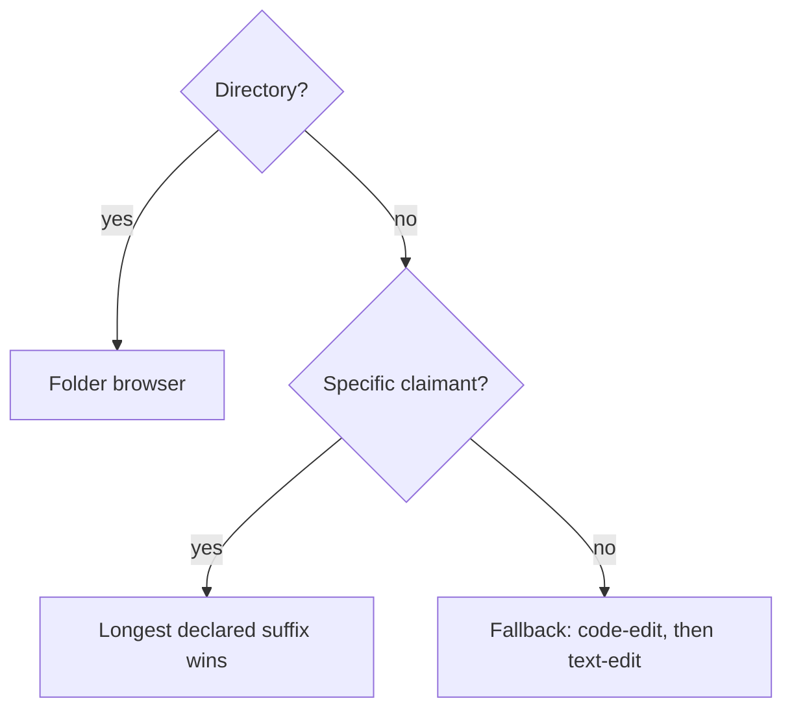
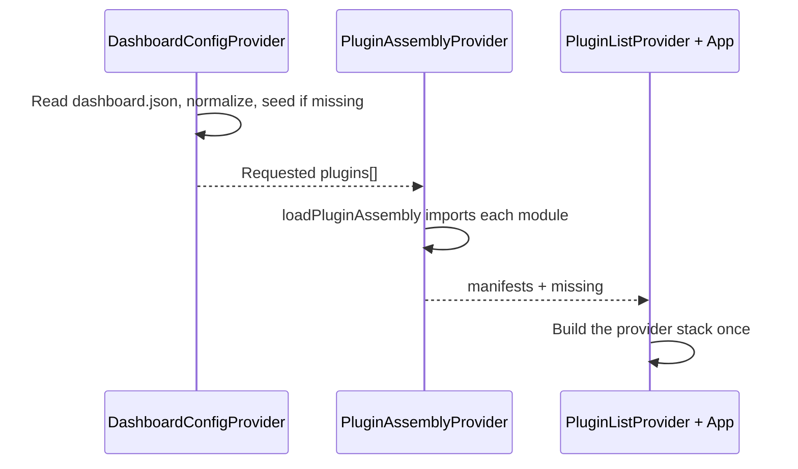
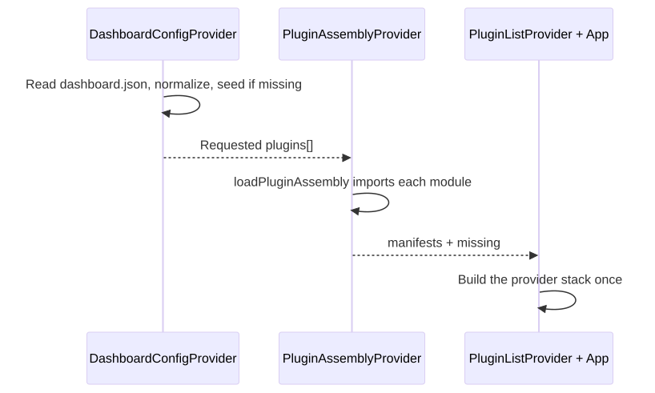

# Dashboard plugins — runtime contract and mechanisms

This page explains what a plugin is and how Dashboard uses it: the manifest, file resolution,
derived registries, loading, enablement and the relationship with skills. Selection, builds and
delivery are in [plugins-assembly.md](./plugins-assembly.md); placement rules and their
precedents are in [plugins-rules.md](./plugins-rules.md). The
[`dashboard-plugin` skill](/.agents/skills/dashboard-plugin/SKILL.md) provides the authoring procedure.

## What a plugin is

A plugin is **an ES module** whose `index.tsx` exports one `plugin: CmsPlugin` manifest, plus
one entry in [catalogue.json](/exchange/dashboard/src/plugins/catalogue.json):
`{ id, title, description }`. Its ID is its folder name under `src/plugins/`, and the entry point
is always `src/plugins/<id>/index.tsx`. Both the build and the loader derive that path.

The manifest is the entire interface between a plugin and the framework. cms-core never imports
a plugin, and plugins never import one another.

## Manifest fields

The contract is [FileBasedPlugin.ts](/exchange/dashboard/src/cms-core/core/FileBasedPlugin.ts).
`fileConfigFor` is required; the other contributions are optional. Many plugins are viewers
with no additional contributions.

| Field | Contribution |
| --- | --- |
| `fileConfigFor(file)` | Claims a file with `{ fileLabelCmp, mainView }`, or returns `null`. Required. Plugins claiming no type, such as `chat`, `tags` and `bookmarks`, always return `null`. |
| `fileExtensions` | Declares claimed suffixes for resolution and generic rename/duplicate behavior. |
| `fallback` | Used only by `code-edit` and `text-edit` to claim files no specific plugin handles. |
| `CreationProvider` | Adds a “New <type>” creation command. |
| `toolBars` | Adds tabs to the top bar or a column: `id`, `title`, `icon`, `render`, `defaultBar`, `flush` and a per-tab `isEnabled`. |
| `markdownRenderers` | Renders `[[type:id\|title]]` links; merged across the app. |
| `capabilities` | Offers features to other plugins under names owned by the kit. |
| `appRoutes` | Claims URL prefixes for pages outside the file store. With `panel`, opens that tab and selects its content beside the document; otherwise replaces the document with a page. |
| `providers` | Keeps state alive across document navigation for the app's lifetime. |
| `withGlobalProvider` | Wraps a file view while that plugin's document is open. |
| `isEnabled(config)` | Gates routes and toolbar tabs only; see [the two enablement levels](#the-two-enablement-levels). |

## File resolution

`fileConfigFor` decides whether a plugin claims a file. Its declarations decide which claim wins;
registration order does not break ties between different suffix lengths.

<!-- kiao:diagram

-->

1. **Directories always open in the folder browser**, whatever their names. Its `isDirectory`
   claim beats any suffix. The browser is cms-core's own plugin, imported in
   [App.tsx](/exchange/dashboard/src/App.tsx) and placed first, outside the catalogue, because
   every assembly must browse the store.
2. **A specific claim beats a fallback claim**: `.mmap.json` wins over `code-edit`'s `.json`
   because of its kind, before comparing suffix lengths.
3. **Between claims of the same kind, the longest declared suffix wins**: `.arch.md` beats
   `.md`. Matching is case-insensitive, including `.PNG` and `.JPG`.

A claim without a declared suffix has no matching suffix length.
[resolveFilePlugin](/exchange/dashboard/src/cms-core/core/PluginList-ctx.ts) selects the winner.
List order still determines toolbar proposal order and precedence for capabilities that choose
the first provider.

## Derived registries

Resolution, creation commands, tabs and pooled values all derive from the loaded plugin list.
[PluginList-ctx.ts](/exchange/dashboard/src/cms-core/core/PluginList-ctx.ts) builds these registries:

| Registry | Derivation | Constraint |
| --- | --- | --- |
| `customLinkRenderers` | Merges each plugin's `markdownRenderers`. | Collisions silently overwrite; keys must be globally unique. |
| `knownExtensions` | Pools all declared `fileExtensions`, longest first. | An `.arch.md` file must retain the full suffix even when another plugin declares `.md`. |
| `capabilities` | Keeps all providers of each name in assembly order. | An unpublished name is absent; consumers define how to work without it. |

`App.tsx` composes the other contributions similarly. Every `CreationProvider` registers its
command, with the menu ordered by `order` rather than nesting. App providers mount in list order;
`AppRoutesFromPlugins` publishes URL prefixes.

## Communication between plugins

A store chooses its plugin set, so an unloaded plugin has no module another plugin can import.
Ask whether the consumer would still work without the provider:

- **Shared code** moves into `@cms-kit/<module>` and is imported by both plugins.
- **An optional feature** travels as a capability published under a manifest name. The consumer
  handles its absence: no Play without `chat`, and no tag colors without `tags`.

cms-core pools manifest values without knowing their meaning. The
[capabilities kit](/exchange/dashboard/src/kit/capabilities/index.ts) declares names, types and
absence behavior. Plugins provide and consume those values. Multiple providers remain registered;
each capability defines whether to choose the first or combine them all. A capability may be a
hook because the registry and function identities remain fixed for the app's lifetime.

The kit is authoritative for the available names:

| Name | Provider | Value | Absence behavior |
| --- | --- | --- | --- |
| `chat.show` | `chat` | `useShowChat()` displays a conversation. | No chat marker. |
| `chat.options` | `chat` | `useChatOptions()` lists agents available to a flow node. | No agent options; no playable card. |
| `chat.run` | `chat` | `useChatRun()` exposes runs, `play` and `stop`. | No Play or chain button. |
| `tags.ui` | `tags` | `TagChips`, `TagPicker`. | No tag colors or filter row. |

The board consumes these capabilities; each replaced an import that coupled it to another plugin.

## Startup

Three providers in [App.tsx](/exchange/dashboard/src/App.tsx) establish the sequence:
`WorkerClientProvider`, `DashboardConfigProvider`, then `PluginAssemblyProvider`. Configuration
chooses the plugins, the assembly loads them, and only then can the manifest-derived provider
stack be constructed.

View state loads in parallel under `WorkerClientProvider`. `ViewStateReady` waits for it before
mounting interfaces, so their hooks see saved values on the first render.

<!-- kiao:diagram

-->

[DashboardConfigProvider](/exchange/dashboard/src/cms-core/config/DashboardConfig-ctx.tsx) reads
`dashboard.json` outside the content tree through the configuration-documents API, exposing
`{ chatEnabled, gitEnabled, plugins }`:

- An existing document supplies normalized configuration.
- A missing document (404) is seeded with defaults, including every plugin in the build.
- Other errors, such as an unreachable backend or malformed JSON, use defaults so the app opens.

`normalizeConfig` accepts `chatEnabled` under its older `agentEnabled` and `claudeCodeEnabled`
names. `PLUGIN_RENAMES` preserves saved choices across `claude`/`agent` → `chat`,
`movie-view` → `movie-edit`, and `tasks-board` → `hybridflow-ui`. An absent plugin list means
load everything; an explicitly empty list means load none.

[PluginAssemblyProvider](/exchange/dashboard/src/cms-core/core/assembly/PluginAssembly-ctx.tsx)
uses [loadPluginAssembly](/exchange/dashboard/src/cms-core/core/assembly/pluginAssembly.ts) to
import named plugins in the requested order before the initial view mounts. A name absent from
this build is expected when a smaller assembly opens the store. A module that fails to load is
logged with `console.error` and skipped. Both cases appear in `missing` in the configuration panel.

**Loading waits once.** The list determines the provider stack, creation commands and tabs. It is
read at mount and remains fixed. File resolution falls back to another claimant when a plugin
is unavailable.

**Manifests precede interfaces.** Keep matchers, providers and capabilities available immediately;
defer heavy interfaces with `lazyComponent` from `@cms-core`. Each interface owns its loading and
error boundary, so a Git panel or unrelated editor cannot hold the document back. Providers render
children while loading: nesting controls context access, not initialization completion order.
Shared agent-option reads are pooled per client, including capability consumers above chat providers.

## Changing the loaded set

[usePlugins.ts](/exchange/dashboard/src/cms-core/toolbox/usePlugins.ts) powers the configuration
panel's plugin controls:

- Save `plugins` with `saveConfigJson` in catalogue order, independent of click order.
- Show that reloading is required. `dirty` compares against the configuration at page load.
- Name requested plugins absent from this build through `missing`.

Saving also makes worker reread the list and synchronize store skills immediately. Disabling a
plugin removes its managed skill copies from `.agents/skills` and `.claude/skills` before the
204 response returns.

## The two enablement levels

1. **`plugins` decides what is imported.** An omitted plugin's bundle is never fetched, and its
   files fall through to another claimant.
2. **`isEnabled(config)` gates contributions from a loaded plugin.** It filters `appRoutes`
   through `AppRoutesFromPlugins` and `toolBars` through `PluginContributions`, with each tab's
   own `isEnabled` refining that result. For example, the board's Chain runs tab is hidden when
   the deployment has no chat.

File claims, creation commands, providers and capabilities remain active when `isEnabled` is false.
`chatEnabled: false` hides Conversations and Usage tabs while leaving chat's socket and capabilities
mounted. Consumers combine the configuration and capability checks themselves:
[useChatAvailable.ts](/exchange/dashboard/src/plugins/hybridflow-ui/useChatAvailable.ts) uses
`chatEnabled && useChatRunAvailable()`.

## The skill counterpart

Every skill names the Dashboard plugin it accompanies: embedded skills use `pluginOf` in
[skills.go](/reference/kiao-skills/skills.go); assembly additions use `skills.json`. A store receives
the skills selected by its plugin list. Two skills may name one plugin (`graph` and `strategy`
both accompany the graph editor). Mapping tests reject a skill with no plugin or a plugin absent
from the catalogue. The mapping belongs to the pair, outside skill frontmatter, so the installer
can read it independently of the CLIs.

worker's [SyncSkills](/operation/worker/internal/hybridflow-runner/skills/skills.go) composes embedded
skills with optional `KIAO_WORKER_SKILLS_PATH` sources and writes selected skills into
`<store>/.agents/skills` for Codex and Muse, and `<store>/.claude/skills` for Claude. The Claude
location was confirmed through process tracing.

- Read the same `dashboard.json` `plugins` list the panel writes. Missing, absent-key or unreadable
  configuration installs all skills; an empty list installs none.
- Run at startup and configuration save through `OnDashboardConfigSaved`; changes reach the next turn.
- Mark installed skills with `.kiao-skill`, holding source and installed-tree digests plus provenance.
  Compare provenance even for identical text. Restore edits to managed copies with a warning naming
  the master source; report and leave unmarked directories alone; prune managed skills no longer selected.
- A name conflict, invalid source or unreadable additional catalogue suspends the pass and preserves
  installed copies. See the [catalogue contract](/reference/kiao-skills/README.md).
- Synchronization failure is nonfatal: the service remains usable even when skill instructions
  cannot be installed.

## Runtime constraints

- Read the plugin set once before the first view mounts; change it by reloading the page.
- Report and skip failed modules; resolve unhandled files through the next claimant.
- Link `<id>/style.css` before importing the module, idempotently. The build supplies an empty
  stylesheet for a plugin without CSS to avoid 404s.
- Keep the capability registry fixed for the app's lifetime; its providers may be hooks.
- Keep `withGlobalProvider` active only while the plugin's document is open, guarding a null
  `currentFile`.
- App providers survive navigation; main views and their panels unmount on navigation to a
  document owned by another plugin. Each main view supplies its own `LayoutContent` and toolbars.

## Sources

- Contract and resolution: [FileBasedPlugin.ts](/exchange/dashboard/src/cms-core/core/FileBasedPlugin.ts),
  [PluginList-ctx.ts](/exchange/dashboard/src/cms-core/core/PluginList-ctx.ts),
  [capabilities](/exchange/dashboard/src/kit/capabilities/index.ts).
- Startup and loading: [App.tsx](/exchange/dashboard/src/App.tsx),
  [DashboardConfig-ctx.tsx](/exchange/dashboard/src/cms-core/config/DashboardConfig-ctx.tsx),
  [PluginAssembly-ctx.tsx](/exchange/dashboard/src/cms-core/core/assembly/PluginAssembly-ctx.tsx),
  [pluginAssembly.ts](/exchange/dashboard/src/cms-core/core/assembly/pluginAssembly.ts),
  [usePlugins.ts](/exchange/dashboard/src/cms-core/toolbox/usePlugins.ts).
- Skills: [skills.go](/reference/kiao-skills/skills.go),
  [SyncSkills](/operation/worker/internal/hybridflow-runner/skills/skills.go).
- [Decision index](/docs/solution-design/decisions/README.md), especially the manifest
  decision of 2026-07-16 and assembly decisions of 2026-08-31.
