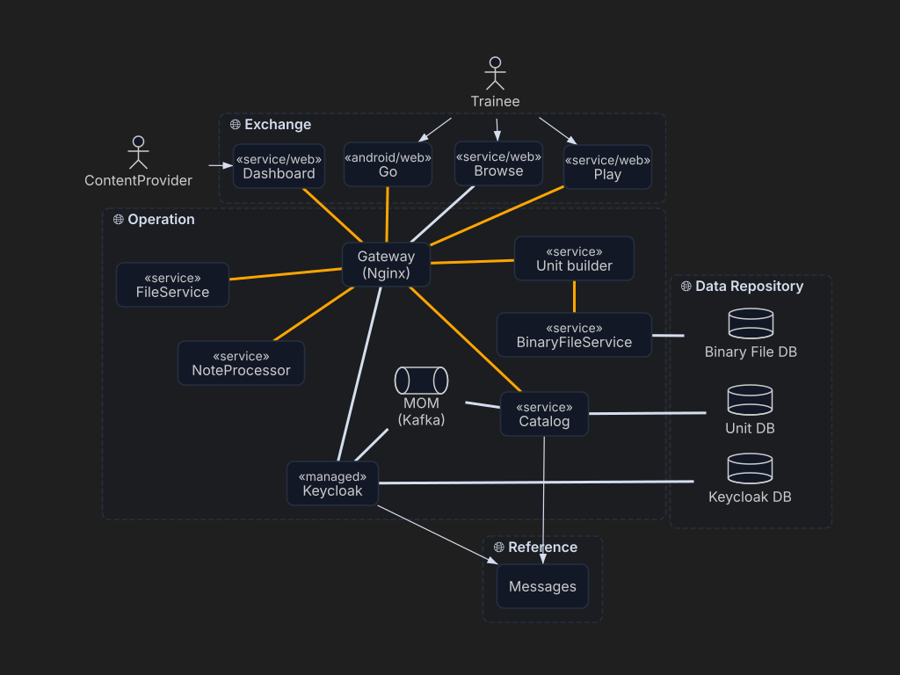

---
document:
  status: DRAFT
  role: PRIMARY_SOURCE
---

# ArchDia — Architecture Diagrams with Free Positioning

ArchDia renders PlantUML structure with editable placement in an `.arch.md` file.
Dashboard's `archdia-edit` plugin provides the editor; `@kiao-dashboard-kit/archdia` provides the shared
parser, layout and SVG components.

## Why ArchDia?

Source describes elements, containers and relations; layout stores their placement separately.
Blocks use `---`-delimited headers and **`===` separators**, with one or more PLANTUML sources,
optional DESCRIPTIONS and optional LAYOUT. See the
[format and authoring skill](/reference/kiao-skills/archdia/SKILL.md) and
[minimal example](../../../plugins/archdia-edit/README.md#the-archmd-file-format).

Without layout, ELK computes initial positions. Later source changes incrementally place new
leaves while preserving existing positions. Container bounds always derive from children.

### The PlantUML layout

PlantUML imports use a source-ranking layout, also available as a toolbar action. It uses
written element order and directional hints: `left to right direction` changes the ranking
axis, `-up->` reverses a rank, and lateral arrows or `Rel_Neighbor` keep peers together.
Rank order follows source endpoints, so `A <-- B` still places the first element above the
second. Packages retain separate bands.

This layout also expands document bounds to fit content, centering a diagram smaller than
the requested canvas. Mermaid conversion uses ELK instead.

## Editing Diagrams

- Drag elements; hover accents identify editable targets.
- Drag a relation's center handle to bend it; double-click to straighten. A wider transparent
  hit band makes thin lines targetable.
- Apply PlantUML, treemap or fresh ELK layout.
- Edit/copy/paste source, toggle class details, zoom and export SVG.

Changes persist in the document. Read-only rendering and export omit editing handles and
hover affordances.

## How It Works

`ArchDiaLayout` stores canvas size, leaf positions and optional bend offsets. `DiagramScene`
is derived from source and never persisted. `ArchDiaSvgRenderer` combines both into SVG.
Relations follow quadratic Bézier curves through their centers; repeated pairs fan apart.
Moving endpoints carries relative bends with them. See the
[implementation design](solution-design/archdia-edit.md).

### Supported PlantUML Elements

| Keywords | Rendering |
| --- | --- |
| `component`, `rectangle`, `node` | Rounded boxes |
| `database`, `actor`, `queue` | Cylinder, stick figure, queue |
| `class`, `interface`, `enum` | Member compartments |
| `entity`, `card`, `storage`, `cloud`, `artifact`, `boundary`, `control`, `collections`, `hexagon` | Corresponding element shapes |
| `package`, or `frame`, `folder`, `cloud`, `node`, `rectangle` with children | Containers |

### C4 Diagrams

[C4-PlantUML](https://github.com/plantuml-stdlib/C4-PlantUML) sources render as-is: paste one into a
PLANTUML block and the macros are recognised alongside native PlantUML syntax.

| Macro                                                         | Rendering                                        |
|---------------------------------------------------------------|--------------------------------------------------|
| `Person` / `Person_Ext`                                        | Stick figure                                     |
| `System` / `Container` / `Component` (+ `_Ext`)                | Rounded rectangle                                |
| `SystemDb` / `ContainerDb` / `ComponentDb` (+ `_Ext`)          | Cylinder shape                                   |
| `SystemQueue` / `ContainerQueue` / `ComponentQueue` (+ `_Ext`) | Queue (rounded ends)                             |
| `Enterprise_Boundary` / `System_Boundary` / `Container_Boundary` | Dashed container, stereotyped by boundary kind |
| `Boundary` / `Node` / `Deployment_Node`                        | Dashed container, stereotyped by its type argument |
| `Rel` / `Rel_Back` / `BiRel` (+ direction suffixes)            | Relation, technology shown under the label       |

The technology argument of `Container`/`Component` becomes the element stereotype, the description
argument becomes its tooltip, and `_Ext` elements are drawn muted. `AddRelTag` styles (`$lineColor`,
`$lineStyle`, `$lineThickness`) apply to relations carrying the matching `$tags`. Directives that
only steer PlantUML's own layout — `!include`, `Lay_*`, `SHOW_LEGEND` — are ignored, since ArchDia
positions elements freely; `LAYOUT_LEFT_RIGHT` / `LAYOUT_TOP_DOWN` and the direction suffixes on
`Rel_*` are the exception, being what the PlantUML layout reads.

Not supported: `AddElementTag` colours (the component model has no per-element colour), sprites,
and legends.

### Mermaid Import

Mermaid `flowchart` / `graph` and `classDiagram` imports convert to PlantUML through
`mermaidToPlantUml`, then `importAsArchDia` wraps and lays them out with ELK. Other kinds,
including sequence and Gantt, are rejected because this representation cannot preserve them.

| Mermaid                                     | Becomes                                        |
|---------------------------------------------|------------------------------------------------|
| `A[Label]`                                   | `rectangle "Label" as A`                       |
| `A(Label)` / `A([Label])` / `A>Label]`       | `card`                                         |
| `A[[Label]]`                                 | `component`                                    |
| `A[(Label)]`                                 | `database`                                     |
| `A((Label))`                                 | `entity`                                       |
| `A{Label}` / `A{{Label}}`                    | `hexagon`                                      |
| `A[/Label/]` / `A[\Label\]`                  | `storage`                                      |
| `subgraph id[Label] … end`                   | `package "Label" as id { … }`                  |
| `-->` / `---` / `-.->` / `==>`               | `-->` / `--` / `..>` / `-[thickness=3]->`      |
| `-->\|text\|` and `-- text -->`              | Relation label                                 |
| `--x`                                        | Line with no arrowhead — a crossed end denies the flow |
| ` ` in a label                           | `\n`                                           |
| `class X { … }`, `X : member`, `<<stereo>>`  | `class "X" <<stereo>> as X { … }`              |
| `namespace X { … }`                          | `package "X" as X { … }`                       |

Node ids that are not valid PlantUML aliases are renamed, consistently on both ends of every
relation. Anything purely cosmetic is dropped — `style`, `classDef`, `linkStyle`, `click`, and the
`%%{init}%%` directive — since ArchDia colours diagrams from its own theme.

### Diagram Extraction

Use `parseArchDiaSources` to extract PLANTUML sources in block order with their `id` and `name`,
without parsing or computing layout. Multi-layer files offer a choice of source. Extraction
leaves layout, descriptions and other layers behind and performs no translation.
