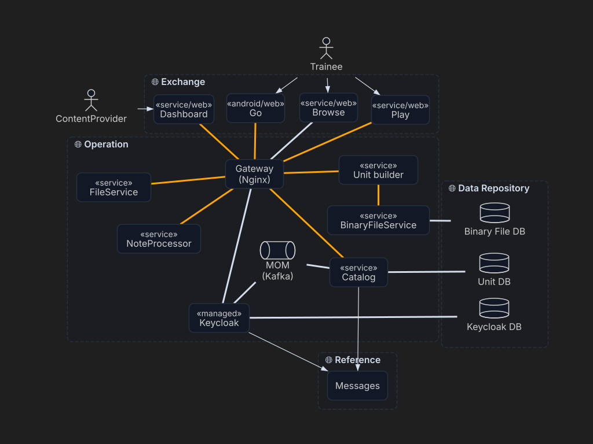

# ArchDia — Architecture Diagrams with Free Positioning

ArchDia is an alternative rendering engine for PlantUML that gives you full control over where elements are placed on the diagram. Instead of relying on PlantUML's automatic layout, you describe the architecture in familiar PlantUML syntax, and then position every component exactly where it makes sense — by dragging it with your mouse.

## Why ArchDia?

PlantUML is a remarkable tool for describing system architecture as code. But its automatic layout engine can be frustrating: elements end up in unexpected places, and the workarounds (`left to right direction`, invisible links, manual ordering) are fragile and hard to maintain.

ArchDia takes a different approach. It keeps PlantUML as the **source of truth** for what exists — components, containers, relations — but lets you decide **where** things go. The diagram structure and the layout are stored in a single `.arch.md` file, separated by a simple `---` marker:

- **Above the separator**: standard PlantUML source
- **Below the separator**: a JSON block with element positions

When you open a new diagram for the first time, ArchDia computes an initial layout automatically using the [ELK](https://www.eclipse.org/elk/) layered algorithm (Sugiyama). From there, you drag elements to refine the layout. Add a new component to the PlantUML source, and ArchDia places it incrementally without disturbing what you've already arranged.

### The PlantUML layout

A diagram brought in from PlantUML opens under the **PlantUML layout**, which puts the elements
where PlantUML itself would have drawn them — so nothing has to be found again after the import.
It is also a toolbar button, and the way back to that arrangement once a diagram has been moved
around by hand.

PlantUML draws through Graphviz `dot`, and this layout follows it: relations step from one rank to
the next, the source's own order decides what ends up left of what, and packages keep a band to
themselves rather than reaching across their neighbours. What the source says about layout is read
along with the rest — `left to right direction` turns the ranks into columns, `-up->` sends a target
back against the reading direction, and `-left->`, `-right->` and C4's `Rel_Neighbor` hold two
elements side by side on one rank. PlantUML ranks by the order two elements are *written*, not by
where the arrowhead lands, so `A <-- B` and `Rel_Back(a, b)` still draw the first one above.

Alone among the layouts, it also sets the document bounds: the size grows to whatever the diagram
needs, so the whole of it is in the visible area from the first render, and a diagram smaller than
the size asked for is centred in it.

## Editing Diagrams

Diagrams are edited in Dashboard, whose `archdia-edit` plugin claims `.arch.md` files. Instead of raw text you get an interactive SVG diagram where you can:

- **Drag** components to reposition them
- **Bend** a relation by dragging the handle at its centre — the curve follows wherever the centre
  is put, and a double-click there straightens it again
- **See what answers to a hand**: whatever the pointer reaches is ringed in the accent colour, and
  coming anywhere near a relation brings out the handle at its centre. A relation is caught by a
  band along its curve rather than by the hairline itself, so neither the curve nor its centre has
  to be aimed at exactly. Nothing lights up on a diagram being read: the marks belong to the
  editing of one.
- **Re-lay out** the diagram — as PlantUML would draw it, as a treemap, or from scratch
- **Export** the diagram as an SVG image
- **Copy/paste** the PlantUML source to iterate on the architecture
- **Toggle** display options for class members, properties, and types
- **Zoom** in and out for detailed or high-level views

The plugin is a React view powered by the `archdia` library. Edits made in the visual editor are written back to the document, so the file stays the single source of truth.

## How It Works

The engine is split into two layers: a **storage model** and a **render model**.

The **storage model** (`ArchDiaLayout`) is what gets persisted in the JSON block. It contains only coordinates — never diagram structure. Container bounds are not stored; they are computed at render time from the positions of their children, so moving a component automatically adjusts its parent container. Alongside the positions it holds the relation **bends**: where each curve's centre has been put, as an offset from where the relation would put it itself, so a bend travels with the elements it hangs between and survives any re-layout.

The **render model** (`DiagramScene`) is derived entirely from the PlantUML source each time the file is loaded. A parser extracts components, containers (packages, frames, folders...), and relations with their visual attributes (stereotypes, line styles, arrow types, colors, thickness). This model is ephemeral — it's never saved, always re-derived.

The renderer itself is a React component (`ArchDiaSvgRenderer`) that produces a pure SVG output. It supports the common PlantUML element types — rectangles, databases, actors, queues, classes with member compartments — and renders relations with proper arrow markers and intersection clipping.

Every relation is drawn as one curve through its centre — a quadratic Bézier, which is the family with exactly one point to spend on saying where a curve passes, so the control point follows from the two ends and the centre with no choice left over. An unbent relation's centre lands on the straight line between its two elements and the curve is that straight line; relations sharing a pair of elements are fanned to either side of it so none hides another. Where each end meets its element is decided by the curve rather than by the straight line, so a bent relation leaves its box facing the way it actually goes.

### Supported PlantUML Elements

| Keyword       | Rendering                          |
|---------------|------------------------------------|
| `component`   | Rounded rectangle                  |
| `rectangle`   | Rounded rectangle                  |
| `node`        | Rounded rectangle                  |
| `database`    | Cylinder shape                     |
| `actor`       | Stick figure                       |
| `queue`       | Queue (rounded ends)               |
| `class`       | UML class box with compartments    |
| `interface`   | UML class box with compartments    |
| `package`     | Dashed container                   |
| `frame`       | Dashed container                   |
| `folder`      | Dashed container                   |

### C4 Diagrams

[C4-PlantUML](https://github.com/plantuml-stdlib/C4-PlantUML) sources render as-is: paste one into a
PLANTUML block and the macros are recognised alongside native PlantUML syntax.

| Macro                                                         | Rendering                                        |
|---------------------------------------------------------------|--------------------------------------------------|
| `Person` / `Person_Ext`                                        | Stick figure                                     |
| `System` / `Container` / `Component` (+ `_Ext`)                | Rounded rectangle                                |
| `SystemDb` / `ContainerDb` / `ComponentDb` (+ `_Ext`)          | Cylinder shape                                   |
| `SystemQueue` / `ContainerQueue` / `ComponentQueue` (+ `_Ext`) | Queue (rounded ends)                             |
| `Enterprise_Boundary` / `System_Boundary` / `Container_Boundary` | Dashed container, stereotyped by boundary kind |
| `Boundary` / `Node` / `Deployment_Node`                        | Dashed container, stereotyped by its type argument |
| `Rel` / `Rel_Back` / `BiRel` (+ direction suffixes)            | Relation, technology shown under the label       |

The technology argument of `Container`/`Component` becomes the element stereotype, the description
argument becomes its tooltip, and `_Ext` elements are drawn muted. `AddRelTag` styles (`$lineColor`,
`$lineStyle`, `$lineThickness`) apply to relations carrying the matching `$tags`. Directives that
only steer PlantUML's own layout — `!include`, `Lay_*`, `SHOW_LEGEND` — are ignored, since ArchDia
positions elements freely; `LAYOUT_LEFT_RIGHT` / `LAYOUT_TOP_DOWN` and the direction suffixes on
`Rel_*` are the exception, being what the PlantUML layout reads.

Not supported: `AddElementTag` colours (the component model has no per-element colour), sprites,
and legends.

### Mermaid Import

A mermaid diagram can be brought in, but not rendered directly: `mermaidToPlantUml` rewrites it as
PlantUML first, and `importAsArchDia` wraps the result in an `.arch.md` laid out by ELK. Only the
mermaid kinds made of boxes and edges have an equivalent — `flowchart` / `graph` and `classDiagram`;
a `sequenceDiagram` or a `gantt` is refused rather than flattened into a diagram that lost what it
was saying.

| Mermaid                                     | Becomes                                        |
|---------------------------------------------|------------------------------------------------|
| `A[Label]`                                   | `rectangle "Label" as A`                       |
| `A(Label)` / `A([Label])` / `A>Label]`       | `card`                                         |
| `A[[Label]]`                                 | `component`                                    |
| `A[(Label)]`                                 | `database`                                     |
| `A((Label))`                                 | `entity`                                       |
| `A{Label}` / `A{{Label}}`                    | `hexagon`                                      |
| `A[/Label/]` / `A[\Label\]`                  | `storage`                                      |
| `subgraph id[Label] … end`                   | `package "Label" as id { … }`                  |
| `-->` / `---` / `-.->` / `==>`               | `-->` / `--` / `..>` / `-[thickness=3]->`      |
| `-->\|text\|` and `-- text -->`              | Relation label                                 |
| `--x`                                        | Line with no arrowhead — a crossed end denies the flow |
| ` ` in a label                           | `\n`                                           |
| `class X { … }`, `X : member`, `<<stereo>>`  | `class "X" <<stereo>> as X { … }`              |
| `namespace X { … }`                          | `package "X" as X { … }`                       |

Node ids that are not valid PlantUML aliases are renamed, consistently on both ends of every
relation. Anything purely cosmetic is dropped — `style`, `classDef`, `linkStyle`, `click`, and the
`%%{init}%%` directive — since ArchDia colours diagrams from its own theme.

### Diagram Extraction

The way back out, and it translates nothing. An `.arch.md` is a wrapper: one or more PlantUML
sources, an optional DESCRIPTIONS section and a layout. Extracting a diagram is lifting one source
out of that wrapper — `parseArchDiaSources` lists them, in source order and with the `id` / `name`
their blocks give them, without reading a layout or waiting on ELK the way `parseArchDiaFile` does.
A file with several layers therefore offers a choice rather than a single answer, and what stays
behind is everything that is archdia's own: the layout, the descriptions, the other layers.

## Part of a Bigger Picture

ArchDia is one piece of a broader family of projects aimed at analyzing IT solutions at a higher level of abstraction. The idea is straightforward: the more clearly and structurally we can represent a system's architecture, the more effectively we can interact with AI to reason about it, generate documentation, detect patterns, or suggest improvements.

By treating architecture diagrams as structured, machine-readable data rather than opaque images, ArchDia makes system design more accessible — both to humans who want to understand a codebase at a glance, and to AI tools that need a reliable representation of how components relate to each other.

## Contributing

Contributions, feedback, and ideas are very welcome. Whether it's a bug report, a feature suggestion, or a question about the approach — feel free to open an issue or start a discussion. This project is at an early stage, and outside perspectives are valuable.

## License

ArchDia is released under the [MIT License](../LICENSE) — use it, fork it, build on it.
