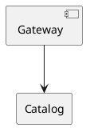

---
document:
  status: DRAFT
  role: PRIMARY_SOURCE
---

# archdia-edit

Edits `.arch.md` architecture diagrams as SVG, with draggable elements, relation bends,
source editing, automatic layouts and SVG export. View mode, display options and zoom are
remembered per file.

| Need | Reference |
| --- | --- |
| Format rules and authoring examples | [ArchDia skill](/reference/kiao-skills/archdia/SKILL.md) |
| Supported syntax, imports and layouts | [ArchDia overview](../../kit/archdia/docs/ProjectDesc.md) |
| Models, persistence and rendering | [Solution design](../../kit/archdia/docs/solution-design/archdia-edit.md) |
| Add a language or conversion | [Extension guide](../../kit/archdia/docs/solution-design/archdia-extending.md) |

## The `.arch.md` File Format

Blocks are separated by **`===` on its own line**. Each has a `---`-delimited header with
`type: PLANTUML`, `DESCRIPTIONS` or `LAYOUT`. At least one source block is required; layout
can be omitted for automatic placement. `---` delimits headers, not blocks.

````text
---
type: PLANTUML
---

===
---
type: LAYOUT
---
```json
{
  "size": { "width": 1200, "height": 800 },
  "positions": {
    "GW": { "x": 100, "y": 100 },
    "Catalog": { "x": 350, "y": 100 }
  }
}
```
````

Only leaf elements get positions, keyed by alias or name. Container bounds are computed
from children. Additional source blocks create layers; DESCRIPTIONS holds element prose.
