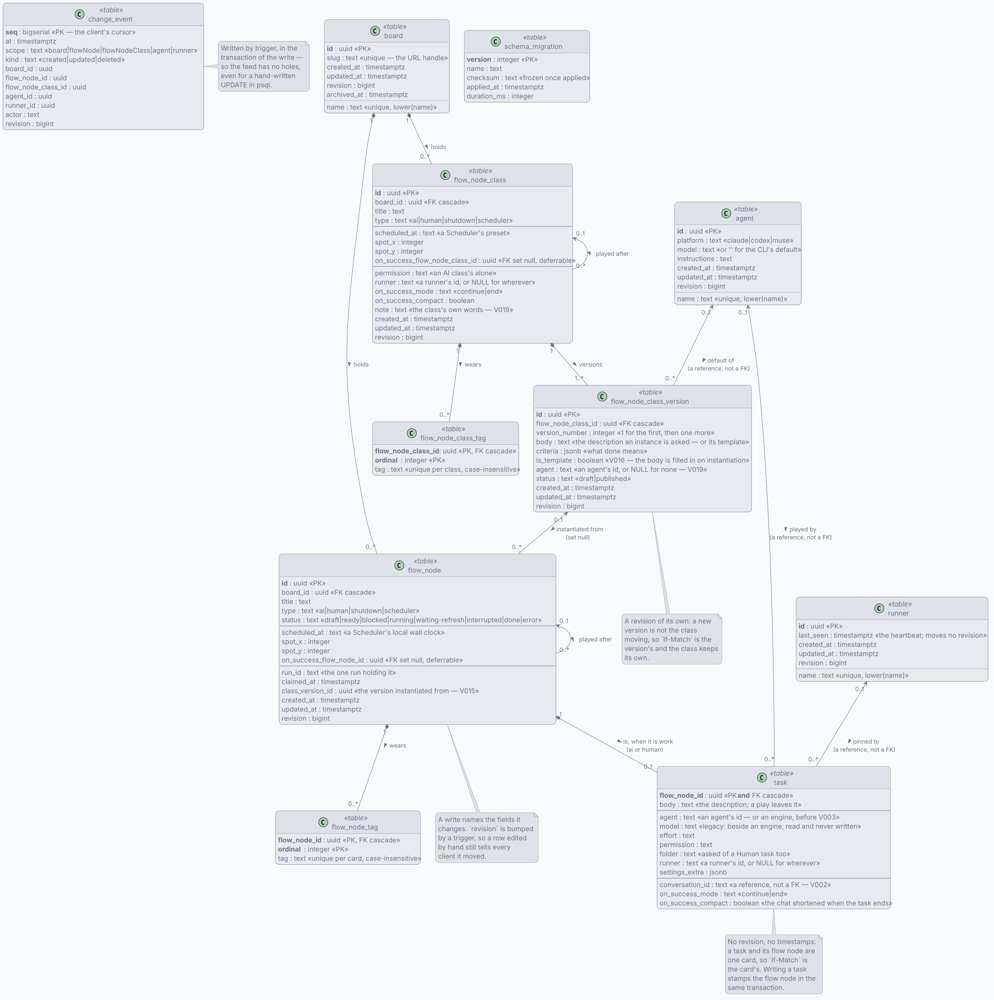

# hybridflow-store — the schema

Boards are rows: `board` + `flow_node` + `task` + `flow_node_tag` + `flow_node_successor` — and
the agents and runners the cards name, in `agent`, `agent_version` and `runner`. Beside the cards sit the reusable
ones: `flow_node_class` + `flow_node_class_version` + `flow_node_class_tag`. What each AI card spent
sits in `task_usage`, one row per report the harness sends.

**A card that is work somebody does is a task.** Two of the five kinds are: an **AI** card an agent
plays and a **Human** card a person does. The other three — Shutdown, Scheduler, Gateway — are the
board acting on its own machine and describe no work at all. `task` is that specialisation, one row
per flow node that is one, keyed by the flow node it belongs to. The word exists so that the ordinary
case stops being four: it used to be "an AI or a Human flow node" every time it was said.

**A card that is never played is a class.** A **flow node class** is the reusable shape of work its
instances do: the title, the kind, the chain to the next class, the note beside the card, and — on
an AI class — how a turn answers its tool calls and where it is pinned. The words are its
**versions**', one row each under a successive number: the description, what done means and the
default agent, draft or published. Only the latest version that is not a draft is used when the
class is instantiated; the others are past versions kept for statistics. A flow node names the
version it was made from in `class_version_id`, and breaking that link disconnects it from its
class and changes nothing else about it.

## Why a database

**Several models play cards of one board at the same time while a person rearranges it.** Each of the rules that takes is a line of SQL:

| the rule | how it holds |
| --- | --- |
| two writers, two fields of one card, both kept | `UPDATE flow_node SET status = …` and `UPDATE flow_node SET title = …` touch different columns |
| a stale write is refused, not silently applied | `WHERE revision = $n`, and the row count is the answer |
| a card is played by one run | `WHERE run_id IS NULL AND status = 'ready'` — one of the two statements matches, the other matches nothing |
| a client learns what changed without polling the board | `change_event` + `LISTEN/NOTIFY` |

## The schema

```plantuml
@startuml
skin rose
hide empty methods

class board <<table>> {
  **id** : uuid <<PK>>
  name : text <<unique, lower(name)>>
  slug : text <<unique — the URL handle>>
  created_at : timestamptz
  updated_at : timestamptz
  revision : bigint
  archived_at : timestamptz
}

class flow_node <<table>> {
  **id** : uuid <<PK>>
  board_id : uuid <<FK cascade>>
  title : text
  type : text <<ai|human|shutdown|scheduler|gateway>>
  status : text <<draft|ready|blocked|running|waiting-refresh|interrupted|done|error>>
  --
  scheduled_at : text <<a Scheduler's local wall clock>>
  duration : text <<alternative fixed wait from play — V024>>
  spot_x : integer
  spot_y : integer
  on_success_flow_node_id : uuid <<FK set null, deferrable>>
  --
  run_id : text <<the one run holding it>>
  claimed_at : timestamptz
  class_version_id : uuid <<the version instantiated from — V015>>
  workflow_id : uuid <<the workflow grouping it, or NULL — V020>>
  created_at : timestamptz
  updated_at : timestamptz
  revision : bigint
}

class task <<table>> {
  **flow_node_id** : uuid <<PK **and** FK cascade>>
  body : text <<the description; a play leaves it>>
  --
  agent : text <<an agent's id — or an engine, before V003>>
  model : text <<legacy: beside an engine, read and never written>>
  effort : text
  permission : text
  folder : text <<asked of a Human task too>>
  runner : text <<a runner's id, or NULL for wherever>>
  settings_extra : jsonb
  --
  conversation_id : text <<a reference, not a FK — V002>>
  on_success_mode : text <<continue|end>>
  on_success_compact : boolean <<the chat shortened when the task ends>>
}

class task_usage <<table>> {
  **id** : uuid <<PK — minted by the reporter>>
  flow_node_id : uuid <<FK task cascade>>
  reported_at : timestamptz <<when the harness said it>>
  run_id : text <<the run reporting, or ''>>
  model : text <<the slug as said, or ''>>
  input_tokens : bigint
  output_tokens : bigint
  cache_read_tokens : bigint
  cache_write_tokens : bigint
  reasoning_tokens : bigint <<split out, never added on top>>
  cost_usd_micros : bigint <<NULL for unknown>>
  extra : jsonb <<carried, nothing reads it>>
}

class flow_node_tag <<table>> {
  **flow_node_id** : uuid <<PK, FK cascade>>
  **ordinal** : integer <<PK>>
  tag : text <<unique per card, case-insensitive>>
}

class flow_node_successor <<table>> {
  **flow_node_id** : uuid <<PK, FK cascade — the Gateway>>
  **successor_id** : uuid <<PK, FK cascade — one branch>>
  ordinal : integer <<the order the card lists them>>
}

class flow_node_class <<table>> {
  **id** : uuid <<PK>>
  board_id : uuid <<FK cascade>>
  title : text
  type : text <<ai|human|shutdown|scheduler>>
  --
  scheduled_at : text <<a Scheduler's preset>>
  duration : text <<alternative fixed wait preset — V024>>
  spot_x : integer
  spot_y : integer
  on_success_flow_node_class_id : uuid <<FK set null, deferrable>>
  --
  permission : text <<an AI class's alone>>
  runner : text <<a runner's id, or NULL for wherever>>
  on_success_mode : text <<continue|end>>
  on_success_compact : boolean
  note : text <<the class's own words — V019>>
  workflow_class_id : uuid <<the workflow class grouping it, or NULL — V020>>
  created_at : timestamptz
  updated_at : timestamptz
  revision : bigint
}

class workflow <<table>> {
  **id** : uuid <<PK>>
  board_id : uuid <<FK cascade>>
  name : text <<the rectangle's name — V020>>
  created_at : timestamptz
  updated_at : timestamptz
  revision : bigint
}

class workflow_class <<table>> {
  **id** : uuid <<PK>>
  board_id : uuid <<FK cascade>>
  name : text <<the rectangle's name — V020>>
  created_at : timestamptz
  updated_at : timestamptz
  revision : bigint
}

class flow_node_class_version <<table>> {
  **id** : uuid <<PK>>
  flow_node_class_id : uuid <<FK cascade>>
  version_number : integer <<1 for the first, then one more>>
  body : text <<the description an instance is asked — or its template>>
  criteria : jsonb <<what done means>>
  is_template : boolean <<V016 — the body is filled in on instantiation>>
  agent : text <<an agent's id, or NULL for none — V019>>
  status : text <<draft|published>>
  created_at : timestamptz
  updated_at : timestamptz
  revision : bigint
}

class flow_node_class_tag <<table>> {
  **flow_node_class_id** : uuid <<PK, FK cascade>>
  **ordinal** : integer <<PK>>
  tag : text <<unique per class, case-insensitive>>
}

class agent <<table>> {
  **id** : uuid <<PK>>
  name : text <<unique, lower(name)>>
  platform : text <<claude|codex|muse|opencode|pi>>
  model : text <<or '' for the CLI's default>>
  profile_id : text <<worker-owned execution profile — V027>>
  description : text <<selection guidance, never sent to turns — V026>>
  instructions : text
  created_at : timestamptz
  updated_at : timestamptz
  revision : bigint
  archived : boolean <<hidden from normal lists — V028>>
}

class agent_version <<table>> {
  **agent_id** : uuid <<PK, FK restrict>>
  **version** : bigint <<PK, increasing per agent>>
  configuration : jsonb <<immutable full snapshot>>
  published_at : timestamptz
}

class runner <<table>> {
  **id** : uuid <<PK>>
  name : text <<unique, lower(name)>>
  last_seen : timestamptz <<the heartbeat; moves no revision>>
  created_at : timestamptz
  updated_at : timestamptz
  revision : bigint
}

class change_event <<table>> {
  **seq** : bigserial <<PK — the client's cursor>>
  at : timestamptz
  scope : text <<board|flowNode|flowNodeClass|workflow|workflowClass|agent|runner>>
  kind : text <<created|updated|deleted>>
  board_id : uuid
  flow_node_id : uuid
  flow_node_class_id : uuid
  agent_id : uuid
  runner_id : uuid
  workflow_id : uuid <<V020>>
  workflow_class_id : uuid <<V020>>
  actor : text
  revision : bigint
}

class schema_migration <<table>> {
  **version** : integer <<PK>>
  name : text
  checksum : text <<frozen once applied>>
  applied_at : timestamptz
  duration_ms : integer
}

board "1" *-- "0..*" flow_node : holds >
agent "1" *-- "0..*" agent_version : publishes >
flow_node "1" *-- "0..1" task : is, when it is work >\n(ai or human)
task "1" *-- "0..*" task_usage : spent >
flow_node "1" *-- "0..*" flow_node_tag : wears >
flow_node "0..1" <-- "0..*" flow_node : played after >
agent "0..1" <-- "0..*" task : played by >\n(a reference, not a FK)
agent "0..1" <-- "0..*" flow_node_class_version : default of >\n(a reference, not a FK)
runner "0..1" <-- "0..*" task : pinned to >\n(a reference, not a FK)
board "1" *-- "0..*" flow_node_class : holds >
flow_node_class "1" *-- "1..*" flow_node_class_version : versions >
flow_node_class "1" *-- "0..*" flow_node_class_tag : wears >
flow_node_class "0..1" <-- "0..*" flow_node_class : played after >
flow_node_class_version "0..1" <-- "0..*" flow_node : instantiated from >\n(set null)
board "1" *-- "0..*" workflow : holds >
workflow "0..1" <-- "0..*" flow_node : grouped in >\n(set null)
board "1" *-- "0..*" workflow_class : holds >
workflow_class "0..1" <-- "0..*" flow_node_class : grouped in >\n(set null)

note right of change_event
  Written by trigger, in the
  transaction of the write —
  so the feed has no holes,
  even for a hand-written
  UPDATE in psql.
end note

note bottom of flow_node
  A write names the fields it
  changes. `revision` is bumped
  by a trigger, so a row edited
  by hand still tells every
  client it moved.
end note

note bottom of task
  No revision, no timestamps:
  a task and its flow node are
  one card, so `If-Match` is
  the card's. Writing a task
  stamps the flow node in the
  same transaction.
end note

note bottom of flow_node_class_version
  A revision of its own: a new
  version is not the class
  moving, so `If-Match` is the
  version's and the class keeps
  its own.
end note

note bottom of task_usage
  Append-only: rows are never
  updated, carry no revision,
  and write no change event —
  totals are SUMs at the read.
end note

@enduml
```

<!-- kiao:diagram

-->

### The seven things worth knowing about it

**A task is a kind of flow node, and the key says so.** `task.flow_node_id` is the primary key
**and** the foreign key, so a flow node has at most one task and a task has exactly one flow node —
the identity is shared rather than duplicated, and no row can claim otherwise. What is on it is
everything a Shutdown, a Scheduler and a Gateway have no answer to: the description, the folder the
work happens in, the four settings a turn is run with, the chat it is played in and what becomes of
that chat. What stays on `flow_node` is what every card has whatever kind it is —
`on_success_flow_node_id` among them, because a Scheduler chains and only a Shutdown does not, while
what happens to the *conversation* is a task's alone. A Gateway chains too, but the list way: one
successor is a column and several are rows of their own, in `flow_node_successor`, one per branch in
the order the card lists them.

**The revision stays on the card.** A task has no `revision`, no `created_at` and no `updated_at`: a
task and its flow node are one card to everything that reads a board, so `If-Match: <revision>` has
to mean the whole of it. The adapter stamps `flow_node` in the same transaction as every write to
`task` — as it already did for `flow_node_tag`, which has no revision either — so a change to a body
bumps the card's revision and appends to the change log exactly once. The wire is flat for the same
reason: `flowNode` carries `body`, `settings`, `chat` and `onSuccess` beside `title` and `type`, and
which of the two rows each lives in stops at this service's edge.

**A class and its versions are two aggregates, so the revision is on each.** Unlike a task, a
version is not one card with its class: it is filed, edited and published through its own calls,
carries its own `revision`, and `If-Match` on a version write means the version's. What the class
holds is what every instance shares — the title, the kind, the chain, the tags, the spot, the
Scheduler's preset, and the permission, runner and transition an AI class alone is asked — and what
it never holds is what it is never asked: no folder, no agent, no effort, no chat, no body and no
success criteria of its own, and no status, a class never being executed. The chain is the one
column that names its own table twice over: `on_success_flow_node_class_id` names a class of the
same board, never a version and never a simple flow node, so the two kinds chain among themselves
and never across — and a class retyped to Shutdown loses its chain for the reason a flow node does.
A flow node's `class_version_id` is the version it was instantiated from, `ON DELETE SET NULL` both
ways: a version that has gone leaves the flow nodes made from it saying what they were asked. A
version's change is logged under its class's id in the `flowNodeClass` scope, because the class is
the card the board draws.

**A board is a set of cards, and the editor lays them out by their spots.** A card says where it
sits with `spot_x`/`spot_y`, and the chain — what runs after what — is the whole of the order a
board has. There is nothing to file a card in and nothing to rank it against: the columns and the
fractional ranks that ordered the cards inside them went in `V010`.

**A revision is per row, not per board.** An edit conflicts only with another edit of the same card.
`If-Match: <revision>` on the wire is what makes a write conditional; no header is a write that does
not care, which is what a run's status write means and what a person's rename does not.

**The claim is the database's.** `ClaimFlowNode` is one `UPDATE … WHERE run_id IS NULL AND status =
'ready'`. Twenty goroutines against one row give one winner (`TestOnlyOneRunTakesACardForReal`).

**The change log is written by triggers.** A feed with a hole in it leaves a client wrong until it
reloads, so the append cannot be something a call site may forget. The actor comes from
`current_setting('kiao.actor')`, set once per transaction by the adapter — and defaulting to `sql`,
which is the honest answer for a statement somebody typed.

### AI task consumption

**Each AI card's spend lands in `task_usage`, one row per report.** A runner finishes a turn — or
a play — and writes what the harness said it spent: the card, the run, the model slug as said, and
the tokens. A Human task never gets a row; a Shutdown, a Scheduler and a Gateway cannot, the key
naming `task` rather than `flow_node`.

**Five token columns, and the rule that they are splits, not extras.** Every harness reports an
input count and an output count under some name, and most split out what was served from cache,
what was written to it, and what was spent reasoning:

| the harness says | it lands in |
| --- | --- |
| `input_tokens`, `prompt_tokens` | `input_tokens` |
| `output_tokens`, `completion_tokens` | `output_tokens` |
| `cache_read_input_tokens`, `cached_tokens`, `cache_hit_tokens` | `cache_read_tokens` |
| `cache_creation_input_tokens` | `cache_write_tokens` |
| `reasoning_tokens`, `reasoning_output_tokens` | `reasoning_tokens` |
| `costUSD`, `cost_usd` | `cost_usd_micros`, × 1,000,000 and rounded |
| `cache_miss_tokens`, `uncached_tokens` | nowhere — already inside `input_tokens` |

`input_tokens` + `output_tokens` is the spend; cache and reasoning are never added on top, they say
where part of it went. Where a harness folds reasoning into its completion count, `output_tokens`
keeps it folded and `reasoning_tokens` carries the split-out part beside it. The mapping is
approximate and deliberately so: exact per-model metering is the harness's job, this table's is one
shape every harness fits.

**Money is micro-dollars, or NULL.** `cost_usd_micros` is what the reporter says the report cost,
in millionths of a dollar — an integer, so sums stay exact. NULL is "the harness said nothing",
and the store never prices a report itself: it owns no price table and wants none.

**No revision, no change event, no stored total.** A usage row is never updated — a correction is a
new row — so there is nothing `If-Match` could guard, and a token report must not bump the card
under an editor's keystrokes. Totals are `SUM()`s at the read, per card, per board, or per class
through `flow_node.class_version_id`, which the statistics the versions are kept for get for free.
Like `runner.last_seen`, writes here move nothing else.

**Replays are safe.** The `id` is minted by the reporter, so a spool replay re-sends the same row
and the second insert is a no-op (`ON CONFLICT DO NOTHING`) rather than a double count.

**What is not here is in the runner.** Turns, transcripts and durations stay in the runner's
registry, where `V014` left them: this table says what a card spent, not what it did.

### Schema history and migration

`adapters/postgres/schema/V###__kebab-name.sql`, compiled into the binary, applied at startup, one
transaction each, recorded in `schema_migration` with a checksum.

**An applied migration is frozen**: startup compares the checksum of every script the ledger holds
and refuses to serve on a mismatch — even a changed comment. A database that ran `V001` and a binary
carrying a different `V001` do not disagree about a statement, they disagree about what the tables
are. Fix what a past migration did in a new one. It is the same rule, and the same file-naming, as
the content migrations in the repo root `migrations/`.

A session advisory lock is taken for the pass, so two instances starting together do not both apply
`V002`. `GET /schema` reports the ledger, because "which version is that instance on?" is a question
asked of a running service.

`V002` drops the foreign key from `flow_node.conversation_id` to `conversation(id)`. The chat a card
is played in is minted and kept by the hybridflow-runner's registry in worker — turns, transcripts
and the chat panel all still live there — and nothing registers those ids here, so the constraint refused every
play at its first turn. The column stays: it says which chat each card belongs to, as a reference
rather than a key, exactly like `run_id`.

`V003` files the managed agents: one `agent` row per named definition of what plays a flow node, and
a flow node naming one by id in its `settings.agent`. The engine and the model a turn runs on moved
from the card to the agent; the effort, the permission mode and the folder stayed the card's. There
is deliberately **no foreign key** between the two: a card naming an agent that has gone must still
open and say which agent it wanted, refused at its next play rather than at the delete. The change
log learns the `agent` scope with it, so the panel listing them is told rather than asking.

`V009` renames the card: the table is `flow_node`, its tags are `flow_node_tag`, the card played
next is `on_success_flow_node_id`, and the change log's own column and `scope` word follow — with
the rows already in the log converted, so a client reading the feed after a restart is not made to
know both words. Nothing about a row changed; only what it is called. "Task" said *a unit of work in
a queue*, which is neither what the row holds nor how anything reads it: a board is a graph, a card
names the card played after it, and three of the four kinds — Shutdown, Scheduler, and a Human card
waiting on somebody — are not work to be done at all. The schema's own history is the one place the
old word is still written, which is what a migration is for. The file half of the same rename is the
store migration `V013__workflow-tasks-are-flow-nodes.js`, and the two are independent.

`V011` files the tasks: `task`, one row per flow node whose type is `ai` or `human`, taking
`body`, `agent`, `model`, `effort`, `permission`, `folder`, `settings_extra`, `conversation_id`,
`on_success_mode` and `on_success_compact` off `flow_node`. A card that is work somebody does is a
**task**, and there was no word for that pair before — everything that spoke about them said "an AI
or a Human flow node", for the ordinary case. `V009` is what made the word free: it is what a card
used to be called whatever kind it was, which was wrong for a Shutdown and a Scheduler and is right
for these two. The flow node's change trigger stops naming the card's conversation with the column
it loses — the board is what narrows a card's change, every client reads the feed that way, and the
in-memory store never set it — and a Shutdown or a Scheduler carrying anything in the moved columns
loses it, since a task row for a card that is not a task would break the invariant on its first day.

`V010` drops the columns: `board_column` goes whole, and with it `flow_node.column_id`,
`flow_node.rank`, the change log's `column_id` and the `column` scope — with the rows already in
the log under it deleted, since a scope outside the check would refuse every future write. A column
was a place to file a card and nothing more — not a queue, not a state, not an order — and the
editor shows one face, the canvas, where every card sits at the point somebody put it. With the
filing goes the ordering inside it: a rank said where a card sat among the cards of its column, and
with no columns there is nothing to sit among.

`V014` drops the conversations: `conversation` and `transcript_record` go whole, with the two
functions that announced their changes and the change log's `conversation_id`, `conversation` and
`transcript` — the rows already in the log under those scopes deleted, for the reason `V010`
gives. V001 filed the chats here and `V002` is where that stopped being true in anything but the
schema: turns run in the hybridflow-runner, whose registry mints the ids and keeps the transcripts, and
nothing ever registered them here. `task.conversation_id` stays: it names a chat of that registry,
a reference rather than a key.

`V015` files the node classes: `flow_node_class`, one row per reusable card beside the board's own,
with its tags in `flow_node_class_tag` — and `flow_node_class_version` beneath each, one row per
version under a successive number, taking the description and the success criteria a class is
instantiated with. It is two tables and not one for the reason a task is one row and not none: what
changes together lives together, and the description changes from version to version while the
title, the kind and the chain do not. A class always has at least one version, numbered from 1, and
only the latest one that is not a draft is used at instantiation; a published version is frozen by
the service, not by the schema — the check constraint only holds the two words — because freezing
is a rule about writes and the schema holds rows. `flow_node.class_version_id` names the version a
flow node was made from, `ON DELETE SET NULL`, and the change log learns the `flowNodeClass` scope
with its own column, a version's change logged under its class — the class is the card the board
draws, and the board id on the row is what wakes the clients watching that board.

`V020` files the workflows: `workflow` and `workflow_class`, one row per rectangle round a set of
cards or classes — a name and nothing else, because the bounds are computed from the members, the
way an archdia container's are. Membership is the card's, `flow_node.workflow_id` and
`flow_node_class.workflow_class_id`, each at most one, both `ON DELETE SET NULL`: deleting a
workflow ungroups its cards rather than taking them. The change log learns the `workflow` and
`workflowClass` scopes with their own columns, and grouping a card is a change to the card too —
its own row moves, so its own trigger says so.

`V021` files the spend: `task_usage`, one row per usage report on an AI card — the run, the model
slug as said, five token columns, a micro-dollar cost or NULL, and an `extra` the service carries
the way it carries `settings_extra`. The key names `task`, so a Shutdown and a Scheduler cannot
hold one; there is no trigger and no revision, so a report moves nothing but its own row.

`V023` files the fifth kind: `gateway` joins the type check, and `flow_node_successor` holds a
Gateway's branches — one row per branch, in the order the card lists them. One successor is a
column; several are rows of their own. Both foreign keys are `ON DELETE CASCADE`, so deleting the
Gateway takes its branches with it and deleting a branch takes it out of every list naming it, the
way `ON DELETE SET NULL` takes a deleted card out of the single chain — and both `DEFERRABLE`, for
the reason the single chain is: a pasted Gateway arrives in one batch with the branches it names.
The class table keeps its four kinds: a Gateway holds no words, so there is nothing reusable in it
to file.

### V024 — Scheduler duration

Adds nullable `duration` to flow nodes and node classes. A database check keeps `duration` and
`scheduled_at` mutually exclusive. Setting a nonempty alternative clears the other atomically.
The runner counts a positive duration from entering the Scheduler; existing date-time schedules
retain their local wall-clock interpretation. Scheduler Play and Stop are available on the board.

### V026 — Agent selection description

Adds `agent.description`, empty for existing agents. It explains when to choose an agent for a
task and is returned by the agents API and MCP tools. Dashboard edits it separately from standing
instructions and shows it in agent choices. The runner reads only execution fields from an agent
response, so the description is never added to a turn's prompt or system instructions.

### V027 — Worker execution profile references

Adds `agent.profile_id` and accepts the `pi` platform. References remain readable when the worker
or its profile is unavailable; the boards store owns neither credentials nor adapter catalogues.

### V028 — Agent publications and archives

Adds `agent.archived` and `agent_version`. Each publication stores the complete configuration as
JSON under `(agent_id, version)`; a database trigger rejects updates and deletes. Publication
serializes on the agent row and advances its revision. Existing definitions become publication 1.
Published agents retain their history and are archived rather than deleted. The runner captures
the latest publication when creating a task conversation; see the
[publication decision](../../../../docs/solution-design/decisions/00075-agent-publications.md).
