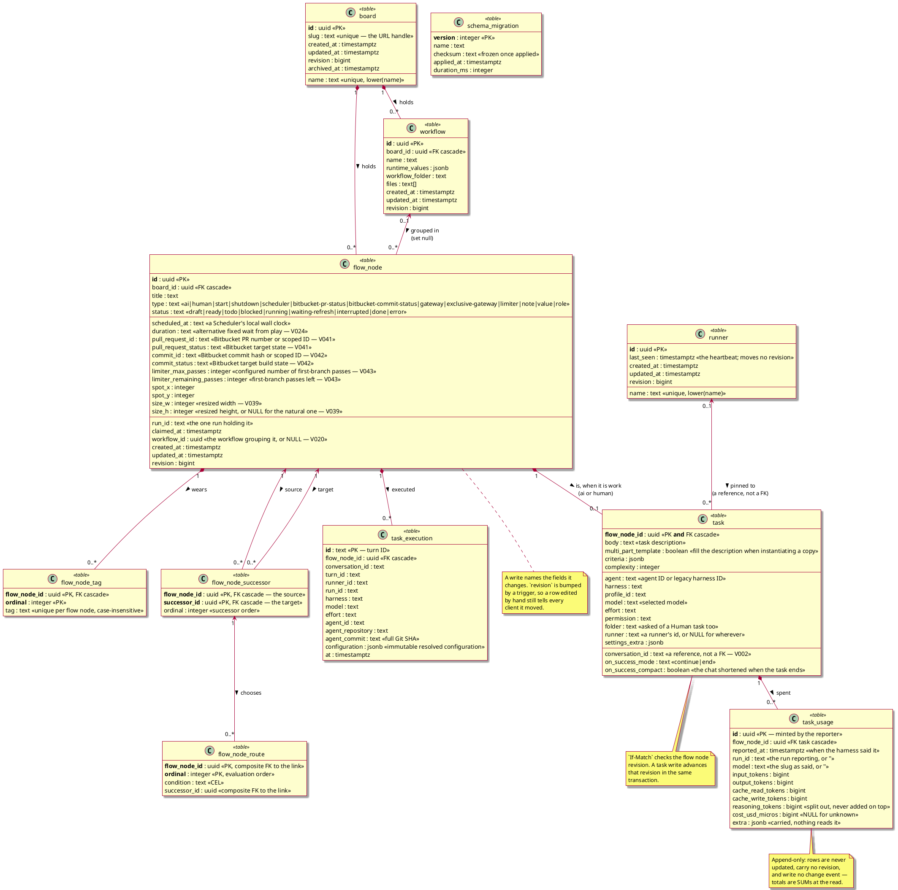
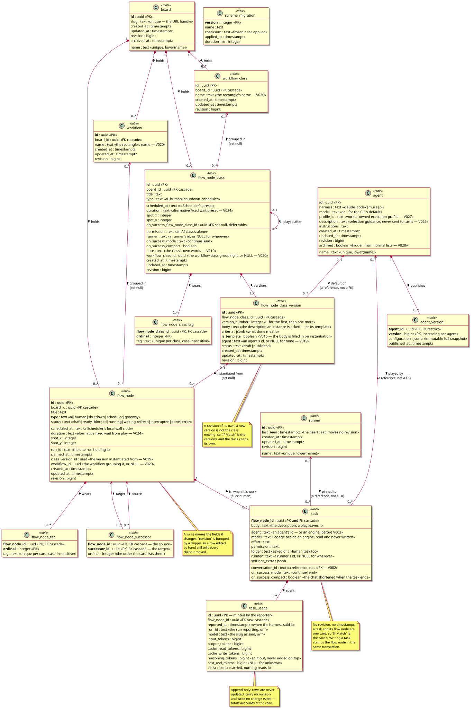
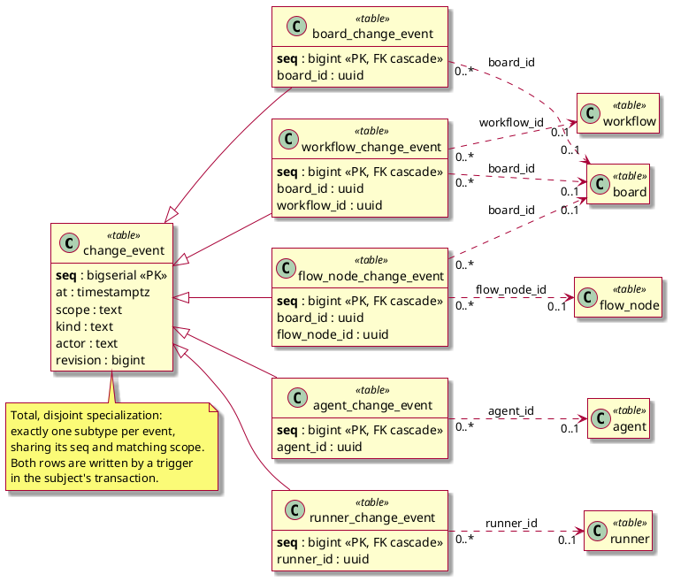
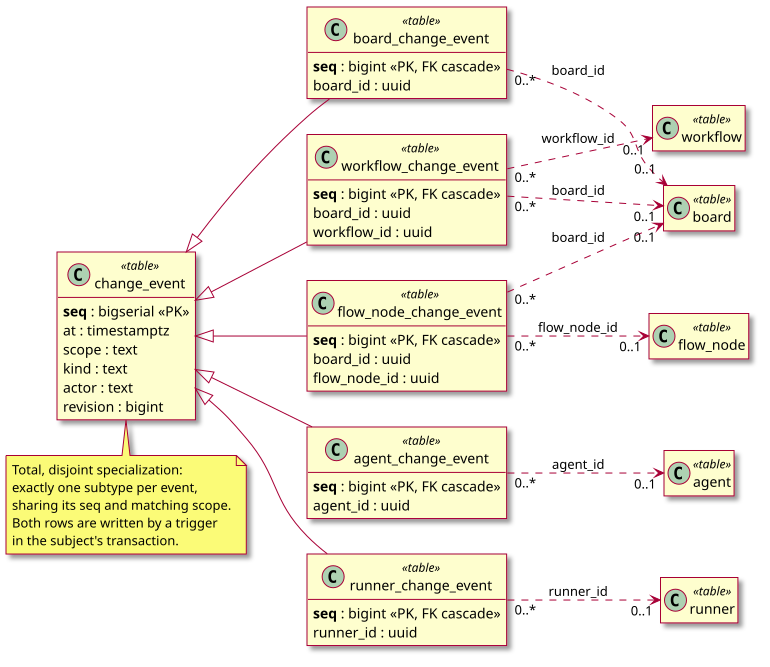

---
document:
  status: DRAFT
  role: PRIMARY_SOURCE
---

# hybridflow-store — the schema

Boards store flow nodes, workflow groups, tags and successor links. The `runner` table identifies
the machines that can run them. Agent configurations live in Git/APM projects.
`task_usage` holds one row per report the harness sends. `task_execution` records the immutable
agent publication and resolved settings of each execution. Read the
[agentic resource design](../../../../docs/solution-design/agentic-resources.md) for package delivery.

**A task is work performed by an agent or a person.** AI and Human flow nodes each have a `task` row
keyed by the flow node. Shutdown, Scheduler, Bitbucket PR Status and both gateways execute in the runner.

## Why a database

**Several models play flow nodes of one board at the same time while a person rearranges it.** Each of the rules that takes is a line of SQL:

| the rule | how it holds |
| --- | --- |
| two writers, two fields of one flow node, both kept | `UPDATE flow_node SET status = …` and `UPDATE flow_node SET title = …` touch different columns |
| a stale write is refused, not silently applied | `WHERE revision = $n`, and the row count is the answer |
| a flow node is played by one run | `SELECT … FOR UPDATE` locks the row while checking `run_id` and Ready or Done status, claiming the flow node and detaching a completed AI chat |
| a client learns what changed without polling the board | `change_event` + `LISTEN/NOTIFY` |

`flow_node.completion` records the database order of completed results. When a chain reaches a
Done parallel gateway, its claim checks that each incoming flow node completed after the gateway's
last firing. Flow nodes predating completion tracking start at zero.

Migration V046 adds `workflow.runtime_values`, a JSON object that starts empty for every group.
Successful flow node completions merge individual fields into this object in the same transaction as
the guarded flow node release. Workflow name and ID come from the group's existing columns.

## Classification folders

`folder` stores names and IDs by collection scope. Names are unique within their scope,
ignoring case. The `Folders` service, repository and HTTP routes can serve another collection
by binding it to its own scope.

Membership lives on the classified record. Boards carry a nullable `folder_id` and a
`folder_scope` constrained to `boards`. The composite foreign key restricts each board to
folders in that scope and clears membership when a folder is deleted. The board keeps its
ID, slug and flow nodes. Another collection can use the same foreign-key pattern with its own
scope and member table. Migration V045 starts existing boards at the top level.

## The schema

<!-- kiao:diagram

-->

### Events

`change_event` holds the common identity and metadata. Its five concrete subtypes hold the
identifiers specific to each scope. Each event has one base row and one subtype row. Deferred
constraints validate this total, disjoint specialization when the transaction commits.

The diagram below shows only events and their references. Other entities have no fields or
relationships among themselves in this view. Generalization arrows show the event hierarchy;
dashed arrows name references to subjects, which may already have been deleted.

<!-- kiao:diagram

-->

| Field | Description |
| --- | --- |
| `seq` | Store-wide sequence number and primary key, shared by the subtype. Clients use it as a replay cursor; sequence gaps are allowed. |
| `at` | Timestamp assigned from the database transaction's start time (`now()`). Retention uses it to prune old events. |
| `scope` | Subtype discriminator: `board`, `flowNode`, `workflow`, `agent` or `runner`. The event must have exactly one matching subtype. |
| `kind` | Operation on the subject row: `created` for `INSERT`, `updated` for `UPDATE`, or `deleted` for `DELETE`. |
| `actor` | Identity of the writer or run, passed from the service to SQL triggers through `kiao.actor`, a custom transaction-scoped PostgreSQL setting. |
| `revision` | Historical copy of the changed row's own `revision`, captured after creation or update. `NULL` for a deletion. |

**References survive their subjects.** The subtype's `seq` is a foreign key to `change_event`
with `ON DELETE CASCADE`; its subject identifiers are references without foreign keys. Deleting
a board or a flow node must leave its deletion event available for replay. Retention deletes the base
event and its subtype together. Board identifiers also remain on board-related subtypes so a
board-scoped replay needs no join to a subject that may have disappeared.

**The feed remains flat.** `change_event_feed` is a read-only view joining the base event to a
union of its subtypes. The adapter reads it into `Change`, the feed projection, so `/changes`
keeps the same scopes, identifiers, ordering and cursor semantics. Triggers insert both rows
before announcing the sequence on `kiao_hybridflow`; runner heartbeats still emit no event.

### Storage invariants

**Each AI or Human flow node has a task row.** `task.flow_node_id` is both the primary key and
the foreign key. The shared ID gives each flow node at most one task and each task exactly one
flow node. The task row holds the description, settings, conversation and handoff options.

Connections live in `flow_node_successor`, one ordered row per link. Tasks, Schedulers and
Bitbucket status events have at most one predecessor and successor. Shutdown accepts at most
one predecessor. Parallel and exclusive gateways allow several predecessors and successors.
A limiter allows two successors.
An index on the target supports incoming-link checks.
The primary key supports outgoing-link reads. The API uses `onSuccess.flowNode` for a single
successor and `onSuccess.flowNodes` for gateway branches. `flow_node_route` stores the ordered CEL
routes of an exclusive gateway and references the corresponding links.

**The flow node revision covers the task and tags.** The adapter stamps `flow_node` in the
same transaction as each write to `task` or `flow_node_tag`, bumping the revision and appending
to the change log once. The flat `flowNode` object includes `body`, `settings`, `chat` and
`onSuccess` alongside `title` and `type`.

**Positions and dimensions describe the canvas layout.** The editor places each card at its
flow node's `spot_x` and `spot_y`. Dragging an edge saves the selected card's dimensions in
`size_w` and `size_h`. With a null height the card grows with its contents. The database
requires positive values and the client clamps them to the type's minimum size.

**A revision is per row, not per board.** An edit conflicts only with another edit of the same flow node.
`If-Match: <revision>` on the wire is what makes a write conditional; no header is a write that does
not care, which is what a run's status write means and what a person's rename does not.

**Claims are serialized in the database.** `ClaimFlowNode` locks the flow node row before
checking its status and current claim. Twenty goroutines against one row give one winner
(`TestOnlyOneRunTakesAFlowNodeForReal`).

**The change log is written by triggers.** A feed with a hole in it leaves a client wrong until it
reloads, so the append cannot be something a call site may forget.

### AI task consumption

**Each AI flow node's spend lands in `task_usage`, one row per report.** A runner finishes a turn — or
a play — and writes what the harness said it spent: the flow node, the run, the model slug as said, and
the tokens. A Human task never gets a row; a Shutdown, a Scheduler and a Gateway cannot, the key
naming `task` rather than `flow_node`.

**Five token columns, and the rule that they are splits, not extras.** Every harness reports an
input count and an output count under some name, and most split out what was served from cache,
what was written to it, and what was spent reasoning:

| the harness says | it lands in |
| --- | --- |
| `input_tokens`, `prompt_tokens` | `input_tokens` |
| `output_tokens`, `completion_tokens` | `output_tokens` |
| `cache_read_input_tokens`, `cached_tokens`, `cache_hit_tokens` | `cache_read_tokens` |
| `cache_creation_input_tokens` | `cache_write_tokens` |
| `reasoning_tokens`, `reasoning_output_tokens` | `reasoning_tokens` |
| `costUSD`, `cost_usd` | `cost_usd_micros`, × 1,000,000 and rounded |
| `cache_miss_tokens`, `uncached_tokens` | nowhere — already inside `input_tokens` |

`input_tokens` + `output_tokens` is the spend; cache and reasoning are never added on top, they say
where part of it went. Where a harness folds reasoning into its completion count, `output_tokens`
keeps it folded and `reasoning_tokens` carries the split-out part beside it. The mapping is
approximate and deliberately so: exact per-model metering is the harness's job, this table's is one
shape every harness fits.

The worker normalizes exclusive cache counters (Claude Code and Pi) into the full input total,
and uses Muse's counted-once prompt total when supplied. An unclassified total or remainder is
kept as approximate input rather than dropped. Every harness uses the same reporting path;
the [worker's mapping](../../../worker/docs/solution-design/playing-board.md) owns the adapter details.

**Money is micro-dollars, or NULL.** `cost_usd_micros` is what the reporter says the report cost,
in millionths of a dollar — an integer, so sums stay exact. NULL is "the harness said nothing",
and the store never prices a report itself: it owns no price table and wants none.

**No revision, no change event, no stored total.** A usage row is never updated — a correction is a
new row — so there is nothing `If-Match` could guard, and a token report must not bump the flow node
under an editor's keystrokes. Totals are summed at the read.
Like `runner.last_seen`, writes here move nothing else.

**Replays are safe.** The `id` is minted by the reporter, so a spool replay re-sends the same row
and the second insert is a no-op (`ON CONFLICT DO NOTHING`) rather than a double count.

**What is not here is in the runner.** Turns, transcripts and durations stay in the runner's
registry, where `V014` left them: this table says what a flow node spent, not what it did.

### Schema history and migration

`adapters/postgres/schema/V###__kebab-name.sql`, compiled into the binary, applied at startup, one
transaction each, recorded in `schema_migration` with a checksum.

**An applied migration is frozen**: startup compares the checksum of every script the ledger holds
and refuses to serve on a mismatch — even a changed comment. A database that ran `V001` and a binary
carrying a different `V001` do not disagree about a statement, they disagree about what the tables
are. Fix what a past migration did in a new one. It is the same rule, and the same file-naming, as
the content migrations in the repo root `migrations/`.

A session advisory lock is taken for the pass, so two instances starting together do not both apply
`V002`. `GET /schema` reports the ledger, because "which version is that instance on?" is a question
asked of a running service.

`V002` drops the foreign key from `flow_node.conversation_id` to `conversation(id)`. The chat a flow node
is played in is minted and kept by the hybridflow-runner's registry in worker — turns, transcripts
and the chat panel all still live there — and nothing registers those ids here, so the constraint refused every
play at its first turn. The column stays: it says which chat each flow node belongs to, as a reference
rather than a key, exactly like `run_id`.

`V003` files the managed agents: one `agent` row per named definition of what plays a flow node, and
a flow node naming one by id in its `settings.agent`. The harness and the model a turn runs on moved
from the flow node to the agent; the effort, the permission mode and the folder stayed the flow node's. There
is deliberately **no foreign key** between the two: a flow node naming an agent that has gone must still
open and say which agent it wanted, refused at its next play rather than at the delete. The change
log learns the `agent` scope with it, so the panel listing them is told rather than asking.

`V009` renames the original `task` table to `flow_node` to cover both work and control steps.
It also renames the tag table to `flow_node_tag`, the successor column to
`on_success_flow_node_id` and the change log's reference column and scope. Existing log entries
receive the new scope as well. The independent file-store migration
`V013__workflow-tasks-are-flow-nodes.js` made the equivalent change to workflow documents.

`V011` files the tasks: `task`, one row per flow node whose type is `ai` or `human`, taking
`body`, `agent`, `model`, `effort`, `permission`, `folder`, `settings_extra`, `conversation_id`,
`on_success_mode` and `on_success_compact` from `flow_node`. The change trigger uses the board
as the scope for those updates. The migration copies the task fields only for AI and Human
steps.

`V010` drops the columns: `board_column` goes whole, and with it `flow_node.column_id`,
`flow_node.rank`, the change log's `column_id` and the `column` scope — with the rows already in
the log under it deleted, since a scope outside the check would refuse every future write. A column
was a place to file a flow node and nothing more — not a queue, not a state, not an order — and the
editor shows one face, the canvas, where every card sits at the point somebody put it. With the
filing goes the ordering inside it: a rank said where a flow node sat among the flow nodes of its column, and
with no columns there is nothing to sit among.

`V014` drops the conversations: `conversation` and `transcript_record` go whole, with the two
functions that announced their changes and the change log's `conversation_id`, `conversation` and
`transcript` — the rows already in the log under those scopes deleted, for the reason `V010`
gives. V001 filed the chats here and `V002` is where that stopped being true in anything but the
schema: turns run in the hybridflow-runner, whose registry mints the ids and keeps the transcripts, and
nothing ever registered them here. `task.conversation_id` stays: it names a chat of that registry,
a reference rather than a key.

`V020` introduces workflow groups. A flow node stores membership in `flow_node.workflow_id`.
Deleting a workflow ungroups its flow nodes. Grouping a flow node produces a flow node change event.

`V021` files the spend: `task_usage`, one row per usage report on an AI flow node — the run, the model
slug as said, five token columns, a micro-dollar cost or NULL, and an `extra` the service carries
the way it carries `settings_extra`. The key names `task`, so a Shutdown and a Scheduler cannot
hold one; there is no trigger and no revision, so a report moves nothing but its own row.

`V023` files the fifth kind: `gateway` joins the type check, and `flow_node_successor` holds a
Gateway's branches — one row per branch, in the order the flow node lists them. One successor is a
column; several are rows of their own. Both foreign keys are `ON DELETE CASCADE`, so deleting the
Gateway takes its branches with it and deleting a branch takes it out of every list naming it, the
way `ON DELETE SET NULL` takes a deleted flow node out of the single chain — and both `DEFERRABLE`, for
the reason the single chain is: a pasted Gateway arrives in one batch with the branches it names.

### V024 — Scheduler duration

Adds nullable `duration` for Scheduler flow nodes. A database check keeps `duration` and
`scheduled_at` mutually exclusive. Setting a nonempty alternative clears the other atomically.
The runner counts a positive duration from entering the Scheduler; existing date-time schedules
retain their local wall-clock interpretation. Scheduler Play and Stop are available on the board.

### V026 — Agent selection description

Adds `agent.description`, empty for existing agents. It explains when to choose an agent for a
task and is returned by the agents API and MCP tools. Dashboard edits it separately from standing
instructions and shows it in agent choices. The runner reads only execution fields from an agent
response, so the description is never added to a turn's prompt or system instructions.

### V027 — Worker execution profile references

Adds `agent.profile_id` and accepts the `pi` harness. References remain readable when the worker
or its profile is unavailable; the boards store owns neither credentials nor adapter catalogues.

### V028 — Agent publications and archives

Adds `agent.archived` and `agent_version`. Each publication stores the complete configuration as
JSON under `(agent_id, version)`; a database trigger rejects updates and deletes. Publication
serializes on the agent row and advances its revision. Existing definitions become publication 1.
Published agents retain their history and are archived rather than deleted. The runner captures
the latest publication when creating a task conversation; see the
[publication decision](../../../../docs/solution-design/decisions/00057-agent-publications.md).

### V030 — Change event subtypes

Moves subject identifiers from `change_event` into event subtype tables and exposes the flat
view used by the feed. Event sequences and the sequence generator are preserved.

The migration locks event-producing tables and the event log, backfills the subtypes, replaces
the recording functions, removes the identifier columns from the base and creates the flat feed
view in one transaction. Deferred constraints validate the hierarchy for both migrated history
and subsequent writes. Earlier migrations and their checksums remain unchanged. Startup applies
V030 before serving requests; an older binary cannot serve the resulting schema.

### V031 — Flow node connections

Moves every single successor into `flow_node_successor` and removes the scalar column from
`flow_node`. The migration preserves existing links, including legacy joins that the runner
refuses to start until repaired. It does not insert Gateways or choose which predecessor to keep.

Deferred constraints validate cardinality, same-board targets, self-links and display flow nodes.
A transaction lock per board serializes topology writes so concurrent writers cannot give a task
two predecessors. Batch creation defers checks until all flow nodes exist. Deleting a target removes
its links and records updates on surviving predecessors. The service also checks connection
changes in domain code, allowing legacy links to be removed without repairing unrelated chains.

## Structured outputs (V033)

`flow_node.output_type` names a JSON Schema value from any board. `output` is nullable JSONB,
written with the completion status under the run claim and cleared by a new claim. These
fields belong to the flow node so Schedulers and Gateways can pass data without a task row.
The [structured task data design](/docs/solution-design/partitions/hybridflow/structured-task-data.md) defines
export validation, prompt interpolation and the missing-reference behavior.

### V036 — Git/APM resources and execution provenance

Creates `task_execution` with an update-rejecting trigger. Each row fixes the agent Git
commit and resolved harness, model, effort, runner and profile configuration before spawn.
The migration removes archived tasks and retires SQL agent configuration and publication
tables. The hosting assembly validates its Git baseline before this migration runs.

### V038 — Agent and harness selection

`task.harness`, `task.model` and `task.profile_id` record the harness choice. Older flow nodes that name
a harness in `task.agent` read its model from `task.model`.

### V039 — Flow node dimensions

`flow_node.size_w` and `size_h` keep the dimensions a person
dragged a selected card's edges to. The height is nullable: a card whose height nobody dragged
keeps growing with its wrapped text, and clearing the height restores that.

### V040 — Exclusive gateway

The `exclusive-gateway` flow node can link several successors. Each `flow_node_route` row stores one
CEL condition at an ordinal. The foreign key to `flow_node_successor` removes routes when their
link is deleted.

### V041 — Bitbucket PR Status

The `bitbucket-pr-status` flow node stores its PR identifier in `pull_request_id` and its
target state in `pull_request_status`. Both fields can be empty while configuring the flow node.

### V042 — Bitbucket Commit Status

The `bitbucket-commit-status` flow node stores its commit identifier in `commit_id` and its
target build state in `commit_status`. Both fields can be empty while configuring the flow node.

### V043 — Limiter

A limiter has two ordered successors and at most one predecessor. Its remaining count
is between zero and its configured maximum. Creating a limiter starts it at the maximum.
Board archives can restore both counts.

A pass selects the first successor when the count is positive and the second at zero.
The store writes the decremented count, status and any output against the supplied flow node
revision, then returns the selected successor. A repeated request at the same revision
conflicts.

### V049 — Exclusive gateway joins

The deferred connection check accepts multiple incoming links on an exclusive gateway. An
existing exclusive gateway can receive additional predecessors as soon as the migration runs.

### V054 and V055 — Reuse board flow nodes

`task.multi_part_template` marks descriptions that use a TemplateLang collection. Dashboard
fills templates when the user chooses **Instantiate here** with copied flow nodes or a workflow.

[V055](../../adapters/postgres/schema/V055__reuse-board-cards.sql) converts stored reusable
definitions to draft flow nodes and workflows during startup. It preserves the latest wording,
group membership, placement, and valid connections. It records usage notes as Note flow nodes and
uses exclusive gateways for converging connections.
