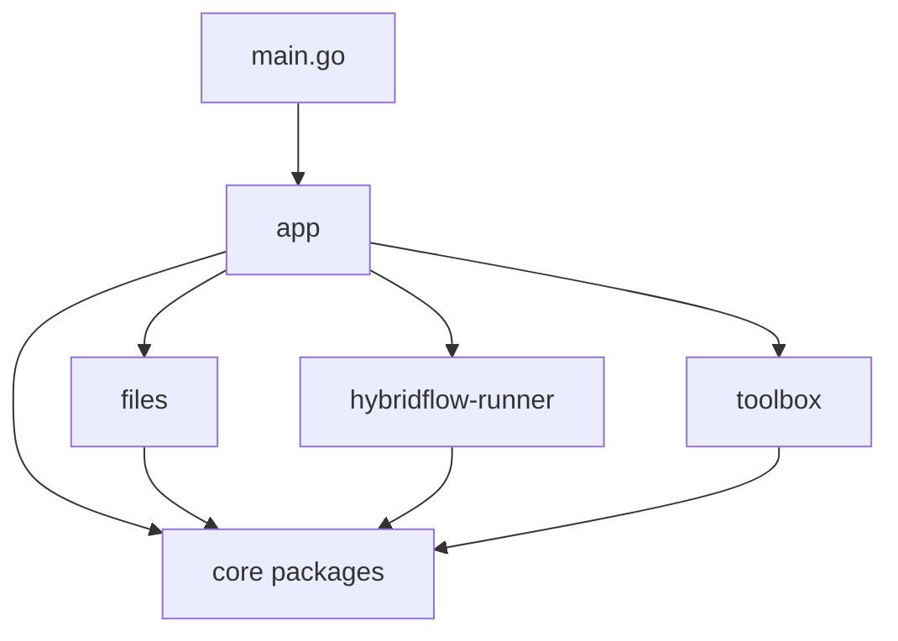
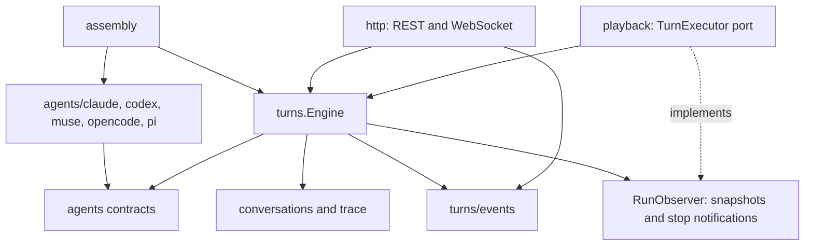

# worker — components

One binary and one process. `internal/app` assembles three service families; each family uses
shared `core/*` packages and exposes its HTTP routes. The roots keep small façades while
subpackages own cohesive responsibilities. See the [code map](./build-code-map.md) and
[package organization decision](./decisions/00078-worker-package-cohesion.md).

## Dependency direction

No production import crosses between `files`, `hybridflow-runner` and `toolbox`.
`app` wires interfaces and callbacks where the families collaborate.
`files` is the worker half of DCMS; `hybridflow-runner` is the execution part of hybridflow.
These remain functional sets spanning the Dashboard and backend containers.

Within each family, HTTP handlers call services. Leaf packages do not import the family façade.
Shared contracts and data models have one owner; consumers import that owner.
The [dependency check](../../internal/app/packages_test.go) enforces the family boundaries,
search's independence from mutations and execution's independence from transport and drivers.

## Document operations

`content.FileService` coordinates storage, companion files, search invalidation and link repair.
`search.Searcher` owns index refresh, query evaluation and reindexing, without importing content
mutations. Both use `scope` for `.kiao-files` exclusions. Git, actions, media and migration
execution have separate packages.

`configuration` owns settings, migration source declarations, configuration document names,
PDF themes and import-gate defaults. `migrations` owns execution and applied-history ledgers.
This keeps reading a configuration independent of running a migration.

## Agent execution and transport

The execution engine owns turn reservations, live state, permissions, questions, event application
and settling. Its agent registry is injected. It does not import concrete engines, `net/http` or
Gorilla WebSocket.

`turns/events` owns connection contracts and subscription routing. It shares the engine's mutex
so job lookup and subscription updates retain one lock order. The HTTP adapter owns the actual
WebSocket, upgrade, deadlines, heartbeat and input decoding. Disconnecting a socket removes its
subscriptions; it does not terminate a turn.

Playback calls `TurnExecutor` to start, observe and stop turns and obtain agent capabilities.
The reverse `RunObserver` port reports run snapshots and turn-stop notifications. Run snapshot
models live separately in `playback/state`, so execution does not import playback's implementation.

Each driver owns its CLI protocol and provider-specific options, credentials and quota handling.
`agents` owns the shared contracts and profile data, `agents/login` the common device flow,
`agents/faults` failure interpretation and `agents/protocol` value conversion and bounds.
The Pi bridge and protocol fixtures stay beside the Pi driver.

## Toolbox

The catalogue declares what may be installed. Inventory records what is installed and enabled.
Installation coordinates one asynchronous job at a time and dispatches channel recipes.
MCP resolution and handshake probes use the catalogue and inventory without owning installations.
The build-time CLI reuses installation code; REST handlers expose the same lifecycle.

## Runtime collaboration

All lookups are evaluated when needed, so panel changes reach the next operation:

| Consumer | Port or callback wired by app | Purpose |
| --- | --- | --- |
| Runner → toolbox | `MCPRegistry`, agent availability and installation lookup | Select equipment for a turn. |
| Files → toolbox | `RuntimeBinary("ffmpeg")` | Resolve the encoder at each save. |
| Toolbox → runner | `OnAgentInstalled` | Synchronize skills after installation. |
| Files → runner | `OnDashboardConfigSaved` | Synchronize skills after plugin changes. |
| Files → runner | `OnRunnerConfigSaved` | Reload identity and restart the heartbeat. |
| Authentication ← runner | `TurnTokenRegistry` | Authenticate callbacks from bundled MCP servers. |

The boards client reaches hybridflow-store over HTTP. Its spool preserves pending updates while
the upstream is unavailable. Action providers receive the initiating caller's authorization.

## State and access

The content store and operational state retain distinct lifetimes. `filesystem.Storage` bounds
content paths and rejects access to the state directory. Atomic state writers and the lifetime
process lock are shared filesystem primitives; each family owns its own persisted documents.
Conversations, transcripts and traces remain in the conversation directory; run logs remain in
`chain-runs`; inventory remains in `toolbox.json`.

`files` owns the document API, search and link repair, rather than all filesystem access.
The runner directly accesses working folders, skills and images through the shared filesystem
vocabulary. It reaches no file-service implementation.

JWT validation, reader routes and reader roots remain independent checks. `readerRoutes` sits
beside the mux in `app/server.go`. The root liveness probe bypasses authentication and request
tracing. Other routes use recovery → CORS → request ID → tracing → authentication → mux.
