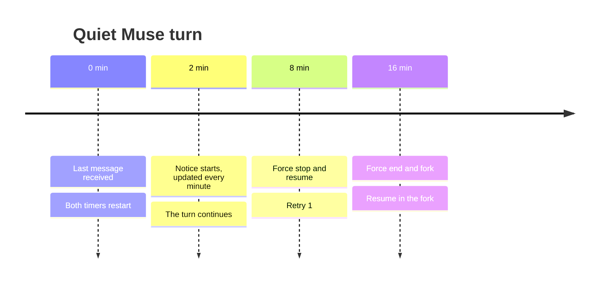
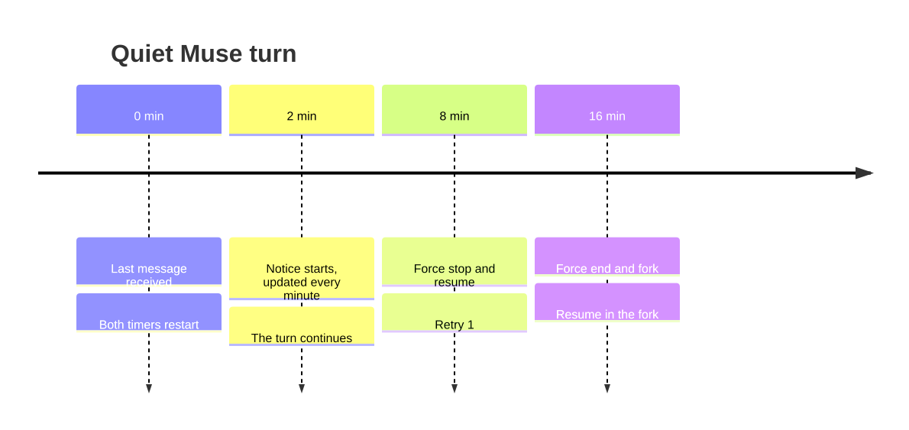

# Quiet Muse turns

A turn is quiet when `muse` sends no message: no text, tool call, question or completion.

<!-- kiao:diagram

-->

- **At 2 minutes, start a notice and update it every minute.** Each notice reports the silence
  duration (`quiet for 2m0s...`, `3m0s`...) and retry count: no parenthesized count before the
  first retry, then the retry count afterward.
- **Poll the quiet turn again before deciding it is stuck.** A dead live view may hide ongoing
  work. The driver rereads the session (`view/page` after the last cursor, replayed through the
  same relay as live messages; `session/read` without attaching; growth of the host log). A
  completed turn ends cleanly with the recovered output, without retry or fork. A live turn gets
  another wait. Only a turn with no completion or activity is retried, then forked.
- **After 8 quiet minutes, force stop and resume.** Cancel the current turn and start another
  on the same session with `you were blocked and I had to stop you. Please resume.` The retry
  count becomes 1 and both timers restart. Its output remains part of the current turn; the run
  does not observe the recovery as a failure.
- **After another 8 quiet minutes, force end and fork.** The turn fails with
  `Muse was blocked twice without ending the turn.` The run forks the conversation, whose
  transcript is the one at the first retry because the stuck turn was silent, and plays the card
  there with `After two blockages, I forked this conversation. Please take it over and go through to the end of what was requested.`
- **The run continues when the task finishes.** A successful resumed or forked turn marks the
  card done and advances the chain. A forked turn that gets stuck twice is not forked again:
  it is marked as an error and playback stops.
- **Waiting for the user pauses both timers.** An approval request or unanswered question
  produces neither a quiet notice nor a forced stop at 8 minutes.

Two other timeouts provide context:

- A compaction-only turn ends after 2 minutes with `compaction still running`, exit code 0.
- The quota read at the end of a turn is bounded to 60 seconds and cannot hold completion open.
